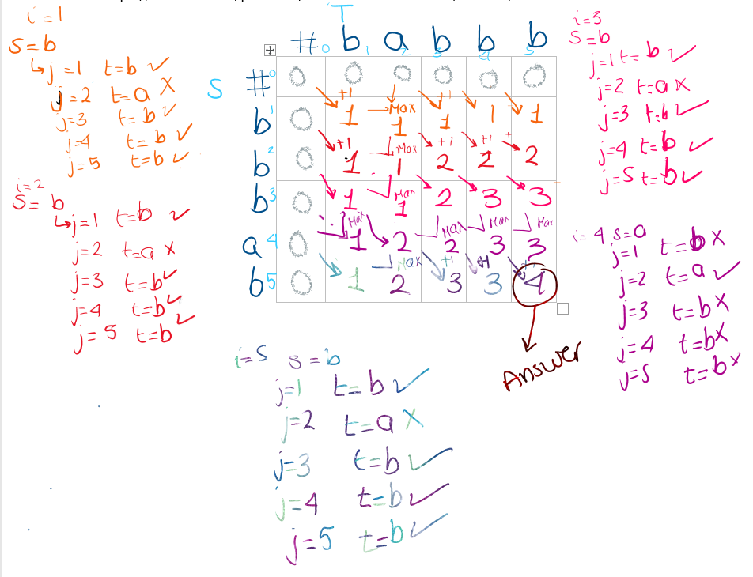

# Python 🐍 solution bottom-up based on min edit distance with explanation

**Author:** InjySarhan
**Votes:** 50
**Link:** [https://leetcode.com/problems/longest-palindromic-subsequence/solutions/1600820/](https://leetcode.com/problems/longest-palindromic-subsequence/solutions/1600820/)

---

So before solving this problem I solved [one-edit distance](https://leetcode.com/problems/one-edit-distance/) as a warm up, then [minimum edit distance](https://leetcode.com/problems/edit-distance/). My idea was to try to create a solution similar to edit distance which asks from the edit between 2 words S and T

So as starting point I created **t** to be inverse of **s** (by the way if you reverse the indecees of i and j you can achieve that without creating t, I just did that because for me it is more simple to imagine).

Then I created my 2D dp array, why 2D ? becuase I am comparing strings **t** and **s** so I need a 2D array to add in rows **s** and in cols **t**  (or vice versa).

So the golden question is how will I fill in my 2D array to get the result that I need ? The point is: what is the **maximum Length** that we can make **s** and **t** equal ? 
so thats why I compare **if s[i]=t[j]** then take the previous answer you had and add 1 to it so **dp[ i-1][j-1]+1**, but if they are not equal, well then take the highest previous answer you saw which is **max(dp[i-1][j],dp[i][j-1])**




```
class Solution:
    def longestPalindromeSubseq(self, s: str) -> int:
        t=s[::-1]  #idea is reverse t and compare t with s
        
        dp=[[0 for _ in range(len(s)+1)] for __ in range(len(s)+1)] #create dp array
        
        for i in range(1,len(s)+1):  #start from1 to match dp size, but compare s[i-1] and t [j-1]
            for j in range(1,len(s)+1):
                if s[i-1]!=t[j-1]:  #if not equal what do we want to do ? the question is asking to
				#find the longest palindromic subsequence and char @ S !=char @T, 
                    dp[i][j]=max(dp[i][j-1],dp[i-1][j]) #so we just take the max previous value we found before
                else:                                     #now they are equal so our palindrome can be bigger
                    dp[i][j]=1+dp[i-1][j-1]   #take previous + 1 
        return dp[-1][-1]
```
