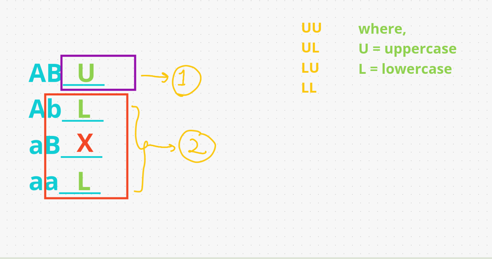

# [Java/C++/Python] one stop solution EASY explained

**Author:** hi-malik
**Votes:** 46
**Link:** [https://leetcode.com/problems/detect-capital/solutions/1714640/](https://leetcode.com/problems/detect-capital/solutions/1714640/)

---

```
What the problem is saying we have to check whether the string has CAPITAL [uppercase] letters or not, but with some conditions
```
>There are 3 rules to determine wether it's a valid condition or not :-
1. Everything can be **upper-case "LEETCODE"**
2. **1st character is capital** then everything is **lowercase "Leetcode"**
3. Everyting is **lowercase "leetcode"**

Anything other then this is invalid like :-
* **LeetcodE**
* **leetCode**

*So, you got the idea anything that's not following 3 rules is invalid.*

**Let's talk about how can we solve it:**



>Let's look at the first 2 character, if we have first 2 character there are 4 ways of writing it :- UU, UL, LU, LL
* So, if we have UU like :- AB____ then remaing one has to be **uppercase**
* If we have UL like :- Ab_____ then remaining one has to be **lowercase**
* If we have LU like :- aB then straight away we know that it's **invalid**
* If we have LL like :- ab_____ then remaining one has to be **lowercase**

In last **3 cases Ab & aB & ab** we can check from **2nd letter onwards everything should be lower**. So, **aB is invalid** because the 2nd letter is capital
But if **1st and 2nd both are capital** we will check from **3rd letter everyting should be upper** in **AB**. So this is valid

So, in our solution we create **2 cases** in **1st case everything has to be UpperCase from 3rd letter** and in **2nd case** everything has to be **LowerCase from 2nd letter**. If any of these condition **invalidate** we **return false** otherwise we **return true**

*I hope you get the idea,* **Now let's code it up :**

*code each line explained :* `Similar for C++, Java, Python` **{Only Syntax Difference}** approach same

```
{
        if(word.length() < 2) return true;// either if word is empty or word is just 1 character long, then it's always valid
        // isupper OR islower is built in function in C++, but all the language have but available in different syntax format
        // but if you don't want to use you can write word[0] >= 'A' ASCII value && word[1] <= 'Z'
        if(isupper(word[0]) && isupper(word[1])){ // creating our 1st condition, from 3rd letter onward everything should be capital
            for(int i = 2; i < word.length(); i++){
                if(islower(word[i])) return false;
            }
        }
        else{ // creating our 2nd condition, from 2nd letter onward everything should be small
            for(int i = 1; i < word.length(); i++){
                if(isupper(word[i])) return false;
            }
        }
        return true;
```

**Java**
```
class Solution {
    public boolean detectCapitalUse(String word) {
        if(word.length() < 2) return true;
        if(Character.isUpperCase(word.charAt(0)) && Character.isUpperCase(word.charAt(1))){
            for(int i = 2; i < word.length(); i++){
                if(Character.isLowerCase(word.charAt(i))) return false;
            }
        }
        else{
            for(int i = 1; i < word.length(); i++){
                if(Character.isUpperCase(word.charAt(i))) return false;
            }
        }
        return true;
    }
}
```
**C++**
```
class Solution {
public:
    bool detectCapitalUse(string word) {
        if(word.length() < 2) return true;
        if(isupper(word[0]) && isupper(word[1])){
            for(int i = 2; i < word.length(); i++){
                if(islower(word[i])) return false;
            }
        }
        else{
            for(int i = 1; i < word.length(); i++){
                if(isupper(word[i])) return false;
            }
        }
        return true;
    }
};

```
**Python**
```
class Solution:
    def detectCapitalUse(self, word: str) -> bool:
        if len(word) < 2: return True
        if word[0].isupper() and word[1].isupper():
            for i in range(2, len(word)):
                if word[i].islower(): return False
        else:
            for i in range(1, len(word)):
                if word[i].isupper(): return False
        return True;
```
ANALYSIS :-
* **Time Complexity :-** BigO(N) where N is no. of characters in word

* **Space Complexity :-** BigO(1) as we are not using any extra space