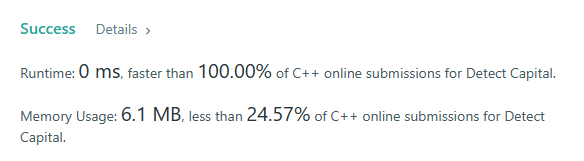

# ✅ Easiest C++ solution || O(N) || 0ms

**Author:** ayushsenapati123
**Votes:** 204
**Link:** [https://leetcode.com/problems/detect-capital/solutions/2982608/](https://leetcode.com/problems/detect-capital/solutions/2982608/)

---

**PLEASE UPVOTE IF YOU FIND MY APPROACH HELPFUL, MEANS A LOT \uD83D\uDE0A**

**Intuition:** use a counter and isupper function to check number of capital.

**Approach:**
* Initialize count=0
* if count equals 0 means all are small chars
* if count equals size of word then all are capital
* if count equals 1 then check is it the first char which is capital
* if none of the conditions are true then return false

```
class Solution {
public:
    bool detectCapitalUse(string word) {
        int count=0;
        if(word.size()==1)
            return true;
        
        for(int i=0; i<word.size(); i++)
            if(isupper(word[i]))
                count++;
        
        if(count==1 && isupper(word[0]))
            return true;
        if(count==0 || count==word.size())
            return true;
        else
            return false;
    }
};
```
**Time Complexity** => `O(N)`
**Space Complexity** => `O(1)`




