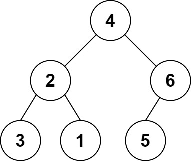

# [536. Construct Binary Tree from String](https://leetcode.com/problems/construct-binary-tree-from-string/)

| Category | Difficulty | Likes | Dislikes |
| :------: | :--------: | :---: | :------: |
| Algorithms | Medium | 1131 | 184 |

**Tags:** [`string`](https://leetcode.com/tag/string), [`stack`](https://leetcode.com/tag/stack), [`tree`](https://leetcode.com/tag/tree), [`depth-first-search`](https://leetcode.com/tag/depth-first-search), [`binary-tree`](https://leetcode.com/tag/binary-tree)

**Companies:** `facebook`, `amazon`

## Description

You need to construct a binary tree from a string consisting of parenthesis and integers.

The whole input represents a binary tree. It contains an integer followed by zero, one or two pairs of parenthesis. The integer represents the root's value and a pair of parenthesis contains a child binary tree with the same structure.

You always start to construct the left child node of the parent first if it exists.

 

**Example 1:**


```

Input: s = &quot;4(2(3)(1))(6(5))&quot;
Output: [4,2,6,3,1,5]

```

**Example 2:**

```

Input: s = &quot;4(2(3)(1))(6(5)(7))&quot;
Output: [4,2,6,3,1,5,7]

```

**Example 3:**

```

Input: s = &quot;-4(2(3)(1))(6(5)(7))&quot;
Output: [-4,2,6,3,1,5,7]

```

 

**Constraints:**

	- `0 <= s.length <= 3 * 10^4`

	- `s` consists of digits, `'('`, `')'`, and `'-'` only.

	- All numbers in the tree have value **at most** than `2^30`.

---

**Links:** [Submissions](https://leetcode.com/problems/construct-binary-tree-from-string/) | [Solutions](https://leetcode.com/problems/construct-binary-tree-from-string/)
