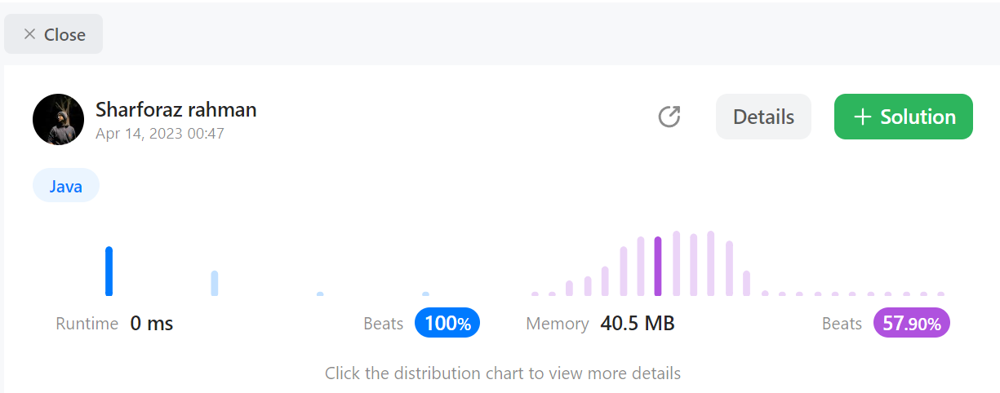

# JAVA || 100% || EASIEST SOLUTION

**Author:** sharforaz_rahman
**Votes:** 8
**Link:** [https://leetcode.com/problems/student-attendance-record-i/solutions/2826653/](https://leetcode.com/problems/student-attendance-record-i/solutions/2826653/)

---




# Code
```
class Solution {
    public boolean checkRecord(String s) {
        int A = 0, L = 0, max = 0;
        for (char c : s.toCharArray()) {
            if (c == 'A') A++;
        }
        if (A >= 2) return false;
        for (char c : s.toCharArray()) {
            if (c == 'L') {
                L++;
            } else {
                L = 0;
            }
            max = Math.max(max, L);
        }
        return max < 3;
    }
}
```