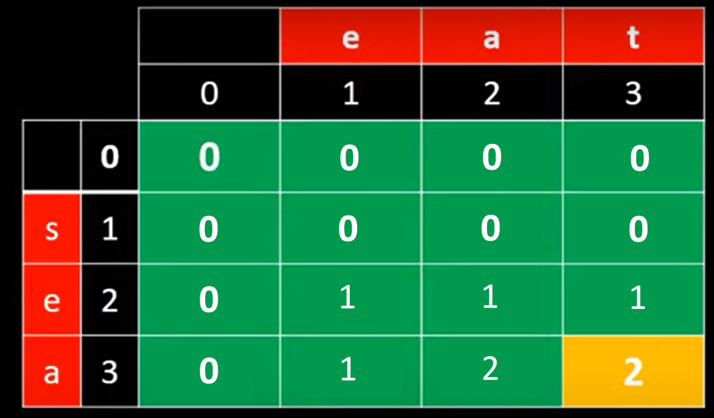
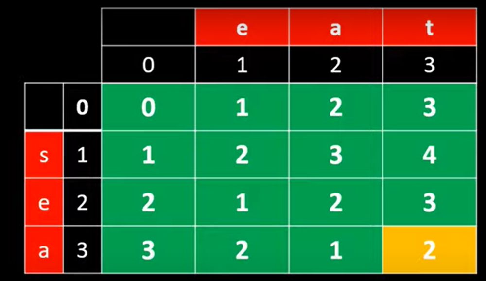

# ✅C++ | ✅Use DP | ✅2 Approaches | ✅Efficient solution with explanation | 🗓️ DLC June, Day 14

**Author:** Yash2arma
**Votes:** 14
**Link:** [https://leetcode.com/problems/delete-operation-for-two-strings/solutions/2150373/](https://leetcode.com/problems/delete-operation-for-two-strings/solutions/2150373/)

---

**Approach-1:** We first calculate longest common sequence in both the strings using dp. Then, subtract twice of lcs from sum of the length of two strings. 
*formula:* M+N - 2*LCS
where- M-length of word1, N-length of word2

**TC: O(MxN), SC: O(MxN)**

**Code:**
```
class Solution {
public:
    
    int minDistance(string word1, string word2) 
    {
        int m=word1.length(), n=word2.length(); 
        
        vector<vector<int>> dp(m+1, vector<int> (n+1, 0)); 
        
        for(int i=0; i<=m; i++)
        {
            for(int j=0; j<=n; j++)
            {
                if(i==0 || j==0) continue;
                
                else if(word1[i-1]==word2[j-1])
                    dp[i][j] = 1+dp[i-1][j-1];
                
                else
                    dp[i][j] = max(dp[i-1][j], dp[i][j-1]);
            }
        }
        return m+n-2*dp[m][n];
    }
};
```

**For better understanding:**


So, length of word1 = 3, length of word2 = 3, lcs=2
answer = 3+3-2*2 = 2


**Approach-2:** We direct calculate minimum no. of steps to make both the strings same using dp

**TC: O(MxN), SC: O(MxN)**

**Code:**
```
class Solution {
public:
    int minDistance(string word1, string word2) 
    {
        int m=word1.length(), n=word2.length(); 
        vector<vector<int>> dp(m+1, vector<int> (n+1, 0)); 
        
        for(int i=0; i<=m; i++)
        {
            for(int j=0; j<=n; j++)
            {
                if(i==0 || j==0)
                    dp[i][j] = i+j;
                
                else if(word1[i-1]==word2[j-1])
                    dp[i][j] = dp[i-1][j-1];
                
                else
                    dp[i][j] = 1+min(dp[i-1][j], dp[i][j-1]);
            }
        }
        return dp[m][n];  
    }
};
```

**For better understanding:**



So, answer = 2

**Please Upvote if this solution helps :)**
