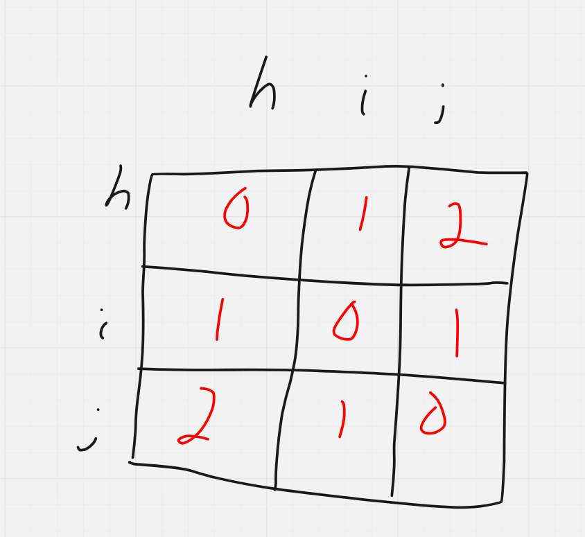
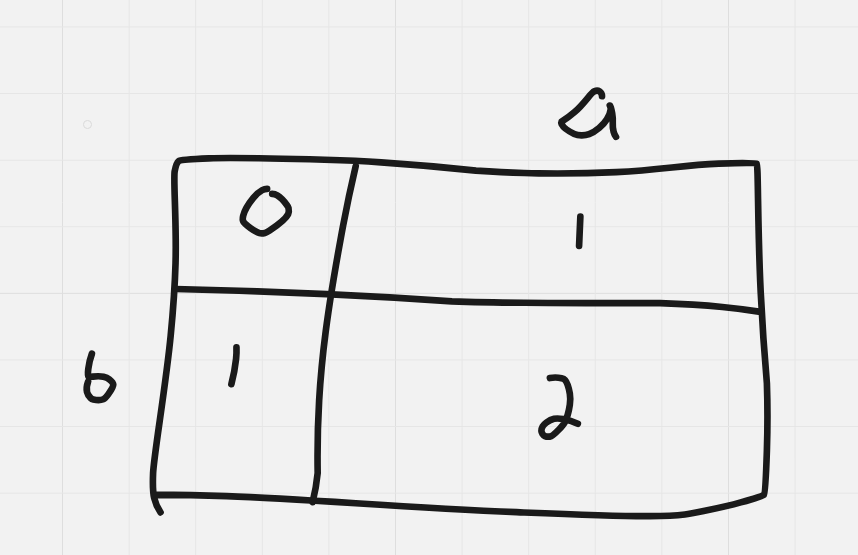
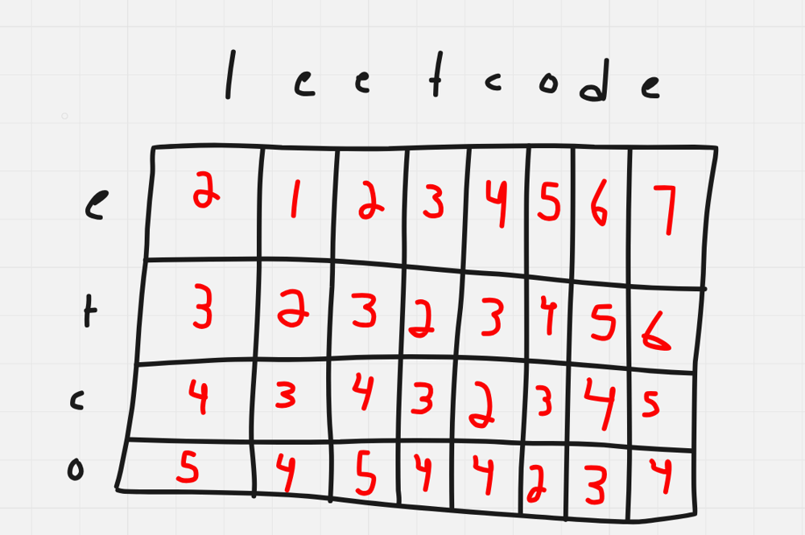

# Dart Solution

**Author:** Friendlygecko
**Votes:** 0
**Link:** [https://leetcode.com/problems/delete-operation-for-two-strings/solutions/4109679/](https://leetcode.com/problems/delete-operation-for-two-strings/solutions/4109679/)

---

# Intuition
<!-- Describe your first thoughts on how to solve this problem. -->

# Approach
<!-- Describe your approach to solving the problem. -->

# Complexity
- Time complexity:
<!-- Add your time complexity here, e.g. $$O(n)$$ -->

- Space complexity:
<!-- Add your space complexity here, e.g. $$O(n)$$ -->

# Code
```
class Solution {
  int minDistance(String word1, String word2) {
      final List<List<int>> dp = List.generate(word1.length + 1, (_) => List.filled(word2.length + 1, 0));

      for (int i = 1; i <= word1.length; i++) {
          dp[i][0] = i;
      }

      for (int j = 1; j <= word2.length; j++) {
          dp[0][j] = j;
      }

      for (int i = 1; i <= word1.length; i++) {
          for (int j = 1; j <= word2.length; j++) {
              if (word1[i - 1] == word2[j - 1]) {
                  dp[i][j] = dp[i - 1][j - 1];
              } else {
                  dp[i][j] = min(dp[i - 1][j], dp[i][j - 1]) + 1;
              }
          }
      }
      return dp[word1.length][word2.length];
  }
}
```



