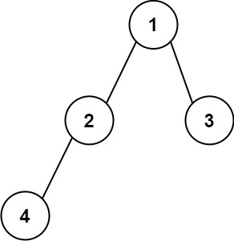

# [606. Construct String from Binary Tree](https://leetcode.com/problems/construct-string-from-binary-tree/)

| Category | Difficulty | Likes | Dislikes |
| :------: | :--------: | :---: | :------: |
| Algorithms | Medium | 183 | 70 |

**Tags:** [`string`](https://leetcode.com/tag/string), [`tree`](https://leetcode.com/tag/tree), [`depth-first-search`](https://leetcode.com/tag/depth-first-search), [`binary-tree`](https://leetcode.com/tag/binary-tree)

**Companies:** `facebook`, `tiktok`, `amazon`

## Description

Given the `root` node of a binary tree, your task is to create a string representation of the tree following a specific set of formatting rules. The representation should be based on a preorder traversal of the binary tree and must adhere to the following guidelines:

	- 
	
**Node Representation**: Each node in the tree should be represented by its integer value.

	

	- 
	
**Parentheses for Children**: If a node has at least one child (either left or right), its children should be represented inside parentheses. Specifically:

	
		If a node has a left child, the value of the left child should be enclosed in parentheses immediately following the node's value.

		- If a node has a right child, the value of the right child should also be enclosed in parentheses. The parentheses for the right child should follow those of the left child.

	
	
	- 
	
**Omitting Empty Parentheses**: Any empty parentheses pairs (i.e., `()`) should be omitted from the final string representation of the tree, with one specific exception: when a node has a right child but no left child. In such cases, you must include an empty pair of parentheses to indicate the absence of the left child. This ensures that the one-to-one mapping between the string representation and the original binary tree structure is maintained.

	
In summary, empty parentheses pairs should be omitted when a node has only a left child or no children. However, when a node has a right child but no left child, an empty pair of parentheses must precede the representation of the right child to reflect the tree's structure accurately.

	

 

**Example 1:**


```

Input: root = [1,2,3,4]
Output: &quot;1(2(4))(3)&quot;
Explanation: Originally, it needs to be &quot;1(2(4)())(3()())&quot;, but you need to omit all the empty parenthesis pairs. And it will be &quot;1(2(4))(3)&quot;.

```

**Example 2:**


```

Input: root = [1,2,3,null,4]
Output: &quot;1(2()(4))(3)&quot;
Explanation: Almost the same as the first example, except the () after 2 is necessary to indicate the absence of a left child for 2 and the presence of a right child.

```

 

**Constraints:**

	- The number of nodes in the tree is in the range `[1, 10^4]`.

	- `-1000 <= Node.val <= 1000`

---

**Links:** [Submissions](https://leetcode.com/problems/construct-string-from-binary-tree/) | [Solutions](https://leetcode.com/problems/construct-string-from-binary-tree/)
