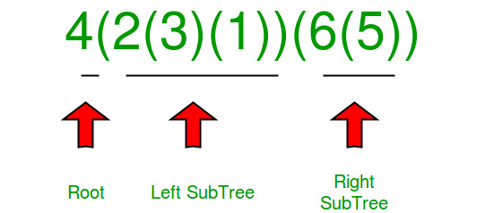

# C++ | Recursive Pre-Order Traversal Approach ✅

**Author:** prantik0128
**Votes:** 160
**Link:** [https://leetcode.com/problems/construct-string-from-binary-tree/solutions/2542357/](https://leetcode.com/problems/construct-string-from-binary-tree/solutions/2542357/)

---

**Please upvote if you like the post :)**

**Intuition:**
Seeing tree problems, first thing that hit's your brain is **Recursion.**

**Approach:**
Here we recursively traverse the nodes in binary tree and check:
*  If there exists a **left** or **right** child, we add **parentheses** for **left** child and put inside whatever we find on **left subtree.**
*  If there exists only right child, we add **parentheses** for **right** child and add inside whatever we find in right subtree.
*  The difference that can observed is that for **left** part we create **parentheses** even when there is no **left** child, but for right part we create **parentheses** only when there is **right** child.
 
**Visualization:**



**C++:**
```
class Solution {
public:
    string tree2str(TreeNode* root) {
		string ans = to_string(root->val);
		if (root->left) //left side check
			ans += "(" + tree2str(root->left) + ")";
		if (root->right) { //right side check
			if (!root->left) ans += "()"; //left side not present, but right side present
			ans += "(" + tree2str(root->right) + ")"; 
		}
		return ans;
	}
};
```
****
**Time Complexity:** **O(N^2)**, where N is the number of nodes in the Binary Tree.
**Space Complexity:** **O(H)**, where H is the height of the Binary Tree (Recursion stack space)
****

**C++:(Optimized)** Thanks @heder @SourashisHeartHacker for pointing out the issue :)
```
class Solution {
public:
    static string tree2str(const TreeNode* root) {
        string ans;
        tree2Str(root, ans);
        return ans;
    }
    static void tree2Str(const TreeNode* node, string& ans) {
        if (!node) return;   
        ans += to_string(node->val);
        if (node->left) { //left side check
            ans += '(';
            tree2Str(node->left, ans);
            ans += ')';
        }
        if (node->right) { //right side check
            if (!node->left) ans += "()"; //left side not present, but right side present
            ans += '(';
            tree2Str(node->right, ans);
            ans += ')';
        }
    }
};
```
****
**Time Complexity:** **O(N)**, where N is the number of nodes in the Binary Tree.
**Space Complexity:** **O(H)**, where H is the height of the Binary Tree (Recursion stack space)
****