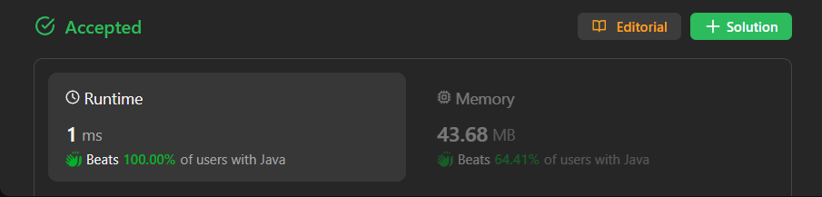
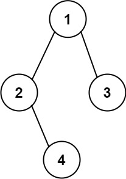

# ✅ Beats 100% - Explained with [ Video ] - C++/Java/Python/JS - DFS - Visualized

**Author:** lancertech6
**Votes:** 127
**Link:** [https://leetcode.com/problems/construct-string-from-binary-tree/solutions/4376654/](https://leetcode.com/problems/construct-string-from-binary-tree/solutions/4376654/)

---



# YouTube Video Explanation:

[https://youtu.be/18weMMdqzWY](https://youtu.be/18weMMdqzWY)
<!-- **If you want a video for this question please write in the comments** -->

**\uD83D\uDD25 Please like, share, and subscribe to support our channel's mission of making complex concepts easy to understand.**

Subscribe Link: https://www.youtube.com/@leetlogics/?sub_confirmation=1

*Subscribe Goal: 700 Subscribers*
*Current Subscribers: 663*

---

# Example Explanation

**Input: root = [1,2,3,null,4]**



| Step |     Code                           |   Result (res)          | Explanation |
|------|------------------------------------|--------------------------|-------------|
|  1   | StringBuilder res = new StringBuilder(); | ""                     | Initialize an empty StringBuilder. |
|  2   | dfs(root, res);                    | ""                     | Start DFS traversal from the root. |
|  3   | res.append(root.val);              | "1"                    | Append the value of the root node. |
|  4   | res.append('(');                    | "1("                   | Append an opening parenthesis. |
|  5   | dfs(root.left, res);               | "1(2"                  | Recursively handle left child. |
|  6   | res.append("()");                   | "1(2()"                | Append empty parentheses for left child. |
|  7   | res.append(')');                    | "1(2())"               | Close parenthesis for left child. |
|  8   | dfs(root.right, res);              | "1(2())"               | Recursively handle right child. |
|  9   | res.append('(');                    | "1(2())("              | Append an opening parenthesis. |
| 10   | dfs(root.right.left, res);         | "1(2()(4"              | Recursively handle left child of the right child. |
| 11   | res.append(')');                    | "1(2()(4))"            | Close parenthesis for left child of the right child. |
| 12   | dfs(root.right.right, res);        | "1(2()(4))"            | Recursively handle right child of the right child. |
| 13   | res.append(')');                    | "1(2()(4))"            | Close parenthesis for right child of the right child. |
| 14   | res.append(')');                    | "1(2()(4))(3)"         | Close parenthesis for the right child. |
| 15   | return res.toString();             | "1(2()(4))(3)"         | Convert StringBuilder to String. |

# Intuition
<!-- Describe your first thoughts on how to solve this problem. -->
The problem requires constructing a string representation of a binary tree using the preorder traversal approach. The key is to handle the omission of unnecessary empty parenthesis pairs while maintaining a one-to-one mapping relationship between the string and the original binary tree.

# Approach
<!-- Describe your approach to solving the problem. -->
1. Initialize a StringBuilder (`res`) to construct the final string representation.
2. Implement a recursive depth-first search (DFS) function (`dfs`) to traverse the binary tree.
3. Append the current node's value to the result string.
4. Check if the current node has left and right children:
    - If it has only a left child, append '(' and recursively call `dfs` on the left child.
    - If it has both left and right children, append '(' and recursively call `dfs` on both the left and right children.
5. After handling the left children, if the current node has a right child, append '(' and recursively call `dfs` on the right child.
6. Close the parenthesis after handling the left and right children.
7. The final result is obtained as a string from the `StringBuilder`.

# Complexity
- The time complexity is O(N), where N is the number of nodes in the binary tree. We visit each node exactly once during the DFS traversal.

- The space complexity is O(H), where H is the height of the binary tree. In the worst case, the recursion stack can go as deep as the height of the tree.

# Code
```java []
class Solution {
    public String tree2str(TreeNode t) {
        StringBuilder res = new StringBuilder();
        dfs(t, res);
        return res.toString();
    }

    public static void dfs(TreeNode t, StringBuilder res) {
        if (t == null)
            return;
        res.append(String.valueOf(t.val));
        if (t.left == null && t.right == null)
            return;
        res.append('(');
        dfs(t.left, res);
        res.append(')');
        if (t.right != null) {
            res.append('(');
            dfs(t.right, res);
            res.append(')');
        }
    }
}
```
```C++ []
class Solution {
public:
    string tree2str(TreeNode* root) {
        string str = "";
         check(root, str);
         return str;
    }
    void check(TreeNode* root, string &str) {
        if (root == NULL) {
            return;
        }
        str += to_string(root->val);
        if (root->left || root->right) {
            str += '(';
            check(root->left, str);
            str += ')';
        }
        if (root->right) {
            str += '(';
            check(root->right, str);
            str += ')';
        }
        
    }
    
};
```
```Python []
class Solution(object):
    def tree2str(self, t):
        res = []
        self.dfs(t, res)
        return ''.join(res)

    def dfs(self, t, res):
        if t is None:
            return

        res.append(str(t.val))

        if t.left is None and t.right is None:
            return

        res.append('(')
        self.dfs(t.left, res)
        res.append(')')

        if t.right is not None:
            res.append('(')
            self.dfs(t.right, res)
            res.append(')')
```
```JavaScript []
var tree2str = function(t) {
    let res = [];
    dfs(t, res);
    return res.join('');

    function dfs(t, res) {
        if (t === null)
            return;

        res.push(t.val);

        if (t.left === null && t.right === null)
            return;

        res.push('(');
        dfs(t.left, res);
        res.push(')');

        if (t.right !== null) {
            res.push('(');
            dfs(t.right, res);
            res.push(')');
        }
    }
};
```

