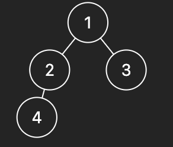

# 【Video】Give me 7 minutes - Recursion and Stack solution(Bonus) - How we think about a solution

**Author:** niits
**Votes:** 61
**Link:** [https://leetcode.com/problems/construct-string-from-binary-tree/solutions/4376889/](https://leetcode.com/problems/construct-string-from-binary-tree/solutions/4376889/)

---

# Intuition
Check right child first.

---

# Solution Video

https://youtu.be/gV7MkiwMDS8

\u25A0 Timeline of the video

`0:05` How we create an output string
`2:07` Coding
`4:30` Time Complexity and Space Complexity
`4:49` Step by step of recursion process
`7:27` Step by step algorithm with my solution code

### \u2B50\uFE0F\u2B50\uFE0F Don't forget to subscribe to my channel! \u2B50\uFE0F\u2B50\uFE0F

**\u25A0 Subscribe URL**
http://www.youtube.com/channel/UC9RMNwYTL3SXCP6ShLWVFww?sub_confirmation=1

Subscribers: 3,377
My first goal is 10,000 (It's far from done \uD83D\uDE05)
Thank you for your support!

---

# Approach

## How we think about a solution

The description says "preorder traversal way", so we should traverse the tree in preorder way.

```
Input: root = [1,2,3,4]
Output: "1(2(4))(3)"
```
We need to create output string with node value and parenthesis.



Based on example 1 in the description, output string should be
```
"1(2(4))(3)"
root(= 1)(left(= 2)(left(= 4)))(right(= 3))
```
So, when we have right child, we should create output string like this.

```
root(left)(right)
1(2)(3)
```
If we don't have right child, we should create output string like this
```
root(left)
2(4)
```
We will repeat those process.

And when we create output string, we will check right child first. Why? Look at my solution code.
```
if root.right:
    return str(root.val) + '(' + dfs(root.left) + ')(' + dfs(root.right) + ')'
if root.left:
    return str(root.val) + '(' + dfs(root.left) + ')'

```
Let's change order of `root.left` and `root.right`.
```
if root.left:
    return str(root.val) + '(' + dfs(root.left) + ')'
if root.right:
    return str(root.val) + '(' + dfs(root.left) + ')(' + dfs(root.right) + ')'
```

What if we have both children and we check left child first, in that case, we cannot create right child because this program is executed.

```
return str(root.val) + '(' + dfs(root.left) + ')'
```
No right child in the string.

Let's see dfs function one by one.


```
Input: root = [1,2,3,4]
```

```
root = 1
We have right child(= 3) 

root(left)(right)
1(left)(right)

            "1"                Execute \u2193
return str(root.val) + '(' + dfs(root.left) + ')(' + dfs(root.right) + ')'
```
Go to left
```
root = 2
We don't have right child

root(left)
2(left)
            "2"                Execute \u2193
return str(root.val) + '(' + dfs(root.left) + ')'
```
Go to left.
```
root = 4
We don't have both children, so return "4"

                    "4"
Execute return str(root.val)
```
Go back to root = 2
```
root = 2

root(left)
return 2(4)
                      "2"                    "4" 
Execute return str(root.val) + '(' + dfs(root.left) + ')'
```
Go back to root = 1
```
root = 1

root(left)(right)
1(2(4))(right)
            "1"                    Done\u2193 "2(4)"            Execute \u2193
return str(root.val) + '(' + dfs(root.left) + ')(' + dfs(root.right) + ')'
```
Go to right (= 3). No children. Just return "3"
```
root = 3
return "3"
                    "3"
Execute return str(root.val)
```
Go back to root = 1
```
root = 1

root(left)(right)
1(2(4))(3)
                    "1"                  Done\u2193 "(2(4))"       Done \u2193 "(3)"
Execute return str(root.val) + '(' + dfs(root.left) + ')(' + dfs(root.right) + ')'

```
```
Output: 1(2(4))(3)
```

Easy!\uD83D\uDE04
Let's see real algorithm!


---

1. **Base Case Check:**
   - The DFS function checks if the current node (`root`) is `None` (i.e., if it doesn't exist). If so, it returns an empty string.

2. **String Construction:**
   - If the current node has a right child (`root.right` exists), the function constructs a string by combining the value of the current node (`str(root.val)`) with its left subtree (`dfs(root.left)`) and right subtree (`dfs(root.right)`). The substrings are enclosed in parentheses.

   ```python
   if root.right:
       return str(root.val) + '(' + dfs(root.left) + ')(' + dfs(root.right) + ')'
   ```

3. **Alternative String Construction:**
   - If the current node doesn't have a right child but has a left child, the function constructs a string by combining the value of the current node (`str(root.val)`) with its left subtree (`dfs(root.left)`). The substrings are enclosed in parentheses.

   ```python
   if root.left:
       return str(root.val) + '(' + dfs(root.left) + ')'
   ```

4. **Leaf Node Case:**
   - If the current node is a leaf node (i.e., it has neither left nor right child), the function returns a string containing only the value of the leaf node.

   ```python
   return str(root.val)
   ```

5. **Return Result:**
   - The `tree2str` method returns the result of the DFS function applied to the root of the binary tree.

   ```python
   return dfs(root)
   ```

### Summary:

- The algorithm uses DFS to traverse the binary tree and construct a string representation based on the specified rules.
- The conditions in the DFS function are designed to skip unnecessary parentheses pairs and create a compact, one-to-one mapping relationship between the string and the original binary tree.


---


# Complexity
- Time complexity: $$O(n)$$

Each node is visited exactly once, so the time complexity is $$O(n)$$, where n is the number of nodes in the tree.

- Space complexity: $$O(n)$$

In the worst case, we have a skewed tree.

```python []
class Solution:
    def tree2str(self, root: Optional[TreeNode]) -> str:

        def dfs(root):
            if not root:
                return ''
            if root.right:
                return str(root.val) + '(' + dfs(root.left) + ')(' + dfs(root.right) + ')'
            if root.left:
                return str(root.val) + '(' + dfs(root.left) + ')'
            
            return str(root.val)
      
        return dfs(root)        
```
```javascript []
var tree2str = function(root) {
    function dfs(node) {
        if (!node) {
            return '';
        }
        if (node.right) {
            return `${node.val}(${dfs(node.left)})(${dfs(node.right)})`;
        }
        if (node.left) {
            return `${node.val}(${dfs(node.left)})`;
        }
        return `${node.val}`;
    }

    return dfs(root);    
};
```
```java []
class Solution {
    public String tree2str(TreeNode root) {
        if (root == null) {
            return "";
        }

        StringBuilder result = new StringBuilder();

        dfs(root, result);

        return result.toString();        
    }

    private void dfs(TreeNode node, StringBuilder result) {
        if (node == null) {
            return;
        }

        result.append(node.val);

        if (node.left != null || node.right != null) {
            result.append("(");
            dfs(node.left, result);
            result.append(")");

            if (node.right != null) {
                result.append("(");
                dfs(node.right, result);
                result.append(")");
            }
        }
    }    
}
```
```C++ []
class Solution {
public:
    string tree2str(TreeNode* root) {
        if (!root) {
            return "";
        }

        string result;
        dfs(root, result);

        return result;        
    }

private:
    void dfs(TreeNode* node, string& result) {
        if (!node) {
            return;
        }

        result += to_string(node->val);

        if (node->left || node->right) {
            result += "(";
            dfs(node->left, result);
            result += ")";

            if (node->right) {
                result += "(";
                dfs(node->right, result);
                result += ")";
            }
        }
    }
};
```

---


# Bonus - Stack solution

In most posts, the problems were solved using recursion, so I tried solving it using a stack.

If possible, please let me know about any optimizations or improvements, since I didn't have time to think too much. lol

```python []
class Solution:
    def tree2str(self, root: Optional[TreeNode]) -> str:
        # Check if the tree is empty
        if not root:
            return ""
        
        # Initialize an empty result string
        res = ""
        # Initialize a stack for iterative traversal
        stack = [root]
        # Use a set to track visited nodes
        visited = set()
        
        # Iterate through the tree using a stack
        while stack:
            # Get the current node from the top of the stack
            cur = stack[-1]
            
            # If the current node is already visited, pop it from the stack and close the parenthesis
            if cur in visited:
                stack.pop()
                res += ")"
            else:
                # If the current node is not visited, mark it as visited and add its value to the result
                visited.add(cur)
                res += f"({cur.val}"
                
                # If the current node has no left child and a right child, add an empty pair of parentheses
                if not cur.left and cur.right:
                    res += "()"
                
                # Add the right child to the stack if it exists
                if cur.right:
                    stack.append(cur.right)
                # Add the left child to the stack if it exists
                if cur.left:
                    stack.append(cur.left)
                
        # Return the result string with leading '(' and trailing ')' removed
        return res[1:-1]

```
```javascript []
var tree2str = function(root) {
    // Check if the tree is empty
    if (!root) {
        return "";
    }
    
    // Initialize an empty result string
    let res = "";
    // Initialize a stack for iterative traversal
    const stack = [root];
    // Use a set to track visited nodes
    const visited = new Set();
    
    // Iterate through the tree using a stack
    while (stack.length > 0) {
        // Get the current node from the top of the stack
        const cur = stack[stack.length - 1];
        
        // If the current node is already visited, pop it from the stack and close the parenthesis
        if (visited.has(cur)) {
            stack.pop();
            res += ")";
        } else {
            // If the current node is not visited, mark it as visited and add its value to the result
            visited.add(cur);
            res += `(${cur.val}`;
            
            // If the current node has no left child and a right child, add an empty pair of parentheses
            if (!cur.left && cur.right) {
                res += "()";
            }
            
            // Add the right child to the stack if it exists
            if (cur.right) {
                stack.push(cur.right);
            }
            
            // Add the left child to the stack if it exists
            if (cur.left) {
                stack.push(cur.left);
            }
        }
    }
    
    // Return the result string with leading '(' and trailing ')' removed
    return res.substring(1, res.length - 1);    
};

```
```java []
class Solution {
    public String tree2str(TreeNode root) {
        // Check if the tree is empty
        if (root == null) {
            return "";
        }

        // Initialize a StringBuilder to efficiently build the result string
        StringBuilder res = new StringBuilder();
        // Initialize a stack for iterative traversal
        Stack<TreeNode> stack = new Stack<>();
        // Use a set to track visited nodes
        Set<TreeNode> visited = new HashSet<>();
        stack.push(root);

        // Iterate through the tree using a stack
        while (!stack.isEmpty()) {
            // Get the current node from the top of the stack
            TreeNode cur = stack.peek();

            // If the current node is already visited, pop it from the stack and close the parenthesis
            if (visited.contains(cur)) {
                stack.pop();
                res.append(")");
            } else {
                // If the current node is not visited, mark it as visited and add its value to the result
                visited.add(cur);
                res.append("(").append(cur.val);

                // If the current node has no left child and a right child, add an empty pair of parentheses
                if (cur.left == null && cur.right != null) {
                    res.append("()");
                }

                // Add the right child to the stack if it exists
                if (cur.right != null) {
                    stack.push(cur.right);
                }

                // Add the left child to the stack if it exists
                if (cur.left != null) {
                    stack.push(cur.left);
                }
            }
        }

        // Return the result string with leading '(' and trailing ')' removed
        return res.substring(1, res.length() - 1);
    }    
}

```
```C++ []
class Solution {
public:
    string tree2str(TreeNode* root) { // Time: O(n), Space: O(n)
        // Check if the tree is empty
        if (!root) return "";
        
        // Initialize an empty result string
        string res;
        // Initialize a stack for iterative traversal
        stack<TreeNode*> st;
        // Use a set to track visited nodes
        unordered_set<TreeNode*> visited;
        // Push the root onto the stack
        st.push(root);
        
        // Iterate through the tree using a stack
        while (!st.empty()) {
            // Get the current node from the top of the stack
            TreeNode* cur = st.top();
            
            // If the current node is already visited, pop it from the stack and close the parenthesis
            if (visited.count(cur)) {
                st.pop();
                res += ")";
            } else {
                // If the current node is not visited, mark it as visited and add its value to the result
                visited.insert(cur);
                res += "(" + to_string(cur->val);
                
                // If the current node has no left child and a right child, add an empty pair of parentheses
                if (!cur->left && cur->right) {
                    res += "()";
                }
                
                // Add the right child to the stack if it exists
                if (cur->right) st.push(cur->right);
                
                // Add the left child to the stack if it exists
                if (cur->left) st.push(cur->left);
            }
        }
        
        // Return the result string with leading '(' and trailing ')' removed
        return res.substr(1, res.length() - 2);
    }
};

```


---

Thank you for reading my post.
\u2B50\uFE0F Please upvote it and don't forget to subscribe to my channel!

\u25A0 Subscribe URL
http://www.youtube.com/channel/UC9RMNwYTL3SXCP6ShLWVFww?sub_confirmation=1

\u25A0 Twitter
https://twitter.com/CodingNinjaAZ

### My next daily coding challenge post and video.

post
https://leetcode.com/problems/binary-tree-inorder-traversal/solutions/4380244/video-give-me-5-minutes-recursive-and-stack-solutionbonus-how-we-think-about-a-solution/

video
https://youtu.be/TKMxiXRzDZ0

\u25A0 Timeline of the video
`0:04` How to implement inorder, preorder and postorder
`1:16` Coding (Recursive)
`2:14` Time Complexity and Space Complexity
`2:37` Explain Stack solution
`7:22` Coding (Stack)
`8:45` Time Complexity and Space Complexity
`8:59` Step by step algorithm with my stack solution code

### My previous daily coding challenge post and video.

post
https://leetcode.com/problems/largest-odd-number-in-string/solutions/4372831/video-give-me-1-minute-how-we-think-about-a-solution/

video
https://youtu.be/f-hyawcTl8U

\u25A0 Timeline of the video

`0:04` Coding
`1:18` Time Complexity and Space Complexity
`1:31` Step by step algorithm with my solution code

