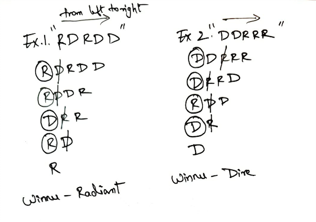
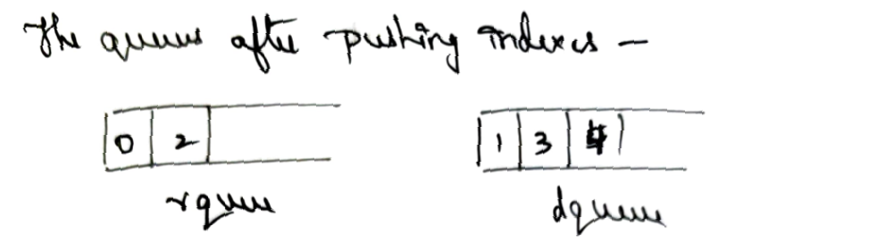
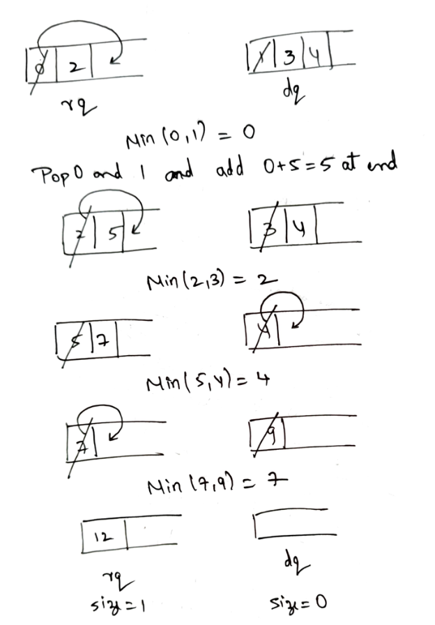

# C++ Explanation with Diagram

**Author:** NeerajDusa
**Votes:** 99
**Link:** [https://leetcode.com/problems/dota2-senate/solutions/1704597/](https://leetcode.com/problems/dota2-senate/solutions/1704597/)

---

*Lets take some examples to understand this question*
Input: senate = ***"RDRDD"*** and ***"DDRRR"***



Here R takes rights of D and again joins back of the string.

We will take "RDRDD" example and see how to code for this problem.

First we will create 2 queues for radiant and dire, and next we push indices of R to R queue and indices of D to D queue.



Now we take 2 front elements from queues, pop both of them and add the min elem to the queue at the back (as it kills and gets ready for another round).


**That's it!!** \uD83E\uDD73 Atlast Radiant won against Dire! 

***Lets see the code for this problem***

```
class Solution {
public:
    string predictPartyVictory(string senate) {
        queue<int> rq, dq;
        
        for(int i=0; i<senate.size(); i++)
            senate[i] == 'R' ? rq.push(i): dq.push(i);
        
        int a, b;
        while(!rq.empty() and !dq.empty()){
            a = rq.front(), b = dq.front();
            rq.pop(), dq.pop();
            if (a < b) // taking min and pushing it to queue again
                rq.push(a+senate.size());
            else
                dq.push(b+senate.size());
        }
        
		if (rq.size() > dq.size())
			return "Radiant";
		else
			return "Dire";
    }
};
```

***Time Complexity:*** O(string size) --> O(n)
***Space Complexity:*** O(queue size) --> O(n)

A bit similar question with same concept: https://leetcode.com/problems/find-the-winner-of-the-circular-game/ 

Please Upvote If you liked it \u263A\uFE0F!! It keeps me motivated to post solutions like these.
If there are any suggestions / questions / mistakes in my post, comment below.