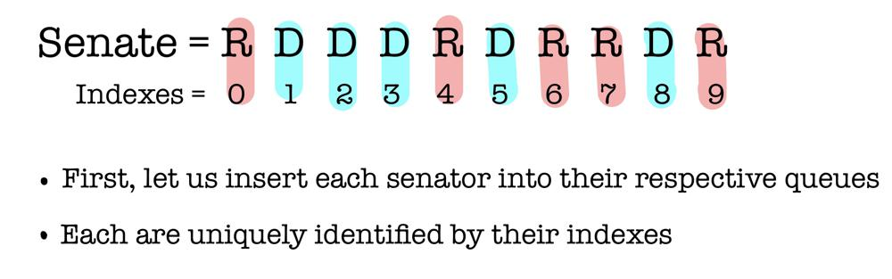
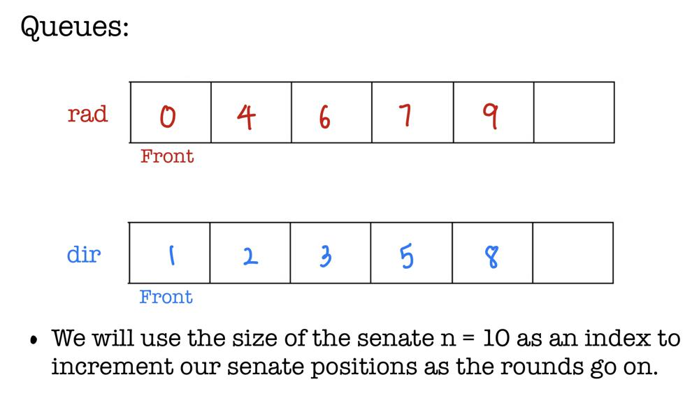
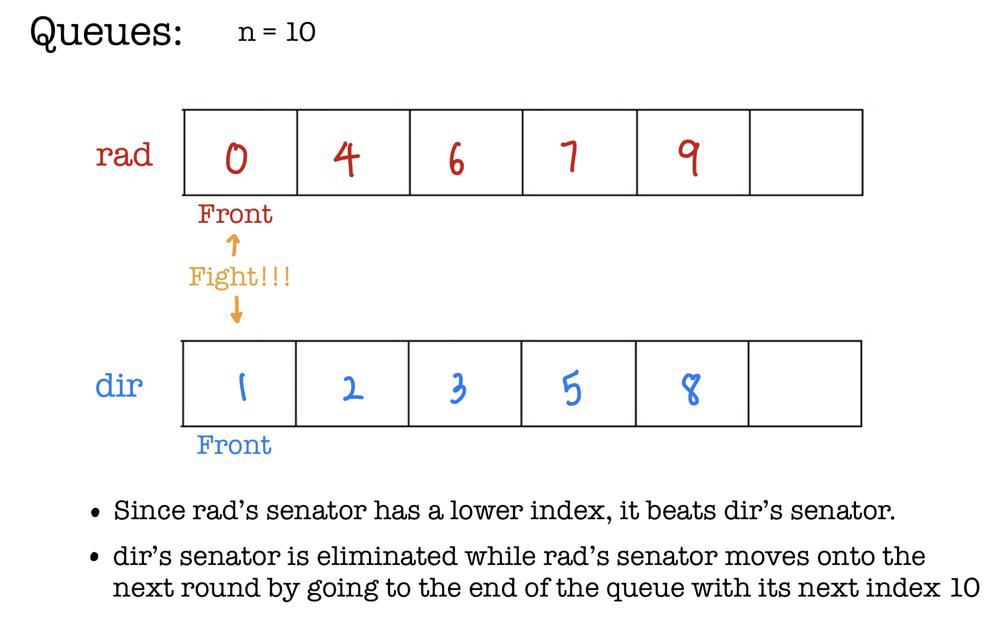
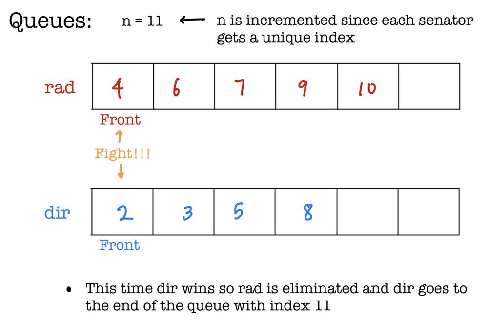
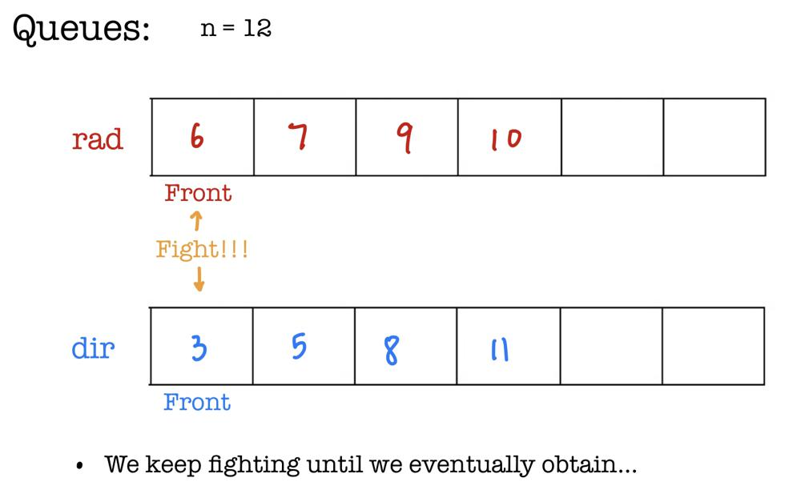
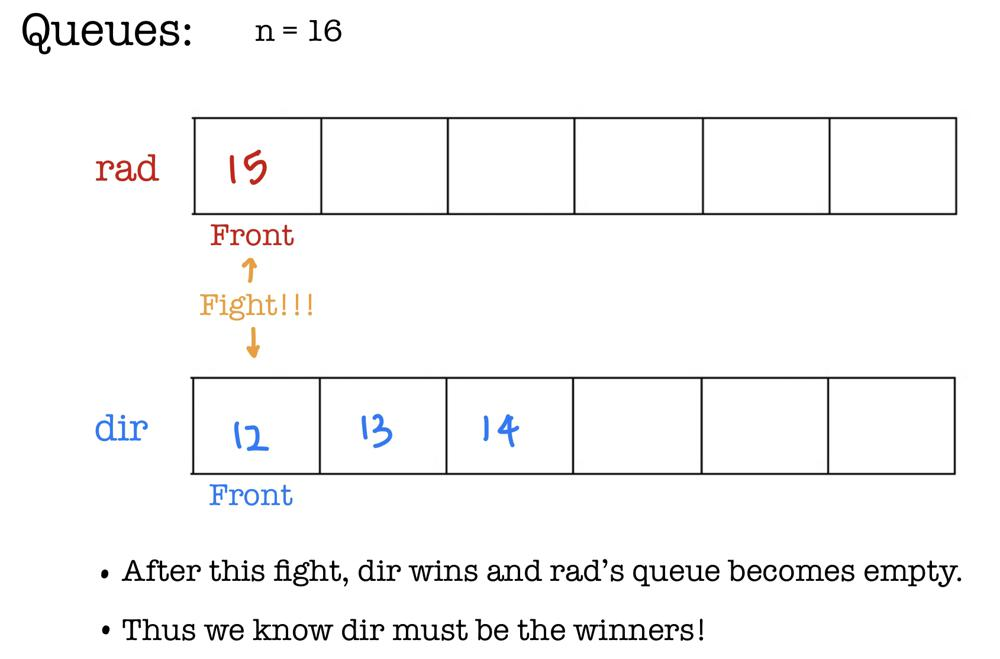

# Simple Diagram Explanation

**Author:** L30XL1U
**Votes:** 909
**Link:** [https://leetcode.com/problems/dota2-senate/solutions/3483399/](https://leetcode.com/problems/dota2-senate/solutions/3483399/)

---

# Idea
- **We will use a two queue approach.**
- Recall, each senator has a position to exercise their right. 
- The ones to the left have an earlier turn than the ones to the right. 
- `rad` is queue that holds all positions of **active** senators in "Radiant"
- `dir` is queue that holds all positions of **active** senators in "Dire".
- **Active** being that they still have the right to vote. 
- Our queue will be ordered so that the senators with earlier voting power come first (to the left of the queue). 
- To goal is to have the earliest senator of each queue *fight* each other to see who gets to eliminate the other depending on their position. 
- Obviously, the one with the earlier position will win. 
- The loser is removed from the queue since they are no longer **active.**
- The winner will go to the end of the queue for the next round. 
- We keep doing this until one queue is empty which means there are no more senators on the team. 

# Everything is easier with an example: 
- `senate = "RDDDRDRRDR"`












# Code
```
class Solution {
public:
    string predictPartyVictory(string senate) {
        queue<int> rad, dir;
        int n = senate.length();
        // Add all senators to respect queue with index
        for (int i = 0; i < n; i++){
            if (senate[i] == 'R'){
                rad.push(i);
            }
            else {
                dir.push(i);
            }
        }
        // Use increasing n to keep track of position
        while (!rad.empty() && !dir.empty()){
            // Only "winner" stays in their queue
            if (rad.front() < dir.front()){
                rad.push(n++);
            }
            else {
                dir.push(n++);
            }
            rad.pop(), dir.pop();
        }
        return (rad.empty()) ? ("Dire") : ("Radiant");
    }
};
```
### Why does the winner go to the end of the queue?
- Since the voting is done such that both sides perform the most optimal strategy, the senators who have already voted will not be a problem to the other team for that round. 
- So, instead of eliminating a senator who has already moved, the best move for each team is to eliminate the next senator who has the power to vote. 
- This works perfectly with the queue approach since we can just place the senators who have voted at the end. 
## If this helped, please leave an upvote! Much appreciated!
##### edit: Thanks all for the kind comments; it definitely motivates me to make more of these diagram solutions!