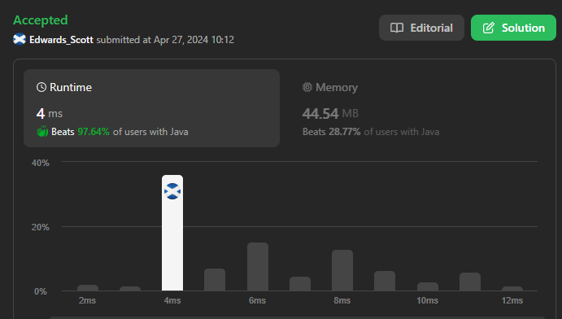
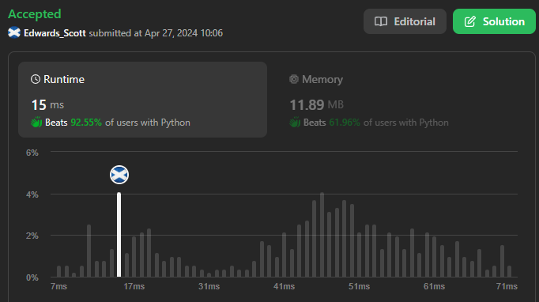
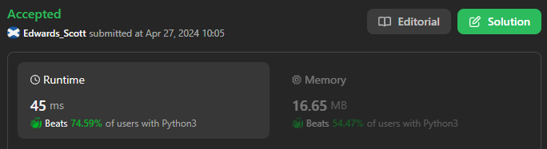
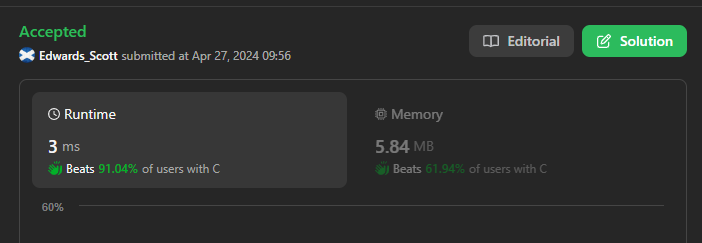
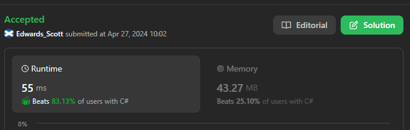

# ☠💀🔥💫Easiest C++✅Python3✅C#✅Java ✅ Python🐍✅C✅👾 Explained🏆✨⚡Solution beats 💯👌💀

**Author:** Edwards310
**Votes:** 4
**Link:** [https://leetcode.com/problems/robot-return-to-origin/solutions/5077921/](https://leetcode.com/problems/robot-return-to-origin/solutions/5077921/)

---

# Intuition







<!-- Describe your first thoughts on how to solve this problem. -->

# Approach
<!-- Describe your approach to solving the problem. -->
# This is a very Simple solution approach is make origin (0,0) -> (x,y) then iterate over string and check if it's 'R' that means we are moving towards x++ direction . similary for 'L' we are moving x-- direction. For 'U' --> y++ and 'D' --> y--
# Then just whether we arrive back at origin or not x == 0 and y == 0
```C++ []
class Solution {
public:
    bool judgeCircle(string moves) {
        pair<int, int> vec; // (x, y) == (0, 0)
        for (auto& s : moves) {
            if (s == 'R')
                vec.first++;
            else if (s == 'L')
                vec.first--;
            else if (s == 'U')
                vec.second++;
            else if (s == 'D')
                vec.second--;
        }
        return !vec.first && !vec.second;
    }
};
```
```python3 []
class Solution:
    def judgeCircle(self, moves: str) -> bool:
        x = y = 0
        for mov in moves:
            if mov == 'R':
                x += 1
            elif mov == 'U':
                y += 1
            elif mov == 'L':
                x -= 1
            elif mov == 'D':
                y -= 1
        return True if x == 0 and y == 0 else False
```
```C# []
public class Solution {
    public bool JudgeCircle(string moves) {
        int x = 0, y = 0;
        for (int i = 0; i < moves.Length; i++) {
            if (moves[i] == 'R')
                x++;
            else if (moves[i] == 'L')
                x--;
            else if (moves[i] == 'U')
                y++;
            else if (moves[i] == 'D')
                 y--;
            }
        return (x == 0) && (y == 0);
    }
}
```
```Java []
class Solution {
    public boolean judgeCircle(String moves) {
        int x = 0, y = 0;
        for (char s : moves.toCharArray()) {
            if (s == 'R')
                x++;
            else if (s == 'L')
                x--;
            else if (s == 'U')
                y++;
            else if (s == 'D')
                y--;
        }
        return (x == 0) && (y == 0);
    }
}
```
```python []
class Solution(object):
    def judgeCircle(self, moves):
        """
        :type moves: str
        :rtype: bool
        """
        if moves.count('L') != moves.count('R'):
            return False
        elif moves.count('U') != moves.count('D'):
            return False
        else:
            return True
```
```C []
bool judgeCircle(char* moves) {
    int x = 0, y = 0;
    for (int i = 0; moves[i] != '\\0'; i++) {
        if (moves[i] == 'R')
            x++;
        else if (moves[i] == 'L')
            x--;
        else if (moves[i] == 'U')
            y++;
        else if (moves[i] == 'D')
            y--;
    }
    return !x && !y;
}
```


# Complexity
- Time complexity:
<!-- Add your time complexity here, e.g. $$O(n)$$ -->
      O(n)
- Space complexity:
<!-- Add your space complexity here, e.g. $$O(n)$$ -->
      O(1)
# Code
```
class Solution {
public:
    bool judgeCircle(string moves) {
        pair<int, int> vec; // (x, y) == (0, 0)
        for (auto& s : moves) {
            if (s == 'R')
                vec.first++;
            else if (s == 'L')
                vec.first--;
            else if (s == 'U')
                vec.second++;
            else if (s == 'D')
                vec.second--;
        }
        return !vec.first && !vec.second;
    }
};
```
# Please upvote if it's useful for you..


