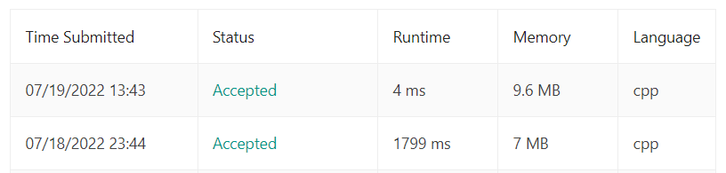
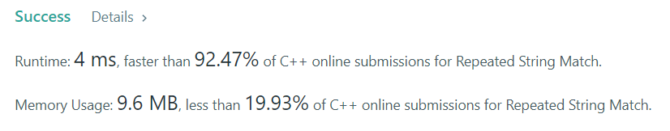

# ✅ C++ | 3 Approaches | Brute force | Rabin-Karp | KMP search | Standard implementation

**Author:** HustlerNitin
**Votes:** 88
**Link:** [https://leetcode.com/problems/repeated-string-match/solutions/2303190/](https://leetcode.com/problems/repeated-string-match/solutions/2303190/)

---

**1. Brute Force (Naive Approach)**
Not much efficient : But Logic is important which is used further while Rabin-Karp implementation of this problem. 

**Time complexity :** **`O(N.M)`**
**Space complexity :** **`O(M)`** *(temporary string)*
**`Time : 1799ms (It takes hell lot of time)`**


```
class Solution {
public:
    
    bool check(string &a, string &b)
    {
        int m=a.size();
        int n=b.size();
        
        for(int i=0;i<=m-n;i++)
        {
            int j;
            for(j=0;j<n;j++){
                if(a[i+j]!=b[j])
                    break;
            }
            if(j==n)
                return true;
        }
        return false;
    }
    
    int repeatedStringMatch(string a, string b) 
    {
        int m=a.size();
        int n=b.size();
        
        int ans=1;
        string tmp=a;
        while(a.size() < b.size()){
            a += tmp;
            ans++;
        }
        
        if(check(a,b)){
            return ans;
        }
        a += tmp;
        if(check(a,b)){
            return ans+1;
        }
        return -1;
    }
};
```

----

**2. Rabin-Karp Algorithm :** It is used to find given substring **pattern** in given **text**. It is also known as string matching algorithm.

**Time complexity :** **`O(M+N)`** 
**Space complexity :** **`O(2*M) ~ O(M)`** *(prefix hash array and power array of size M)*
**`Time : 4ms`**

----


----
```
class Solution {
public: 
    
    // s1 -> text string 
    // s2 -> pattern string
    // Check pattern find in text or not !!
    // Rolling hash : hash calculation in sliding window, window moves by 1 step in right  
    int Rabin_Karp(string s1, string s2) 
    {
        long long m=s1.size();
        long long n=s2.size();
        
        long long p = 31;
        long long pow = 1;
        long long mod = 1e9+7;
        long long targetHashVal = 0;
        
        // targetHashVal - calculate hash value of pattern
        for(long long i=0;i<n;i++){
            targetHashVal = (targetHashVal + (s2[i]-'a'+1)*pow)%mod;
            pow = (pow*p)%mod;
        }
        
        // Rabin-Karp algo :
        // prefix hash array
        vector<long long>pha(m);
        // power array : so that my time is not wasting in calculating big powers
        vector<long long>pa(m);
        
        pha[0] = s1[0]-'a'+1;
        pa[0] = 1;
        pow = p;
        
        for(long long i=1;i<m;i++){
            pha[i] = (pha[i-1] + (s1[i]-'a'+1)*pow)%mod;
            pa[i] = pow;
            pow = (pow*p)%mod;
        }
        
        //Now Start sliding window
        // initialize variables for the starting and ending points of window
        long long sp = 0, ep = n-1;
        
        while(ep < m)
        {
            long long win = pha[ep];
            if(sp>0)
                win = (win - pha[sp-1]+mod)%mod; // agar value negative hoti hai toh usme bas mod add kardo
            
            if(win == (targetHashVal*pa[sp])%mod){
                return 1;
            }
            sp++,ep++;
        }
        return 0;
    }
    
    int repeatedStringMatch(string A, string B) 
    {
        // edge cases
        if(A == B) return 1;
        
        int count = 1;
        string source = A;
        while(source.size() < B.size()){
            source+=A;
            count++;
        }
        
        // edge cases
        if(source == B) 
            return count;
        
        if(Rabin_Karp(source,B) == 1) 
            return count;
        
        if(Rabin_Karp(source+A,B) == 1) 
            return count+1;
        return -1;
    }
};
```

----
**Note :**
The average and best-case running time of the **Rabin-Karp algorithm** is **`O(N+M)`**, 
but its worst-case time is **`O(N*M)`**. 
Worst case of Rabin-Karp algorithm occurs when all characters of pattern and text are same as the hash values of all the substrings of **`txt[]`** match with hash value of **`pat[]`**. For example **`pat[] = \u201CAAA\u201D`** and **`txt[] = \u201CAAAAAAA\u201D`**.

----

**3. KMP Algo for Substring search**

**Time complexity :** **`O(M+N)`** 
**Space complexity :** **`O(N)`** *(prefix LPS array)*
**`Time : 4ms`**
```
class Solution {
public: 
    
    // s --> text
    // p --> pattern
    int KMP_search(string s, string p)
    {
        int m=s.size();
        int n=p.size();
        
        // longest proper prefix : longest "prefix" is same as "suffix" 
        vector<int>lps(n,0);
        int len=0, i=1;
        
        // Dry run for  pattern = "abcabcd", then you will understand clearly how we will create "LPS" array
        // pattern   ----------> a b c a b c d
        // "lps" array comes --> 0 0 0 1 2 3 0
        while(i<n)
        {
            // if match happen
            if(p[len]==p[i]){ 
                len++;
                lps[i]=len;
                i++;
            }
            else
            {
                if(len!=0) // abhi piche nahi jaa sakte
                {
                    len=lps[len-1];
                }
                else // len == 0, isse picche nahi jaa sakte 
                {
                    lps[i]=0;
                    i++;
                }
            }
        }
        
        // Now Searching part starts from here
        i=0;
        int j=0;
        while(i<m and j<n)
        {
            // if match happen then move both i and j
            if(s[i] == p[j])
            {
                i++;
                j++;
                if(j==n){ // we have an answer
                    return true;
                }
            }
            else
            {
                if(j!=0)
                {
                    j = lps[j-1];
                }
                else
                {
                    i++;
                }
            }
        }
        return false;
    }
    
    int repeatedStringMatch(string A, string B) 
    {
        // edge cases
        if(A == B) return 1;
        
        int count = 1;
        string source = A;
        while(source.size() < B.size()){
            source+=A;
            count++;
        }
        
        // edge cases
        if(source == B) 
            return count;
        
        if(KMP_search(source,B) == 1) 
            return count;
        
        if(KMP_search(source+A,B) == 1) 
            return count+1;
        return -1;
    }
};
```

*Thanks for Upvoting !*
\uD83D\uDE42