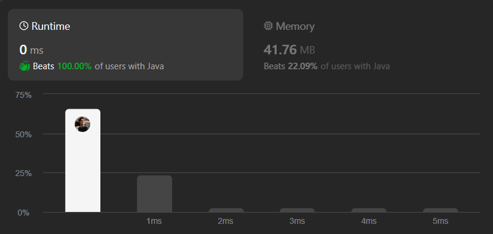
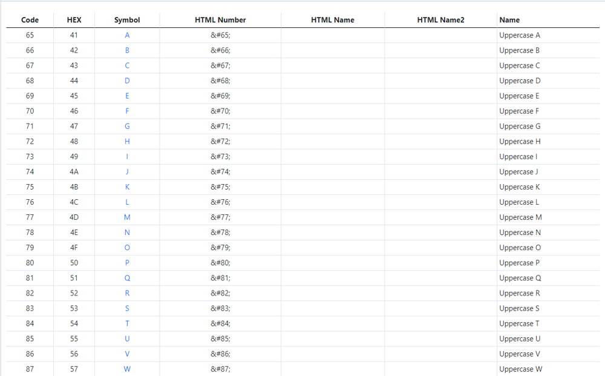
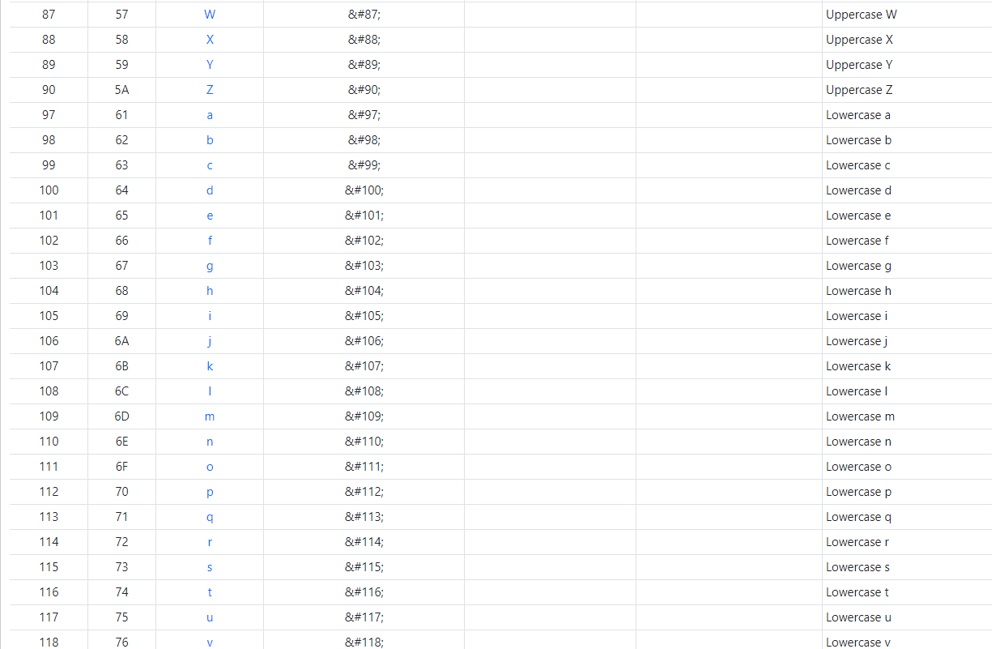
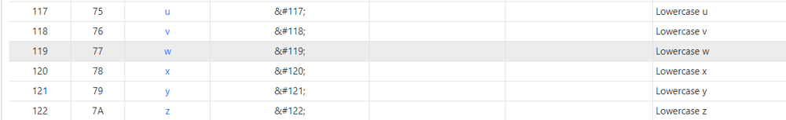

# Simple ,Beginner Friendly & Dry Run || Simple iteration & ASCII values || TC O(n) & SC O(1) || Gits✅

**Author:** GiteshSK_12
**Votes:** 25
**Link:** [https://leetcode.com/problems/to-lower-case/solutions/4738654/](https://leetcode.com/problems/to-lower-case/solutions/4738654/)

---



# Intuition \uD83D\uDC48

In the question, they have given a string, and we have to convert all uppercase characters to lowercase characters and return that string.

# Approach \uD83D\uDC48

### Step 1: Understand the ASCII Table

*   Recognize that ASCII (American Standard Code for Information Interchange) assigns numerical values to characters. In the ASCII table, uppercase and lowercase letters are separated by a fixed interval:
    *   Uppercase 'A' to 'Z' have ASCII values from 65 to 90.
    *   Lowercase 'a' to 'z' have ASCII values from 97 to 122.
    *   The difference between the ASCII values of uppercase and its corresponding lowercase letter is 32.








### Step 2: Initialize Required Variables

*   Calculate and store the length of the input string to know how many times to iterate.
*   Use a `StringBuilder` to build the output string efficiently. `StringBuilder` is chosen because it allows appending characters without creating new string objects for each concatenation, which is more efficient than using a regular `String` for repeated modifications.

### Step 3: Iterate Over the Input String

*   Loop through each character of the input string using a `for` loop. This iteration will allow you to process each character individually.

### Step 4: Convert Uppercase Letters to Lowercase

*   For each character, convert it to its ASCII value. This step is crucial for determining whether the character is uppercase.
*   Check if the ASCII value is within the range of uppercase letters (65 to 90). If so, add 32 to the ASCII value to convert it to the corresponding lowercase letter.
*   Use casting to convert the adjusted ASCII value back into a character.

### Step 5: Append Characters to the StringBuilder

*   Regardless of whether the character was converted, append it to the `StringBuilder` instance. This step builds the output string incrementally, preserving the original character if it's already lowercase or not a letter, and appending the converted character if it was uppercase.

### Step 6: Return the Result

*   Once all characters have been processed and appended to the `StringBuilder`, convert the `StringBuilder` object back to a `String` using the `toString()` method. This final string is the method's output, containing the original string with all uppercase letters converted to lowercase.

# Code Explanation \uD83D\uDC48
 
*   **Method Signature**: `public String toLowerCase(String s)`
    
    *   This indicates that the method is public (accessible from outside the `Solution` class), returns a `String`, and takes a single `String` parameter named `s`.
*   **Variable Initialization**:
    
    *   `int len = s.length();`: This line calculates the length of the input string `s` and stores it in an integer variable `len`.
    *   `StringBuilder str = new StringBuilder();`: A `StringBuilder` instance named `str` is created. `StringBuilder` is used here because it allows for efficient modification of strings. It will be used to construct the result string.
*   **Looping Through the String**:
    
    *   The method uses a `for` loop to iterate over each character of the input string. The loop runs from `i = 0` to `i = len - 1`, where `len` is the length of the string.
*   **Character Processing**:
    
    *   Within the loop, the ASCII value of the current character is obtained using `(int)s.charAt(i)`. This casts the character at position `i` of the string `s` to its ASCII integer value, stored in the variable `ascii`.
    *   It then checks if `ascii` falls within the range of ASCII values for uppercase letters (65 to 90, corresponding to 'A' to 'Z'). If it does, 32 is added to `ascii` to convert it to the corresponding lowercase letter (since in the ASCII table, the lowercase letters 'a' to 'z' start at 97, exactly 32 positions after 'A' to 'Z').
    *   A new character `a` is created by casting `ascii` back to `char`, and this character is appended to the `StringBuilder` instance `str`.
*   **Building the Result String**:
    
    *   For each character in the input string, the code either converts it to lowercase (if it's an uppercase letter) or leaves it unchanged (if it's already lowercase or not a letter). The processed character is appended to `str`.
*   **Returning the Result**:
    
    *   After all characters have been processed, the `StringBuilder` instance `str` contains the fully converted string. The method returns this string by calling `str.toString()`, which converts the `StringBuilder` to a `String`.

# Complexity \uD83D\uDC48
- Time complexity: O(n)

- Space complexity: O(1)

# Code \uD83D\uDC48

```C []
char* toLowerCase(char* s) {
    int len = strlen(s);
    for(int i = 0; i < len; i++) {
        if(s[i] >= 'A' && s[i] <= 'Z') {
            s[i] = s[i] + 32;
        }
    }
    return s;
}
```
```C++ []
class Solution {
public:
    string toLowerCase(string s) {
        for(int i = 0; i < s.length(); i++) {
        if(s[i] >= 'A' && s[i] <= 'Z') {
            s[i] = s[i] + 32;
        }
    }   
    return s;
    }
};
```
```Java []
class Solution {
    public String toLowerCase(String s) {
        int len = s.length();
        StringBuilder str = new StringBuilder();
        for(int i = 0; i<len; i++){
            int ascii = (int)s.charAt(i);
            if(ascii >= 65 && ascii <= 90){
                ascii += 32;
                char a = (char)ascii;
                str.append(a);
            }else{
                char a = (char)ascii;
                str.append(a);
            }
        }
        return str.toString();
    }
}
```
```javascript []
/**
 * @param {string} s
 * @return {string}
 */
var toLowerCase = function(s) {
    let result = '';
    for (let i = 0; i < s.length; i++) {
        const ascii = s.charCodeAt(i);
        if (ascii >= 65 && ascii <= 90) {
            result += String.fromCharCode(ascii + 32);
        } else {
            result += s.charAt(i);
        }
    }
    return result;
};
```
```C# []
public class Solution {
    public string ToLowerCase(string s) {
        int len = s.Length;
        StringBuilder strBuilder = new StringBuilder();
        for(int i = 0; i < len; i++) {
            int ascii = (int)s[i];
            if(ascii >= 65 && ascii <= 90) {
                ascii += 32;
                char a = (char)ascii;
                strBuilder.Append(a);
            } else {
                char a = (char)ascii;
                strBuilder.Append(a);
            }
        }
        return strBuilder.ToString();
    }
}
```
```python []
class Solution(object):
    def toLowerCase(self, s):
        """
        :type s: str
        :rtype: str
        """
        lower_case_str = ""
        for char in s:
            ascii_val = ord(char)
            if 65 <= ascii_val <= 90:  # A-Z in ASCII
                lower_case_str += chr(ascii_val + 32)
            else:
                lower_case_str += char
        return lower_case_str
```
```python3 []
class Solution:
    def toLowerCase(self, s: str) -> str:
        lower_case_str = ""
        for char in s:
            ascii_val = ord(char)
            if 65 <= ascii_val <= 90:  # A-Z in ASCII
                lower_case_str += chr(ascii_val + 32)
            else:
                lower_case_str += char
        return lower_case_str
```
```ruby []
# @param {String} s
# @return {String}
def to_lower_case(s)
    result = ""
    s.each_char do |char|
    if char >= 'A' && char <= 'Z'
      ascii = char.ord + 32
      result += ascii.chr
    else
      result += char
    end
  end
  result
end
```

# Dry Run \uD83D\uDC48

1.  **Initialization**: The input string `s = "Hello"`. The length of `s`, `len = 5`. A `StringBuilder` named `str` is initialized to build the result string.
    
2.  **Iteration 0** (`i = 0`):
    
    *   `s.charAt(0)` = 'H'
    *   ASCII value of 'H' = 72
    *   Since 72 is within the range 65 to 90, we add 32 to it, getting 104.
    *   The character corresponding to ASCII value 104 is 'h'.
    *   'h' is appended to `str`.
3.  **Iteration 1** (`i = 1`):
    
    *   `s.charAt(1)` = 'e'
    *   ASCII value of 'e' = 101
    *   Since 101 is not within the range 65 to 90, no conversion is needed.
    *   'e' is appended to `str`.
4.  **Iteration 2** (`i = 2`):
    
    *   `s.charAt(2)` = 'l'
    *   ASCII value of 'l' = 108
    *   Since 108 is not within the range 65 to 90, no conversion is needed.
    *   'l' is appended to `str`.
5.  **Iteration 3** (`i = 3`):
    
    *   `s.charAt(3)` = 'l'
    *   ASCII value of 'l' = 108
    *   Since 108 is not within the range 65 to 90, no conversion is needed.
    *   'l' is appended to `str`.
6.  **Iteration 4** (`i = 4`):
    
    *   `s.charAt(4)` = 'o'
    *   ASCII value of 'o' = 111
    *   Since 111 is not within the range 65 to 90, no conversion is needed.
    *   'o' is appended to `str`.
7.  **Result**: After completing the iteration, the content of `str` is "hello".
    
8.  **Return Value**: The `toString()` method of `str` is called, returning the string "hello".
    

The final output of the `toLowerCase` method for the input `s = "Hello"` is "hello".

# Hey Guys if the explanation and the solution is helpful then up vote me Please .\u2764\uFE0F\u2764\uFE0F\u2764\uFE0F\u2764\uFE0F\u2764\uFE0F\u2764\uFE0F\u2764\uFE0F\u2764\uFE0F


