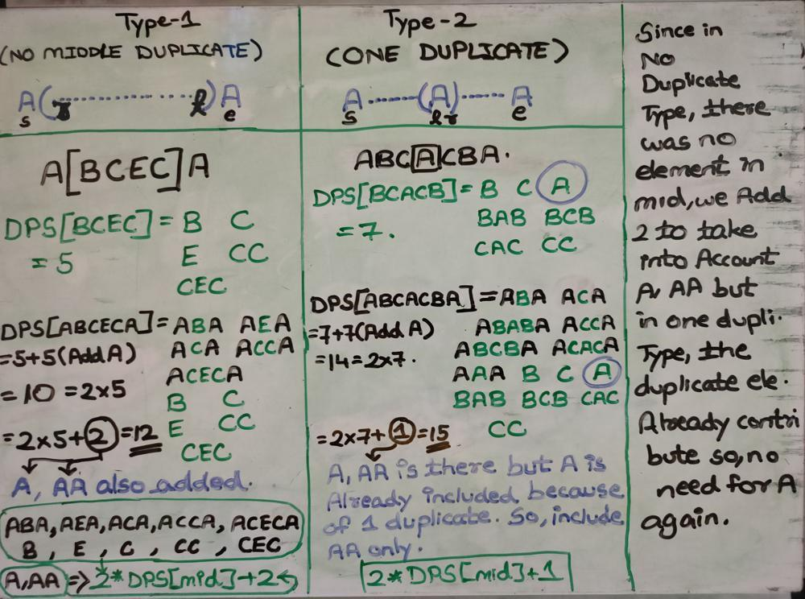
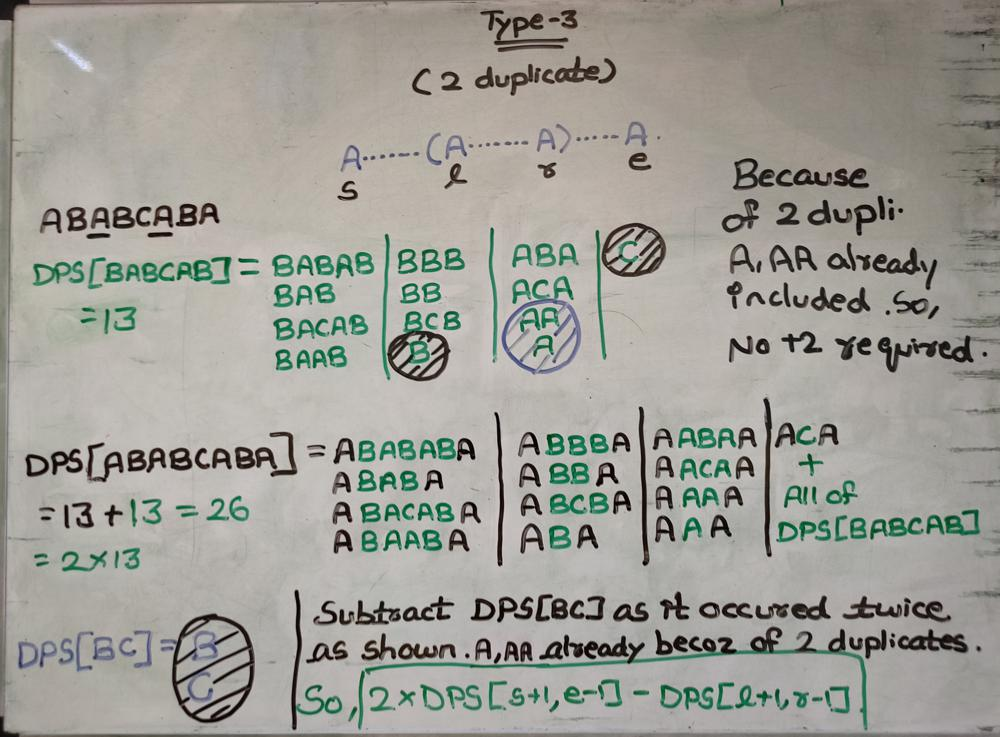

# C++ | CODE FOR BEGINNERS | EXPLAINED | REFERENCE FOR FUTURE

**Author:** Decode_Apocalypse
**Votes:** 25
**Link:** [https://leetcode.com/problems/count-different-palindromic-subsequences/solutions/2852870/](https://leetcode.com/problems/count-different-palindromic-subsequences/solutions/2852870/)

---

I will just be explaining the three cases part when the end and start point match, because the non matching case is very easy to understand already.






```
class Solution {
public:
    int dp[1001][1001];
    int helper(string &S, int start, int end){
        if(start>end){
            return 0;
        }
        if(start==end){
            return 1;
        }
        if(dp[start][end]!=-1){
            return dp[start][end];
        }
        int res=0;
        if(S[start]==S[end]){
            int left=start+1;
            int right=end-1; 
            while(left<=right && S[left]!=S[start]){
                left++;
            } 
            while(left<=right && S[right]!=S[end]){
                right--;
            } 
            
            if(left<right){   // a....(a...a)....a  , 2 duplicates found for end points (start and end)
                res+=2*helper(S,start+1,end-1)-helper(S,left+1,right-1); 
            } 
            else if(left==right){   // a...(a)....a,  1 duplicate found for end points (start and end)
                res+=2*helper(S,start+1,end-1)+1; 
            }  
            else{    // a(.........)a , no duplicate found for end points (start and end)
                res+=2*helper(S,start+1,end-1)+2; 
            } 
        }
        else{
            res+=helper(S,start+1,end)+helper(S,start,end-1)-helper(S,start+1,end-1);
        }
        return dp[start][end]=res<0 ? res+1000000007 : res%1000000007;
    }
    
    int countPalindromicSubsequences(string s) {
        memset(dp,-1,sizeof(dp));
        return helper(s,0,s.size()-1);
    }
};
```