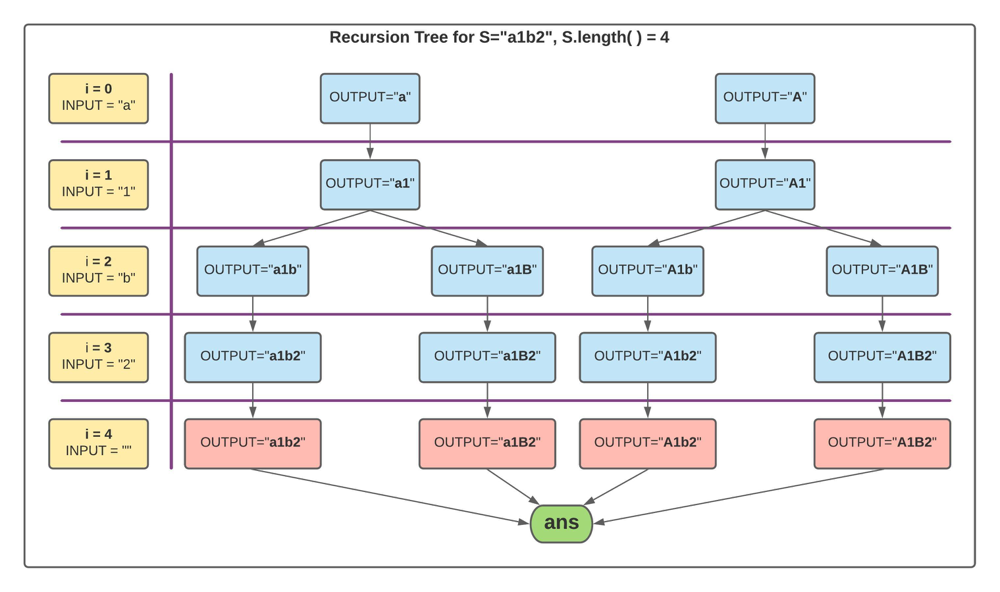

# C++ | Recursion | O(2^n), 0ms, Beats 100% | Easy to Understand

**Author:** akash2099
**Votes:** 172
**Link:** [https://leetcode.com/problems/letter-case-permutation/solutions/1068157/](https://leetcode.com/problems/letter-case-permutation/solutions/1068157/)

---

**EXPLANATION**
Consider the below **recursion tree** for input string **S="a1b2"**
Initially **OUTPUT = ""**.

By observing the above recursion tree, we come to the below *conclusion*.

There are two main *cases* which needs to be solved **recursively**:
- The element at the given index is a **digit**
	- Append the digit to the end of ```curr``` and go to *next index(i+1)*.
	
		```
		curr.push_back(s[i]);
		solve(curr,s,i+1);
		```
- The element at the given index is an **alphabet**, this case has two *sub cases*:
	- Append ```tolower(s[i])``` to ```curr``` and go to *next index (i+1)*.
	
		```
		//sub case 1, considering lower case
		string c1=curr;
		c1.push_back(tolower(s[i]));
		solve(c1,s,i+1);
		```
	- Append ```toupper(s[i])``` to ```curr``` and go to *next index (i+1)*.
	
		```
		//sub case 2, considering upper case
		string c2=curr;
		c2.push_back(toupper(s[i]));
		solve(c2,s,i+1);
		```

- If at any function call, the ```index = S.length()```, then ```curr``` string has one of our **output**, so save it in ```ans``` vector,

	```
	// if end of the string is reached
	if(i==s.length()){
		ans.push_back(curr); // push the current "curr" string to ans
		return;
	}
	```
- At the end of the recursion return ```ans```.

**COMPLETE CODE**
```
class Solution {
public:
    vector<string>ans;
    void solve(string curr,string s, int i){
        // if end of the string is reached
        if(i==s.length()){
            ans.push_back(curr); // push the current "curr" string to ans
            return;
        }
        
        if(isdigit(s[i])){ // case 1
            curr.push_back(s[i]);
            solve(curr,s,i+1);
        }
        else{ // case 2
            //sub case 1, considering lower case
            string c1=curr;
            c1.push_back(tolower(s[i]));
            solve(c1,s,i+1);
            
            //sub case 2, considering upper case
            string c2=curr;
            c2.push_back(toupper(s[i]));
            solve(c2,s,i+1);
        }
    }
    
    vector<string> letterCasePermutation(string S) {
        ans.clear();
        solve("",S,0);
        return ans;
    }
};
```

Considering n = S.length(), [maximum word length of output]
Also, maximum number of alphabetical characters in the string ```S``` = n.

**TIME COMPLEXITY**
**O(2^n)** [*From recursion tree, at each level nodes are increasing by power of 2*]

**SPACE COMPLEXITY**
**O(n)** [*Maximum depth of recursion tree*]