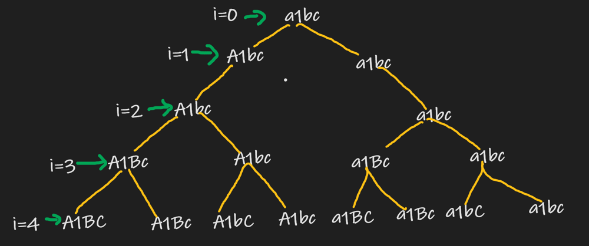

# Detailed c++ solution with recursion tree

**Author:** super_cool123
**Votes:** 37
**Link:** [https://leetcode.com/problems/letter-case-permutation/solutions/1068215/](https://leetcode.com/problems/letter-case-permutation/solutions/1068215/)

---

**Recursion Tree **

==>if we found a current character is alphabet then update that character to upper case
and then by backtracking we change the character to lowercase.
==> if the current charcter is number than left it as it is
*Plz comment if any doubts*
```
class Solution {
public:
    void solve(string S, vector<string>&ans,int i) {
        if(i == S.size()) { // base condition
            ans.push_back(S);
            return;
        }
        
        if(isalpha(S[i])) { // if the scanned character is alphabet
            S[i] = toupper(S[i]);
            solve(S,ans,i+1);
            S[i] = tolower(S[i]);
            solve(S,ans,i+1);
        }
        else { // if the scanned character is number
            solve(S,ans,i+1);
        }
    }
    vector<string> letterCasePermutation(string S) {
        vector<string>ans;
        solve(S,ans,0);
        return ans;
    }

};
```

