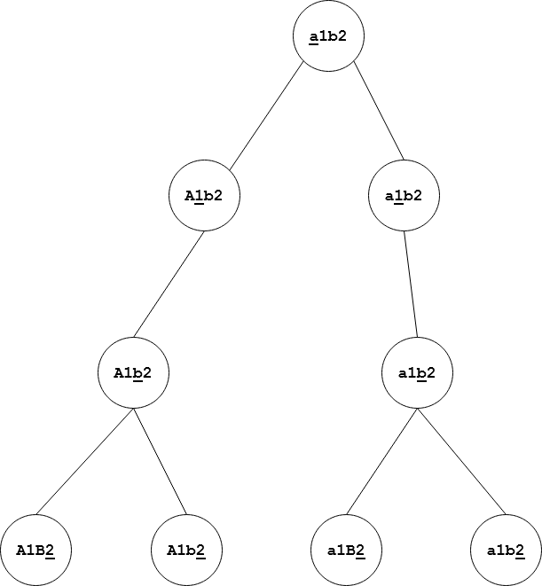

# [Java] backtracking; with recursion tree diagram (1ms, beats 100%)

**Author:** SonicBoomer
**Votes:** 56
**Link:** [https://leetcode.com/problems/letter-case-permutation/solutions/1068812/](https://leetcode.com/problems/letter-case-permutation/solutions/1068812/)

---

This problem is a good example of one solved using recursion and backtracking. 
For every letter that can be transformed (upper case to lower case and vice versa), you have to explore both options (with transformation, and without).

So, we make the change, and start a branch of recursion down that path. Then, we undo the change, to explore options that are possible only if we had not done that change.

Here is a visualization of the recursion tree for the string "a1b2" (one of the sample test cases).
The text inside each node is what the current instance of the recursion function sees when it is invoked.
The underlined character is the one being considered.



```java
class Solution {
    
    void recurse(char[] str, int pos, List<String> result) {
        //If we have reached a leaf in the recursion tree, save the result.
        if (pos == str.length) {
            result.add(new String(str));
            return;
        }
        
        //If char is not a letter, no processing required.
        if (Character.isLetter(str[pos])) {
            //If uppercase char, we make it lower case, and recurse.
            if (Character.isUpperCase(str[pos])) {
                str[pos] = Character.toLowerCase(str[pos]);
                
                //Start a new branch in the recursion tree, exploring options that are possible only if we had changed the case.
                recurse(str, pos + 1, result);
                
                //Backtracking. We undo the change so that we can start a new branch in the recursion tree.
                str[pos] = Character.toUpperCase(str[pos]);
            }
            //If lowercase, then we make it upper case, and recurse.
            else {
                str[pos] = Character.toUpperCase(str[pos]);
                recurse(str, pos + 1, result);
                //Backtracking as explained above.
                str[pos] = Character.toLowerCase(str[pos]);
            }
        }
        //This branch explores options that are possible only if the previously performed change (if any) hadn't happened.
        recurse(str, pos + 1,  result);
    }
    
    public List<String> letterCasePermutation(String S) {
        List<String> result = new ArrayList<>();
        recurse(S.toCharArray(), 0, result);
        return result;
    }
}
```

**Time Complexity**

`O(N * 2^N)`, where `N` is the string length. `2^N` because for each character, we have two choices (whether to transform it or not). The extra `N` factor is because once we reach a leaf, we have to copy the result into a new string (which costs `O(N)`).

**Space Complexity**

`O(N * 2^N)`. Similar reasoning as above. `2^N` combinations are possible, and we'll need `O(N)` space for each of them. I guess this includes the space required for recursion (`O(2^N)`), as well.

**Notes**

* Notice that we are passing a `char` array to the recursion function, not a whole `String`. Doing so would consume a lot of extra memory, since `String`s are immutable. Since we need the resultant strings only when we hit the end of recursion, they would be a waste of space anyway. A `StringBuilder` object would also serve the purpose.