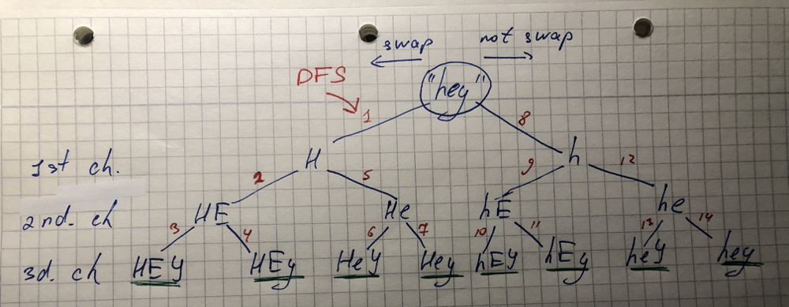

# Python clear solution

**Author:** DenysCoder
**Votes:** 201
**Link:** [https://leetcode.com/problems/letter-case-permutation/solutions/379928/](https://leetcode.com/problems/letter-case-permutation/solutions/379928/)

---

```
class Solution(object):
    def letterCasePermutation(self, S):
        """
        :type S: str
        :rtype: List[str]
        """
        def backtrack(sub="", i=0):
            if len(sub) == len(S):
                res.append(sub)
            else:
                if S[i].isalpha():
                    backtrack(sub + S[i].swapcase(), i + 1)
                backtrack(sub + S[i], i + 1)
                
        res = []
        backtrack()
        return res
```
Example of handling an input "hey":
