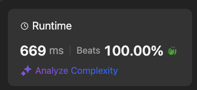

# `foldLeft` || Beats 100%

**Author:** ASRagab
**Votes:** 0
**Link:** [https://leetcode.com/problems/letter-case-permutation/solutions/5880224/](https://leetcode.com/problems/letter-case-permutation/solutions/5880224/)

---

# Intuition
For each letter in the String we need an upper case and a lower case version of that string at that letter

# Approach
Start with the initial string, check to see if the current character is a letter, and then for each existing solution add an uppercased and lowercased version of the string at that character (update) to the accumulator

# Complexity
- Time complexity: $$O(2^n)$$
<!-- Add your time complexity here, e.g. $$O(n)$$ -->

- Space complexity: $$O(2^n)$$
<!-- Add your space complexity here, e.g. $$O(n)$$ -->

# Code
```scala []
object Solution {
    def letterCasePermutation(s: String): List[String] =
        s.indices.foldLeft(List(s)) { case (acc, i) => 
            val char = s(i)
            if char.isLetter then 
                acc.flatMap(cs => List(cs.updated(i, char.toUpper), cs.updated(i, char.toLower)))
            else acc
        }
}
```

