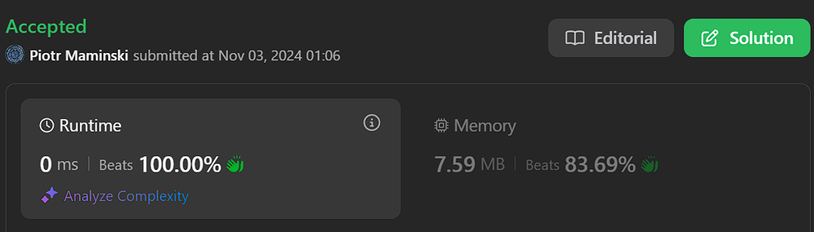

# ✅Beats 100% | Short and Simple | O(n) |  List Most Common String Interview

**Author:** Piotr_Maminski
**Votes:** 137
**Link:** [https://leetcode.com/problems/rotate-string/solutions/5999665/](https://leetcode.com/problems/rotate-string/solutions/5999665/)

---


## Code (all beats 100%)
```python3 []
class Solution:
    def rotateString(self, s: str, goal: str) -> bool:
        if len(s) != len(goal):
            return False
        return goal in s + s
```
```cpp []
class Solution {
public:
    bool rotateString(string s, string goal) {
        if (s.length() != goal.length()) {
            return false;
        }
        return (s + s).find(goal) != string::npos;
    }
};
```
```java []
class Solution {
    public boolean rotateString(String s, String goal) {
        if (s.length() != goal.length()) {
            return false;
        }
        return (s + s).contains(goal);
    }
}
```
```csharp []
public class Solution {
    public bool RotateString(string s, string goal) {
        if (s.Length != goal.Length) {
            return false;
        }
        return (s + s).Contains(goal);
    }
}
```
```golang []
func rotateString(s string, goal string) bool {
    if len(s) != len(goal) {
        return false
    }
    return strings.Contains(s+s, goal)
}
```
```swift []
class Solution {
    func rotateString(_ s: String, _ goal: String) -> Bool {
        if s.count != goal.count {
            return false
        }
        return (s + s).contains(goal)
    }
}
```
```javascript [JS]
// JavaScript
function rotateString(s, goal) {
    if (s.length !== goal.length) {
        return false;
    }
    return (s + s).includes(goal);
}
```
```typescript [TS]
// TypeScript
function rotateString(s: string, goal: string): boolean {
    if (s.length !== goal.length) {
        return false;
    }
    return (s + s).includes(goal);
}
```
```rust []
impl Solution {
    pub fn rotate_string(s: String, goal: String) -> bool {
        if s.len() != goal.len() {
            return false;
        }
        let doubled = s.clone() + &s;
        doubled.contains(&goal)
    }
}
```
```ruby []
def rotate_string(s, goal)
    return false if s.length != goal.length
    (s + s).include?(goal)
end
```
### Complexity 
- Time complexity: O(n) because buid-in Boyer\u2013Moore\u2013Horspool algorithm or simmilar
[[1]](https://github.com/gcc-mirror/gcc/blob/master/libstdc%2B%2B-v3/include/bits/basic_string.tcc) [[2]](https://github.com/llvm/llvm-project/blob/main/libcxx/include/string) [[3]](https://github.com/python/cpython/blob/main/Objects/stringlib/fastsearch.h) [[4]](https://github.com/dotnet/runtime/blob/main/src/libraries/System.Private.CoreLib/src/System/String.Searching.cs) [[5]](https://github.com/openjdk/jdk/blob/master/src/java.base/share/classes/java/lang/String.java)


- Space complexity: O(n)

# Explanation

---


## Intuition
The key insight is that when you concatenate a string with itself (s + s), it contains all possible rotations of the original string. 

For example, if s = "abcde", then s + s = "abcdeabcde" contains all rotations: "abcde", "bcdea", "cdeab", "deabc", "eabcd".

## Approach

1. First, check if lengths are equal (if not, rotation is impossible)
2. Create a concatenated string s + s which contains all possible rotations
3. Check if goal is a substring of s + s
- s = "abcde", goal = "cdeab"
- s + s = "abcdeabcde"
- "cdeab" is present in "abcdeabcde", so return **True**

---

# Still dont understand string/array/pointers

**Video with IMO best explained:** google "Pointers in C / C++ [Full Course]"
(leetscode flag video in solution :)

# Most common String Interview Problems

From the most to the least common (from GitHub/reddit):


 [[8. String to Integer (atoi)]](https://leetcode.com/problems/string-to-integer-atoi/description/)
  [[20. Valid Parentheses]](https://leetcode.com/problems/valid-parentheses/description/) 
[[28. Implement strStr()]](https://leetcode.com/problems/find-the-index-of-the-first-occurrence-in-a-string/description/) [
[65. Valid Number]](https://leetcode.com/problems/valid-number/description/)
 [[125. Valid Palindrome]](https://leetcode.com/problems/valid-palindrome/description/) 
[[680. Valid Palindrome II]](https://leetcode.com/problems/valid-palindrome-ii) 
[[49. Group Anagrams]](https://leetcode.com/problems/group-anagrams/description/) 
[[91. Decode Ways]](https://leetcode.com/problems/decode-ways/description/)


[List Most Common String Problem](https://leetcode.com/problem-list/atf8zle5/)

####  [Interview Questions and Answers Repository](https://github.com/RooTinfinite/Interview-questions-and-answers)

# Interview Priorities

| Patterns                | Difficulty | Interview Frequently           |
|----------------------|---------------------|----------------------|
| **Basic [Array](https://leetcode.com/problems/two-sum/solutions/5999466/beats-100-explained-step-by-step-list-most-common-array-inverview) / String**                 | **Easy**              | **Very High**               |
| **Two Pointers**         | **Easy**                | **High**                 |
| **Sliding Window**       | **Easy**                | **High**                 |
| **Breadth-First Search** | **Easy**                | **High**                 |
| **Depth-First Search**   | **Medium**              | **High**                 |
| **[Backtracking](https://leetcode.com/problems/letter-combinations-of-a-phone-number/solutions/5976064/complex-backtracking-interview-prepare-list-of-backtracking-questions-beats-100)**         | **High**                | **High**                 |
| Heap                 | Medium              | Medium               |
| Binary Search        | Easy                | Medium               |
| [Dynamic Programming](https://leetcode.com/problem-list/atwflvk7/)  | High                | Medium               |
| Divide and Conquer   | Medium              | Low                  |
| Trie                 | Medium              | Low                  |
| Union Find           | Medium              | Low                  |
| Greedy               | High                | Low                  |




