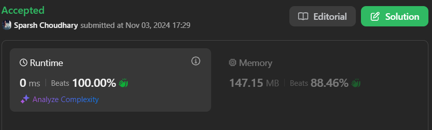

# 🔥BEATS 💯 % 🎯 |✨SUPER EASY BEGINNERS 👏

**Author:** CodeWithSparsh
**Votes:** 2
**Link:** [https://leetcode.com/problems/rotate-string/solutions/6002055/](https://leetcode.com/problems/rotate-string/solutions/6002055/)

---




---

### Intuition
To determine if one string is a rotation of another, we can use the fact that if `s` is rotated to form `goal`, `goal` must be a substring of `s + s`. This approach avoids manual string rotation checks and achieves a simpler, more efficient solution.

### Approach
1. First, check if the lengths of `s` and `goal` are the same. If they are not, return `false`.
2. Concatenate `s` with itself, forming `s + s`.
3. Check if `goal` is a substring of `s + s`. If it is, return `true`; otherwise, return `false`.

### Complexity
- **Time Complexity**: \\(O(n^2)\\) in the brute force approach but \\(O(n)\\) with the optimized concatenation approach.
- **Space Complexity**: \\(O(n)\\), used for storing the concatenated string in the optimized approach.

---

### Code Implementations

####  (Brute-force approach)

```dart
class Solution {
  bool rotateString(String s, String goal) {
    int n1 = s.length;
    int n2 = goal.length;
    if (n1 != n2) return false;

    for (int i = 0; i < n1; i++) {
      String check = s.substring(i) + s.substring(0, i);
      if (check == goal) return true;
    }
    return false;
  }
}
```
####  Optimised approach

```dart []
class Solution {
  bool rotateString(String s, String goal) {
    return s.length == goal.length && (s + s).contains(goal);
  }
}
```

```python []
class Solution:
    def rotateString(self, s: str, goal: str) -> bool:
        return len(s) == len(goal) and goal in (s + s)
```

```javascript []
function rotateString(s, goal) {
    return s.length === goal.length && (s + s).includes(goal);
}
```


```java []
public class Solution {
    public boolean rotateString(String s, String goal) {
        return s.length() == goal.length() && (s + s).contains(goal);
    }
}
```

```cpp []
#include <string>
using namespace std;

class Solution {
public:
    bool rotateString(string s, string goal) {
        return s.size() == goal.size() && (s + s).find(goal) != string::npos;
    }
};
```

```c []
#include <stdbool.h>
#include <string.h>

bool rotateString(char *s, char *goal) {
    int len_s = strlen(s);
    int len_goal = strlen(goal);
    if (len_s != len_goal) return false;
    
    char *concat = malloc(2 * len_s + 1);
    strcpy(concat, s);
    strcat(concat, s);
    bool result = strstr(concat, goal) != NULL;
    free(concat);
    return result;
}
```

```go []
func rotateString(s string, goal string) bool {
    return len(s) == len(goal) && strings.Contains(s+s, goal)
}
```

---

This solution leverages an efficient approach by checking for the substring in the doubled string (`s + s`), reducing unnecessary rotation calculations and providing better performance than the brute-force method.

---

 {:style='width:250px'}
