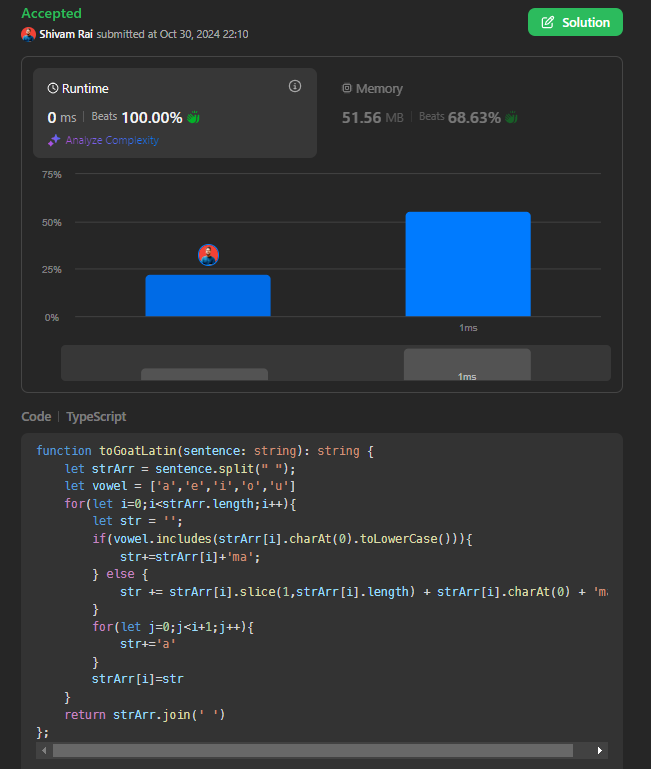

# Beats 100% users || Time: O(n) || Simple Typescript Solution

**Author:** shivamrai83
**Votes:** 0
**Link:** [https://leetcode.com/problems/goat-latin/solutions/5987179/](https://leetcode.com/problems/goat-latin/solutions/5987179/)

---

# Approach
1. Split the string into an array. to iterate over.
2. Then loop over that array.
3. Use condition to identify first character is Vowel or not.
4. simply add the condition defined in problem statement.
5. after if else add number of 'a' according to index.
That's It Easy Peezy!

<!-- Describe your approach to solving the problem. -->


# Complexity
- Time complexity: O(n)
<!-- Add your time complexity here, e.g. $$O(n)$$ -->


# Code
```typescript []
function toGoatLatin(sentence: string): string {
    let strArr = sentence.split(" ");
    let vowel = ['a','e','i','o','u']
    for(let i=0;i<strArr.length;i++){
        let str = '';
        if(vowel.includes(strArr[i].charAt(0).toLowerCase())){
            str+=strArr[i]+'ma';
        } else {
            str += strArr[i].slice(1,strArr[i].length) + strArr[i].charAt(0) + 'ma';
        }
        for(let j=0;j<i+1;j++){
            str+='a'
        }
        strArr[i]=str
    }
    return strArr.join(' ')
};
```