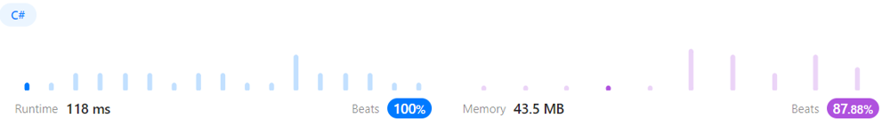

# Beats 100% Solution

**Author:** Rysev_Dmitry
**Votes:** 1
**Link:** [https://leetcode.com/problems/positions-of-large-groups/solutions/3285807/](https://leetcode.com/problems/positions-of-large-groups/solutions/3285807/)

---



# Code
```
public class Solution {
    public IList<IList<int>> LargeGroupPositions(string s) {
        IList<IList<int>> result = new List<IList<int>>();
        int start = 0, count = 1;

        for(int i = 0; i < s.Length; i++){
            if(i < s.Length - 1 && s[i] == s[i + 1]){
                count++;
            }
            else{
                if(count > 2){
                    result.Add(new List<int>() { start, i });
                }

                count = 1;
                start = i + 1;
            }
        }

        return result;
    }
}
```