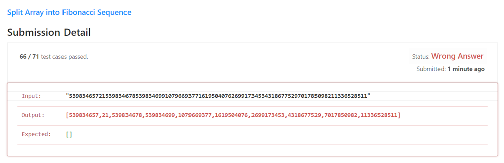

# Correct solution is being flagged as wrong, help needed to understand!

**Author:** thereforeo
**Votes:** 2
**Link:** [https://leetcode.com/problems/split-array-into-fibonacci-sequence/solutions/1418113/](https://leetcode.com/problems/split-array-into-fibonacci-sequence/solutions/1418113/)

---

So I solved this problem, and I got the following error message:



However, if you double check my output, it is perfectly correct.
Input is: "539834657215398346785398346991079669377161950407626991734534318677529701785098211336528511"
And my output is: [539834657,21,539834678,539834699,1079669377,1619504076,2699173453,4318677529,7017850982,11336528511]

Running this quick checkup code on the terminal:
```
>>> a = [539834657,21,539834678,539834699,1079669377,1619504076,2699173453,4318677529,7017850982,11336528511]
>>> for i in range(len(a)-2):
...     print(i, ":", a[i] + a[i+1] == a[i+2])
...
0 : True
1 : True
2 : True
3 : True
4 : True
5 : True
6 : True
7 : True
```

So, why is LeetCode expecting the result to be [] instead of my output?
