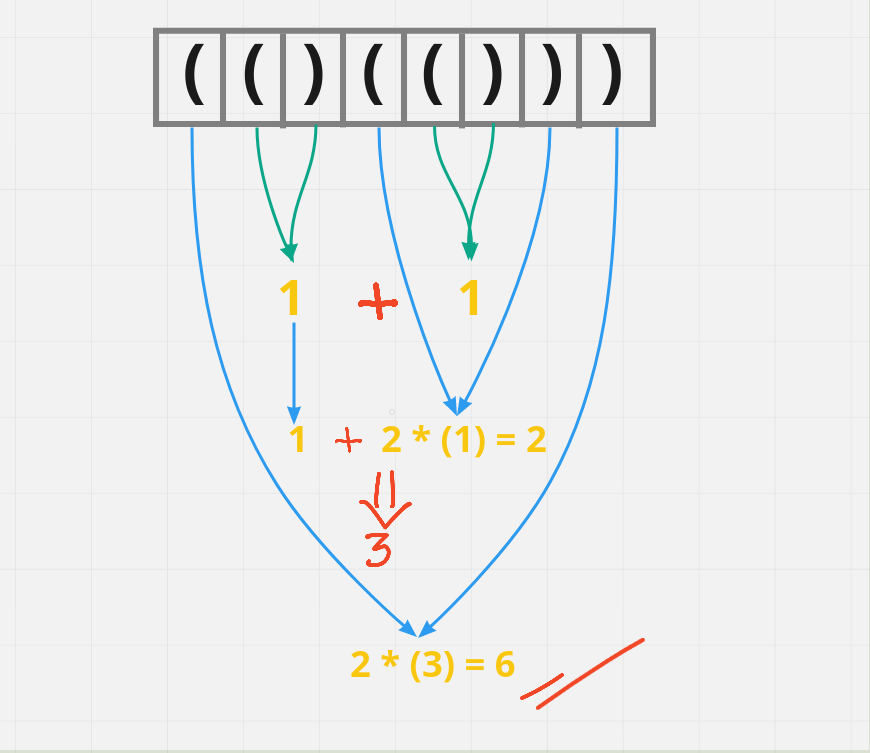
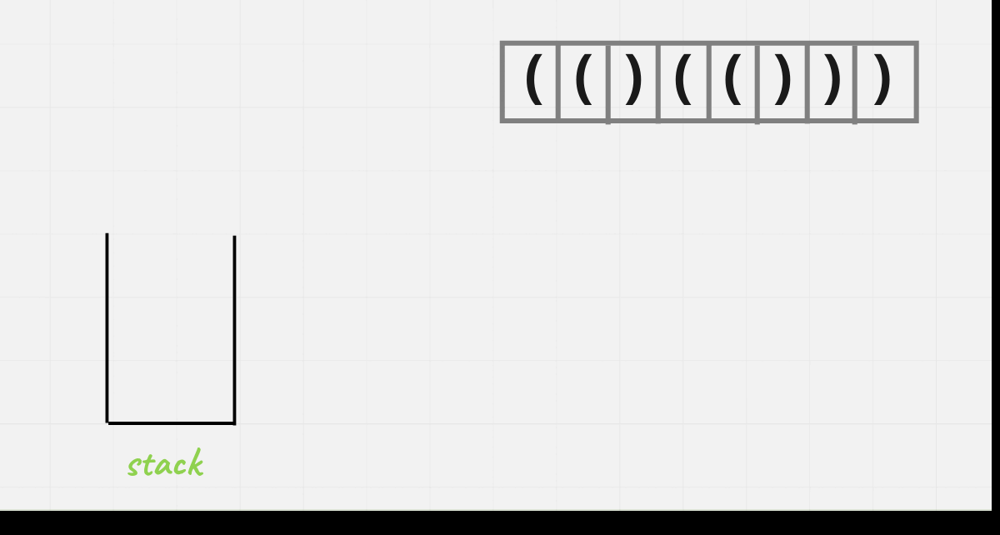

# [Java/C++] Visually Explained!!

**Author:** hi-malik
**Votes:** 371
**Link:** [https://leetcode.com/problems/score-of-parentheses/solutions/1856519/](https://leetcode.com/problems/score-of-parentheses/solutions/1856519/)

---

How's going Ladies - n - Gentlemen, today we are going to solve another coolest problem i.e. **Score of Parentheses**

In order to solve this problem we are assigned with few rules :-
```
"()" has score 1.
AB has score A + B, where A and B are balanced parentheses strings.
(A) has score 2 * A, where A is a balanced parentheses string.
```

Let's understand our rule's first of all :-
* If our input string is **"()"** then our score will be **`1`**, so this is our first rule


* If we have input string **"()()"** then our score will be **1 + 1** i.e. **`2`**, where `1` is a score of a balanced parentheses. So, this is our second rule
* Now last rule say's, if we have given something like **"(())"** in our input string, our score will be **2 X 1** i.e. **`2`**, it means that we have something like `nested parenthesis`. Then multiply it by 2.

Let's take one example, inorder to solve this problem :-

**Input :** "( ( ) ( ( ) ) )"
**Output :** 6



Okay, so first thing came in our mind is can we solve this problem using stack, and I say yes we'll solve this problem using stack.

* First create one stack of **Integer** not ~~**Character**~~
* So, as we are using Integer, what we gonna put in stack is intially **0** when we encounter `(`
* And we'll calculate the score when we encounter `)`

```
Let's Understand it visually :-
```



*I hope you got the idea* **Let's Code it up :-**

**Java**
```
class Solution {
    public int scoreOfParentheses(String s) {
        Stack<Integer> st = new Stack<>();
        int score = 0;
        for(int i = 0; i < s.length(); i++){
            char ch = s.charAt(i);
            if(ch == '('){
                st.push(score);
                score = 0;
            }
            else {
                score = st.pop() + Math.max(2 * score, 1);
            }
        }
        return score;
    }
}
```
**C++**
```
class Solution {
public:
    int scoreOfParentheses(string s) {
        stack<int> st;
        int score = 0;
        for(int i = 0; i < s.size(); i++){
            if(s[i] == '('){
                st.push(score);
                score = 0;
            }
            else {
                score = st.top() + max(2 * score, 1);
                st.pop();
            }
        }
        return score;
    }
};
```

ANALYSIS :-
* **Time Complexity :-** BigO(N)

* **Space Complexity :-** BigO(N)
