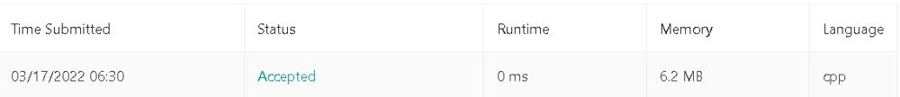

# ✅ C++ || Explained With Algorithm || 0ms || 100 % || Easy & Simple

**Author:** knockcat
**Votes:** 71
**Link:** [https://leetcode.com/problems/score-of-parentheses/solutions/1856417/](https://leetcode.com/problems/score-of-parentheses/solutions/1856417/)

---

# 856. Score of Parentheses
**KNOCKCAT**
```
1. Easy C++
2. Line by Line Explanation with Comments.
3. Detailed Explanation \u2705
4. Stack Approach with initution.
5. Please Upvote if it helps\u2B06\uFE0F
6. Link to my Github Profile contains a repository of Leetcode with all my Solutions. \u2B07\uFE0F
	// \uD83D\uDE09If you Like the repository don't foget to star & fork the repository\uD83D\uDE09
```
``` ```
[LeetCode](http://github.com/knockcat/Leetcode) **LINK TO LEETCODE REPOSITORY**
``` ```
Please upvote my comment so that i get to win the 2022 giveaway and motivate to make such discussion post.
**Happy new Year 2023 to all of you**
**keep solving keep improving**
Link To comment
[Leetcode Give away comment](https://leetcode.com/discuss/general-discussion/2946993/2022-Annual-Badge-and-the-Giveaway/1734919)

**ALGORITHM**
1. **"()"** has a **score of 1.**
2. **"xy**" has a **score of x + y** ,  here x & y are balanced pairs of balanced parenthese.
3. **"(x) "** has a **score of x , (i.e) 2 * score of x.**
	Example.
	**Input: str = \u201C()()\u201D
	Output: 2**
		Explanation: There are are two individual pairs of balanced parenthesis \u201C() ()\u201D. Therefore, **score = score of \u201C()\u201D + score of \u201C()\u201D = 1 + 1 = 2**

	Input: str = \u201C(())\u201D
	Output: 2
		Explanation: Since the input is of the form \u201C(x)\u201D, **the total score = 2 * score of \u201C()\u201D = 2 * 1 = 2**
		
* **Take a Stack**, **Iterate  over the characters of string.**
* For every i**th character check if the character is \u2018(\u2018 or not.** If found to be true, then **insert the character score into the stack.**
* Initialize a **stack to store the current traversed character score** of inner balanced parenthesis.
* For every i check for the conditions.
	* **if the current character is '(' push the current score into stack** , enter the next inner layer and **reset score to 0.**
	* if the **current character is ')'** then **ind score will be doubled and will be at  least one .**
	* we **exit the current level**  and **set ind = stack.top() + max(ind * 2, 1).**
	* and pop the  score from the stack.
	
ANALYSIS :-
* 	**Time Complexity : O(N)**

* 	**Space Complexity : O(N)**




**CODE WITH EXPLANATION**
```
					// \uD83D\uDE09\uD83D\uDE09\uD83D\uDE09\uD83D\uDE09Please upvote if it helps \uD83D\uDE09\uD83D\uDE09\uD83D\uDE09\uD83D\uDE09
class Solution {
public:
    int scoreOfParentheses(string s) {
        
        stack<int> st;
        int ind = 0;
        
        for(auto i : s)
        {
			// if we find open parenthesis
			// push the current score into the stack
            if(i == '(')
            {
                st.push(ind);
				// reset the score to 0
                ind = 0;
            }
            else // if we find close parenthesis
            {
                ind = st.top() + max(ind*2 ,1);
                st.pop();
            }
                
        }
        return ind;
        
    }
};
```