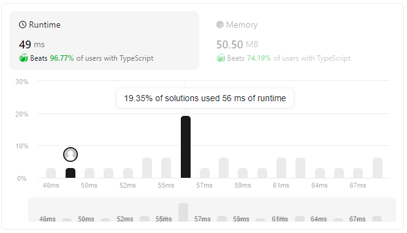

# for-loop + slice, 49ms(Beats 96.77%) 50.50MB (Beats 74.19%)

**Author:** morris367
**Votes:** 0
**Link:** [https://leetcode.com/problems/score-of-parentheses/solutions/4877066/](https://leetcode.com/problems/score-of-parentheses/solutions/4877066/)

---

# Intuition
<!-- Describe your first thoughts on how to solve this problem. -->

# Approach
1. find open and end parentheses
2. slice and call function self

# Complexity
- Time complexity:
<!-- Add your time complexity here, e.g. $$O(n)$$ -->

- Space complexity:
<!-- Add your space complexity here, e.g. $$O(n)$$ -->

# Code
```
function scoreOfParentheses(s: string): number {
    let par: number = 0
    let idx: number = 0
    let score: number = 0

    for (let i: number = 0; i < s.length; i++) {
        if (s[i] == "(") {
            if (par == 0) idx = i
            par++
        } else {
            par--
            if (par == 0) {
                (i - idx == 1)
                    ? score++
                    : score += 2 * scoreOfParentheses(s.slice(idx + 1, i))
            }
        }
    }

    return score
};
```

