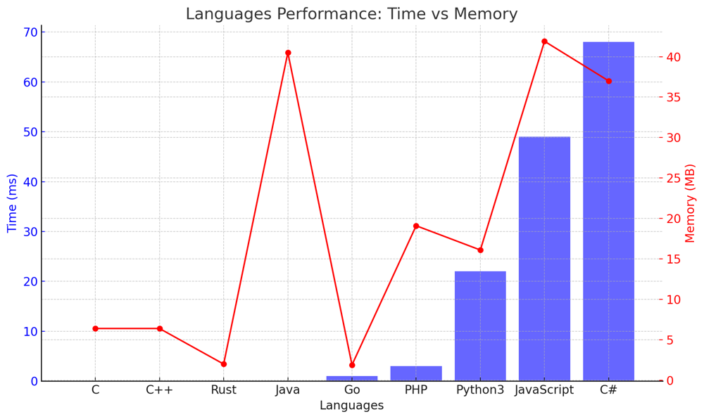

# ✅ 97.47% Reverse Traversal

**Author:** vanAmsen
**Votes:** 149
**Link:** [https://leetcode.com/problems/decoded-string-at-index/solutions/4094647/](https://leetcode.com/problems/decoded-string-at-index/solutions/4094647/)

---

# Interview Guide: "Decoded String at Index" Problem

## Problem Understanding

The "Decoded String at Index" problem requires you to decode a given string based on specific rules. When a letter is encountered, it's written as is; when a digit is encountered, the decoded string so far is repeated that many times. Your task is to return the $$k$$th character in the decoded string.

## Key Points to Consider

### 1. Understand the Constraints

Before starting with the solution, grasp the constraints. The length of string `s` is between 2 and 100, and `s` consists of lowercase English letters and digits from 2 to 9. This provides insight into feasible solutions in terms of time and space complexity.

### 2. Reverse Traversal

One of the efficient methods to solve this problem is to traverse the string in reverse, starting from the end and moving toward the beginning. This avoids having to actually build the complete decoded string, which can be very long.

### 3. Handling Digits and Letters

When traversing the string, if a letter is encountered, the length of the decoded string reduces by one. If a digit is encountered, the length of the decoded string is divided by that digit. This simulates the decoding process in reverse.

### 4. Explain Your Thought Process

Always articulate the rationale behind your approach. Explain why reverse traversal is efficient and how you simulate the decoding process without actually forming the full string.

## Conclusion

The "Decoded String at Index" problem demonstrates the importance of understanding the problem's constraints and requirements. By simulating the decoding process in reverse, you avoid memory issues and provide an efficient solution.

---

## Live Coding & Explain
https://youtu.be/UgSrm6LwXqk?si=WzBk-tHvhzNO8cNI

# Approach: Reverse Traversal

To tackle the "Decoded String at Index" problem using reverse traversal, we simulate the decoding process in reverse:

## Key Data Structures:

- **length**: An integer variable to keep track of the current length of the decoded string.

## Enhanced Breakdown:

1. **Initialization**:
   - Initialize the length variable to 0.
  
2. **Forward Traversal**:
   - Traverse the string from start to end, updating the length based on whether you encounter a letter or a digit.

3. **Reverse Traversal**:
   - Start from the end of the string. If you encounter a digit, divide the length by the digit and update $$k$$ using modulo operation. If you encounter a letter and $$k$$ equals 0 or length, return the letter.

# Complexity:

**Time Complexity:** 
- The solution involves two traversals over the string, leading to a time complexity of $$ O(n) $$, where `n` is the length of the string `s`.

**Space Complexity:** 
- The space complexity is $$ O(1) $$ since the solution doesn't use any additional data structures that scale with the input size. 

# Code Reverse Traversal
``` Python []
class Solution:
    def decodeAtIndex(self, s: str, k: int) -> str:
        length = 0
        i = 0
        
        while length < k:
            if s[i].isdigit():
                length *= int(s[i])
            else:
                length += 1
            i += 1
        
        for j in range(i-1, -1, -1):
            char = s[j]
            if char.isdigit():
                length //= int(char)
                k %= length
            else:
                if k == 0 or k == length:
                    return char
                length -= 1
```
``` Go []
func decodeAtIndex(s string, k int) string {
    length := int64(0)
    i := 0

    for length < int64(k) {
        if s[i] >= '0' && s[i] <= '9' {
            length *= int64(s[i] - '0')
        } else {
            length++
        }
        i++
    }

    for j := i - 1; j >= 0; j-- {
        if s[j] >= '0' && s[j] <= '9' {
            length /= int64(s[j] - '0')
            k %= int(length)
        } else {
            if k == 0 || k == int(length) {
                return string(s[j])
            }
            length--
        }
    }

    return ""
}
```
``` Rust []
impl Solution {
    pub fn decode_at_index(s: String, mut k: i32) -> String {
        let mut length: i64 = 0;
        let mut i = 0;
        let bytes = s.as_bytes();

        while length < k as i64 {
            if bytes[i].is_ascii_digit() {
                length *= (bytes[i] as char).to_digit(10).unwrap() as i64;
            } else {
                length += 1;
            }
            i += 1;
        }

        for j in (0..i).rev() {
            if bytes[j].is_ascii_digit() {
                length /= (bytes[j] as char).to_digit(10).unwrap() as i64;
                k = (k as i64 % length) as i32;
            } else {
                if k == 0 || k as i64 == length {
                    return (bytes[j] as char).to_string();
                }
                length -= 1;
            }
        }

        return "".to_string();
    }
}
```
``` C++ []
class Solution {
public:
    std::string decodeAtIndex(string s, int k) {
        long long length = 0;
        int i = 0;
        
        while (length < k) {
            if (isdigit(s[i])) {
                length *= s[i] - '0';
            } else {
                length++;
            }
            i++;
        }
        
        for (int j = i - 1; j >= 0; j--) {
            if (isdigit(s[j])) {
                length /= s[j] - '0';
                k %= length;
            } else {
                if (k == 0 || k == length) {
                    return std::string(1, s[j]);  // Convert char to std::string
                }
                length--;
            }
        }
        
        return ""; // Default return, should never reach here given problem constraints
    }
};
```
``` C []
char* decodeAtIndex(char* s, int k) {
    long long length = 0;
    int i = 0;

    while (length < k) {
        if (isdigit(s[i])) {
            length *= s[i] - '0';
        } else {
            length++;
        }
        i++;
    }

    static char result[2];  // static to return a local array, initialized to hold one character and a null terminator
    for (int j = i - 1; j >= 0; j--) {
        if (isdigit(s[j])) {
            length /= s[j] - '0';
            k %= length;
        } else {
            if (k == 0 || k == length) {
                result[0] = s[j];
                return result;
            }
            length--;
        }
    }

    return "";
}
```
``` Java []
public class Solution {
    public String decodeAtIndex(String s, int k) {
        long length = 0;
        int i = 0;

        while (length < k) {
            if (Character.isDigit(s.charAt(i))) {
                length *= s.charAt(i) - '0';
            } else {
                length++;
            }
            i++;
        }

        for (int j = i - 1; j >= 0; j--) {
            if (Character.isDigit(s.charAt(j))) {
                length /= s.charAt(j) - '0';
                k %= length;
            } else {
                if (k == 0 || k == length) {
                    return Character.toString(s.charAt(j));
                }
                length--;
            }
        }

        return "";
    }
}
```
``` JavaScript []
var decodeAtIndex = function(s, k) {
    let length = 0;
    let i = 0;

    while (length < k) {
        if (!isNaN(s[i])) {
            length *= Number(s[i]);
        } else {
            length++;
        }
        i++;
    }

    for (let j = i - 1; j >= 0; j--) {
        if (!isNaN(s[j])) {
            length /= Number(s[j]);
            k %= length;
        } else {
            if (k === 0 || k === length) {
                return s[j];
            }
            length--;
        }
    }

    return "";
};
```
``` C# []
public class Solution {
    public string DecodeAtIndex(string s, int k) {
        long length = 0;
        int i = 0;

        while (length < k) {
            if (char.IsDigit(s[i])) {
                length *= s[i] - '0';
            } else {
                length++;
            }
            i++;
        }

        for (int j = i - 1; j >= 0; j--) {
            if (char.IsDigit(s[j])) {
                length /= s[j] - '0';
                k %= (int)length;
            } else {
                if (k == 0 || k == length) {
                    return s[j].ToString();
                }
                length--;
            }
        }

        return "";
    }
}
```
``` PHP []
class Solution {
    function decodeAtIndex($s, $k) {
        $length = 0;
        $i = 0;

        while ($length < $k) {
            if (is_numeric($s[$i])) {
                $length *= intval($s[$i]);
            } else {
                $length++;
            }
            $i++;
        }

        for ($j = $i - 1; $j >= 0; $j--) {
            if (is_numeric($s[$j])) {
                $length /= intval($s[$j]);
                $k %= $length;
            } else {
                if ($k == 0 || $k == $length) {
                    return $s[$j];
                }
                $length--;
            }
        }

        return "";
    }
}
```

## Performance

| Language   | Time (ms) | Memory (MB) |
|------------|-----------|-------------|
| Rust       | 0 ms      | 2 MB        |
| C          | 0 ms      | 6.4 MB      |
| C++        | 0 ms      | 6.4 MB      |
| Java       | 0 ms      | 40.5 MB     |
| Go         | 1 ms      | 1.9 MB      |
| PHP        | 3 ms      | 19.1 MB     |
| Python3    | 22 ms     | 16.1 MB     |
| JavaScript | 49 ms     | 41.9 MB     |
| C#         | 68 ms     | 37 MB       |




The "Decoded String at Index" problem emphasizes the importance of simulating processes and thinking in reverse to find efficient solutions. It's a testament to the idea that sometimes, the direct approach isn't the most efficient one. \uD83D\uDE80\uD83E\uDDE0\uD83D\uDC69\u200D\uD83D\uDCBB\uD83D\uDC68\u200D\uD83D\uDCBB.
