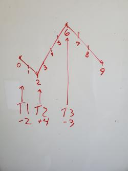
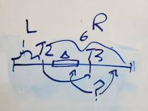
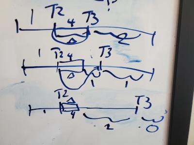
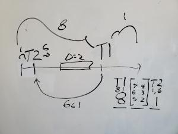
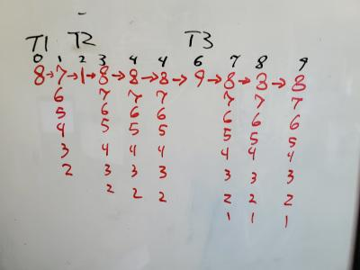
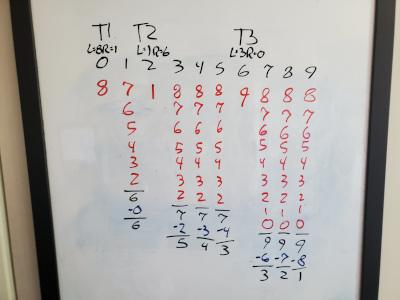
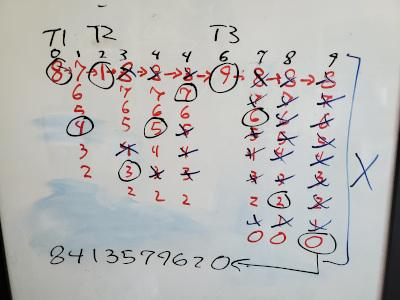
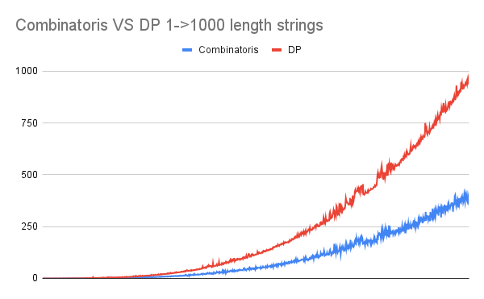

# Combinatorics Approach 2x+ times faster than DP

**Author:** jmavis
**Votes:** 0
**Link:** [https://leetcode.com/problems/valid-permutations-for-di-sequence/solutions/5047671/](https://leetcode.com/problems/valid-permutations-for-di-sequence/solutions/5047671/)

---

# Intuition
First, we simplify the input into a series of transitions up and down by some amounts. III becomes a transition with +3 and DDDDD represents one with -4. Here is a representation of "DDIIIIDDD" with 3 transition points.



This approach is based on an important observation of the relation between the solution at transition i to i+1.
  

To get from T1 to T2 we would need to start with a value that could decrease by 2. T2 to T3 increase by 4 and T3 to End decrease by 3.
  

We have the numbers 0-9 to possibly insert at each transition point. We couldn't go from T1 to T2 starting with 0 or 1 because there aren't two numbers below those. We can only have a starting value at T1 in the range 2-9 that can get to T2. Let \u0394 = the number of elements needed to move from T[i] to T[i+1]. If T[i] is increasing then all \u0394 numbers selected must be greater than the transition's start and less than if the transition is down.

For T3 we can only get to the end with a starting value from 3-9. If we get to T3 with a valid combination of 0-9 then we have only 3 remaining.

Let's see how many ways to get from T3 to the end from the starting value X with Y being all the combinations of 0-9.
Here are a few:
If X is 7 and Y is [0,1,2] there is one way [2,1,0]
If X is 7 and Y is [0,5,6] there is one way [6,5,0]
If X is 6 and Y is [0,1,2] there is one way [2,1,0]
if X is 3 and Y is [0,1,4] there are no ways because 4 cannot be placed to the right of T3's 3 starting point.

You can try this with every combination and we can see that as long as all in Y are less than X there is one possible path to the end. Otherwise, there are 0.

Here we get our key insight. If we reach T3 with 3 numbers to the less than of T3's start the answer is always 1 else 0. **The starting value at T[i] doesn't matter!** The only thing that influences the result from point T3 is the number to the left of the starting point. Similarly, if T[i] is decreasing then the count to the right is the only thing that matters.


Let's go one step further to T2. When arriving at T2 there will have been 2 numbers used to get so 7 values remaining to choose from. If we arrive at T2 with at least 4 values to the right we can get to T3 otherwise there are 0 ways. To move from T2 to T3 we will need to consume 4 values greater than T2's starts. But if we arrive at T3 with less than 3 to the left there are no solutions. If for example, we know T2 has 6 values to the right and 1 to the left. When we move from T2 consuming 4 of those right values how do we know what value T3 would start with and how many it has to the left or right?



  
  

There are 3 possibilities for the remaining 2 values to the right of T2:

1. Both are to the right of T3

2. One is left and one is right

3. Both to the left of T3



  
  

Looking at the cases from T3's perspective:

1. We know T3 has 2 to the right and 1 to the left since T3 is greater than T2 and T2 is greater than the 1 to the left.

2. Left = 2 and right = 1

3. Left = 3 and right = 0

  

Hey, we know the answers to all of those cases! Only case 3 leaves us with a single possible combination. This means that at point T2 we need to select 4 numbers and have 2 still to the left of T3. Since T3 is the end point we can't select that and it consumes one of the 6 to the right of T2. Then we have to fill in 3 "slots" from 5 numbers. T2 _ _ _ T3

  

Here is where combinatorics comes in. How many ways can we select 3 of the 5 numbers? That is expressed as 5 choose 3. Which can be calculated with a formula: Ck(n) = n!/(k!(n\u2212k)!) = 5!/(3!(5-3)!) = 10. We find there are 10 ways to go from T2 to T3 by choosing 4 numbers greater than T2's start that will give us the position where T3 has only 3 to the left. So for T2 with L = 1 R = 6 there are 10 solutions.

  

Now we don't know at T2 that T3 L=3,R=0 is the only solution. So try the case where T3 is L=2R=1 for example. There are now only 4 numbers between T2 and T3 so there are 4 choose 3 = 4 ways to make this traversal. And 3 choose 3 = 1 ways for T3 at L0R2.

  

Then the number of combinations for an increase from T2 to T3 with L=1 and R=6 = (5 choose 3) * T3(L3R0) + (4 choose 3) * T3(L2R1) + (3 choose 3) * T3(L1R2)

Ending at the beginning, let's now look at T1 to T2 with the goal of T2 having L=1R=6. Since there are no values chosen to the left of T1 we have all 10 possible values to start with. Let's first try picking 8. This is T1 with L=8R=1. We are decreasing at T1 so we look to the left count. There are 8 and we need to choose 2 such that T2 has one to the left. Then there are 8 - (the value at T2 itself) - (the value to the left of T2) = 8-1-1 = 6 values to select from. Of those 6 values I need to choose 1. So there are 6 choose 1 = 6 ways to go from T1L=8R=1 to T2L=1R=6. And we know the result of that T2 state is 10. Since we have 6 ways to get to the 10 ways there are 60 solutions from T1L=8R=1. 



I want to take a step back and use actual numbers for demostration and proof this abstraction really works. We know of 0-9 that only "1" has one to the left so this is really about going from 8 -> ? -> 1 and how many ways are there to choose the middle such that it is less than 8 and greater than 1? [7,6,5,4,3,2] which is the 6 values we calculated. The only value possible in this scenario for T3L3R0 is 9. This path with the possible choices at each index then looks like this:


How can we be sure that we use each element only once? Here is a chart breaking down each index and what values could be inside it. Below each choice in black is the total in that range. In blue is the number in that range we know have been consumed, but not which specifically. Then below that is the remaining choices. When we reach that final index we know from the remaing values under 9 (0..8) there have been 8 consumed and there is only one value available. One we've chosen it then we have chosen all and only once.


You can then pick any value in the range at each point and remove it from the future ranges. Until you cross off all of them. Here is one path way were I choose a value in a black circle at each index and remove it from the future values. I satisfy the value changes and only use each value once.


A minor optimization is that since L+R+(the index of T[i])=size we can derive the available right from the available L at T[i]. With the formula R=size-L-(index of T[i]). Making only the number on the left needed as input.


In summary, the combinations at T[i] (L) to T[i+1] is the sum of every T[i+1] (L) * the combination of choices from L to (L+R-\u0394) if increasing and 0 to (L-\u0394) if decreasing. If we sum all T[0] for every L in 0 to size we get the number of valid permutations without any duplicates. Yay.

I had a lot of fun on this and decided to make my first solution post. Constructive feedback is appreciated.

  

# Approach:

The core functions numPermsDISequence, calcTransitionsFrom follow the above summary. The combinations calculation for each possible transition chooses with delta-1 and calculates the value to choose from as the delta + the index - 1. The -1 accounts for the ending value. Since our ranges spread out from the "center" point and delta away then each range gains an additional possible value at each step.

Since the combinations calculations can take some computation I cache it even accross runs since x choose y is the same no matter what.

For calcCombinations(value, choose) I minimize the calculations required for the n!/(k!(n\u2212k)!) by selecting the smaller denominator and canceling out the pairs in the numerator.

For example 60 choose 6:
60!/(6!(54!)) becomes (60*59*58*57*56*55)/(6*5*4*3*2*1)

Then I use BigInteger to do the multiplication/division since the numerator could be very large.

  

# Results:

I will compare my combinatorics approach to the dynamic programming approach given in "numPermsDISequenceDP". Both of which pass.

  

Since a big performance hit is calculating the combinations I run two types of tests. One with a fresh instance of Solution() each time and the second with a shared instance that has will calculate and cache the results as it goes.

  
Here are the benchmark results for both approaches given the same input for each comparison.

  

##### Test #1 Total time taken for 200 runs each with a random 500 length string:

- No cache:
    - Combinatorics: 9873ms
    - DP: 24005ms
    - Improvement 14132ms

- Caching:
    - Combinatorics: 9954ms
    - DP: 24317ms
    - Improvement: 14363ms

  

##### Test #2 Total time taken to run a single 200 length test 200 times:

- No cache:
    - Combinatorics: 842ms
    - DP: 1704ms
    - Improvement 862ms

- Caching:
    - Combinatorics: 713ms
    - DP: 1699ms
    - Improvement 986ms


##### Test #3 Total time taken for random strings with sizes from 1 to 1000:
- Combinatorics: 100201ms
- DP: 224077ms
- Improvement 140,576ms



  

# Complexity

- Time complexity:

In the worst case # Transitions = n (ex: "IDIDID...")

Then for each transition, we check all combinations possible which in the worst case is n again.

So the complexity is $$O(n*n)$$ same as the DP solution just a slower increase.

  

- Space complexity:

The combination caching takes up a constant 200x200 Long

The transitions caching would be n * 200 Long

  

# Code

```
class Solution() {
    private val modulo: Long = 1000000007
    private val maxLength = 200
    private val combinationsCalculator = CombinationsCalculator(modulo, maxLength)
    fun numPermsDISequence(s: String): Int {
        if (s.length <= 1) return 1
        if (s.length > maxLength) throw IllegalArgumentException("Cannot exceed $maxLength max length")
        val transitions = parseTransitions(s)
        var perms: Long = 0

        for (i in 0..s.length) {
            val permsFor = calcTransitionsFrom(
                i,
                s.length,
                0,
                transitions
            )
            perms = (perms + permsFor) % modulo
        }

        return perms.toInt()
    }

    private fun calcTransitionsFrom(
        availableLeft: Int,
        size: Int,
        transitionNumber: Int,
        transitions: Array<TransitionPoint>
    ): Long {
        if (transitionNumber == transitions.size) return 1
        val currentTransition = transitions[transitionNumber]
        val availableRight = size - availableLeft - currentTransition.spacesToLeft
        var result = currentTransition.getTransitionFor(availableLeft)
        if (result == null) {
            val nextPositions = currentTransition.nextPositions(availableLeft, availableRight)
            var sum = 0L
            nextPositions.forEachIndexed { index: Int, nextLeft: Int ->
                val nextStepTransitions = calcTransitionsFrom(
                    nextLeft,
                    size,
                    transitionNumber + 1,
                    transitions
                )
                if (nextStepTransitions != 0L) {
                    val combinationsForRange = combinationsCalculator.combinations(
                        currentTransition.toFill + index - 1,
                        currentTransition.toFill - 1
                    )
                    sum =
                        (sum + (combinationsForRange * nextStepTransitions) % modulo) % modulo
                }
            }
            currentTransition.setTransitionsFor(availableLeft, sum)
            result = sum
        }

        return result
    }

    private fun parseTransitions(s: String): Array<TransitionPoint> {
        val size = s.length+1
        var prev = 0
        var index = 1
        val result = mutableListOf<TransitionPoint>()

        while (index < s.length) {
            if (s[prev] != s[index]) {
                val delta = (index - prev) * if (s[index] == 'I') -1 else 1
                result.add(TransitionPoint(delta, prev, size))
                prev = index
            }
            index++
        }
        val delta = (index - prev) * if (s[index - 1] == 'I') 1 else -1
        result.add(TransitionPoint(delta, prev, size))
        result.add(TransitionPoint(0, index, size))
        return result.toTypedArray()
    }

    class CombinationsCalculator(modulus: Long, private val maxLength: Int) {
        private val combinationsCache: Array<Array<Long?>> =
            Array(maxLength) { Array(maxLength) { null } }
        private val modulo = modulus.toBigInteger()

        fun combinations(value: Int, choose: Int): Long {
            if (value < choose) return 0
            if (value == choose || choose == 0) return 1

            var result = combinationsCache[value][choose]
            if (result == null) {
                result = calcValueChoose(value, choose)
                combinationsCache[value][choose] = result
            }
            return result
        }

        private fun calcValueChoose(value: Int, choose: Int): Long {
            val minDivisor = minOf(choose, value - choose)
            val maxDivisor = maxOf(choose, value - choose)
            val divisors = (2..minDivisor).toList()
            val numerators = ((maxDivisor + 1)..value).toList()

            val numerator = multiplyBigInt(numerators)
            val denominator = multiplyBigInt(divisors)

            return ((numerator/denominator) % modulo).toLong()
        }

        private fun multiplyBigInt(values: List<Int>): BigInteger {
            var result = BigInteger("1")

            for (value in values) {
                result *= value.toBigInteger()
            }

            return result
        }
    }

    class TransitionPoint(val delta: Int, val spacesToLeft: Int, val size: Int) {
        private val transitionsFrom: Array<Long?> = Array(size) { null }
        val toFill = delta.absoluteValue
        private val isIncrease = delta >= 0

        fun getTransitionFor(availableToLeft: Int): Long? {
            return transitionsFrom[availableToLeft]
        }

        fun setTransitionsFor(availableToLeft: Int, transitions: Long) {
            transitionsFrom[availableToLeft] = transitions
        }

        fun nextPositions(availableLeft: Int, availableRight: Int): IntProgression {
            return if (isIncrease) {
                availableLeft..(availableLeft + availableRight - toFill)
            } else {
                (availableLeft - toFill) downTo 0
            }
        }
    }
}
```