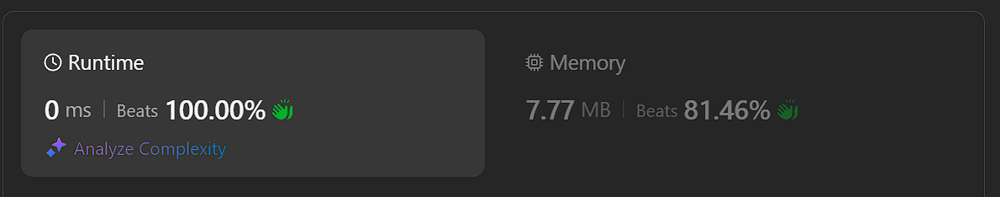

# ✅ Beats 100% | Working 08.10.2024 | Explained step by step

**Author:** Piotr_Maminski
**Votes:** 3
**Link:** [https://leetcode.com/problems/minimum-add-to-make-parentheses-valid/solutions/5888668/](https://leetcode.com/problems/minimum-add-to-make-parentheses-valid/solutions/5888668/)

---

```python3 []
class Solution:
    def minAddToMakeValid(self, s: str) -> int:
        # Initialize the counter for minimum additions needed
        ans = 0
        
        # Initialize the balance of parentheses (open - close)
        bal = 0

        # Iterate through each character in the string
        for ch in s:
            if ch == '(':
                # If it's an opening parenthesis, increment the balance
                bal += 1
            else:
                # If it's a closing parenthesis, decrement the balance
                bal -= 1

            # If balance becomes negative (more closing than opening parentheses)
            if bal < 0:
                # Add the absolute value of balance to answer
                # This represents the number of opening parentheses we need to add
                ans += -bal
                # Reset balance to 0 since we've accounted for the imbalance
                bal = 0

        # After processing all characters, add any remaining open parentheses
        # This represents the number of closing parentheses we need to add
        ans += bal

        # Return the minimum number of additions needed to make the string valid
        return ans
```
```cpp []
#include <string>

class Solution {
public:
    int minAddToMakeValid(std::string s) {
        // 'need' represents the number of closing parentheses ')' needed
        // to balance the opening parentheses '('
        int need = 0;

        // 'res' keeps track of the minimum number of parentheses
        // that need to be added to make the string valid
        int res = 0;

        // Iterate through each character in the input string
        for (char p : s) {
            if (p == '(') {
                // If we encounter an opening parenthesis,
                // we increase the need for a closing parenthesis
                need++;
            }
            
            if (p == ')') {
                // If we encounter a closing parenthesis,
                // we decrease the need (as it matches an opening parenthesis)
                need--;

                // If 'need' becomes -1, it means we have an extra closing parenthesis
                // that doesn't match any opening parenthesis
                if (need == -1) {
                    // We need to add an opening parenthesis to balance this
                    res++;
                    // Reset 'need' to 0 as we've handled this imbalance
                    need = 0;
                }
            }
        }

        // The final result is the sum of:
        // 1. 'res': the number of parentheses we needed to add for balancing extra closing parentheses
        // 2. 'need': the number of closing parentheses we still need to add to balance remaining opening parentheses
        return res + need;
    }
};
```
```java []
class Solution {
    public int minAddToMakeValid(String s) {
        // Initialize the counter for minimum additions needed
        int ans = 0;
        
        // Initialize the balance of parentheses (open - close)
        int bal = 0;
        
        // Iterate through each character in the string
        for (char ch : s.toCharArray()) {
            if (ch == '(') {
                // If it's an opening parenthesis, increment the balance
                bal++;
            } else {
                // If it's a closing parenthesis, decrement the balance
                bal--;
            }
            
            // If balance becomes negative (more closing than opening parentheses)
            if (bal < 0) {
                // Add the absolute value of balance to answer
                // This represents the number of opening parentheses we need to add
                ans += -bal;
                // Reset balance to 0 since we've accounted for the imbalance
                bal = 0;
            }
        }
        
        // After processing all characters, add any remaining open parentheses
        // This represents the number of closing parentheses we need to add
        ans += bal;
        
        // Return the minimum number of additions needed to make the string valid
        return ans;
    }
}
```
```golang []
package main

func minAddToMakeValid(s string) int {
    // Initialize the counter for minimum additions needed
    ans := 0
    
    // Initialize the balance of parentheses (open - close)
    bal := 0
    
    // Iterate through each character in the string
    for _, ch := range s {
        if ch == '(' {
            // If it's an opening parenthesis, increment the balance
            bal++
        } else {
            // If it's a closing parenthesis, decrement the balance
            bal--
        }
        
        // If balance becomes negative (more closing than opening parentheses)
        if bal < 0 {
            // Add the absolute value of balance to answer
            // This represents the number of opening parentheses we need to add
            ans += -bal
            // Reset balance to 0 since we've accounted for the imbalance
            bal = 0
        }
    }
    
    // After processing all characters, add any remaining open parentheses
    // This represents the number of closing parentheses we need to add
    ans += bal
    
    // Return the minimum number of additions needed to make the string valid
    return ans
}
```
```javascript [JS]
/**
 * @param {string} s
 * @return {number}
 */
var minAddToMakeValid = function(s) {
    // Initialize the counter for minimum additions needed
    let ans = 0;
    
    // Initialize the balance of parentheses (open - close)
    let bal = 0;
    
    // Iterate through each character in the string
    for (let ch of s) {
        if (ch === '(') {
            // If it's an opening parenthesis, increment the balance
            bal++;
        } else {
            // If it's a closing parenthesis, decrement the balance
            bal--;
        }
        
        // If balance becomes negative (more closing than opening parentheses)
        if (bal < 0) {
            // Add the absolute value of balance to answer
            // This represents the number of opening parentheses we need to add
            ans += -bal;
            // Reset balance to 0 since we've accounted for the imbalance
            bal = 0;
        }
    }
    
    // After processing all characters, add any remaining open parentheses
    // This represents the number of closing parentheses we need to add
    ans += bal;
    
    // Return the minimum number of additions needed to make the string valid
    return ans;
};
```
```typescript [TS]
function minAddToMakeValid(s: string): number {
    // Initialize the counter for minimum additions needed
    let ans: number = 0;
    
    // Initialize the balance of parentheses (open - close)
    let bal: number = 0;
    
    // Iterate through each character in the string
    for (let ch of s) {
        if (ch === '(') {
            // If it's an opening parenthesis, increment the balance
            bal++;
        } else {
            // If it's a closing parenthesis, decrement the balance
            bal--;
        }
        
        // If balance becomes negative (more closing than opening parentheses)
        if (bal < 0) {
            // Add the absolute value of balance to answer
            // This represents the number of opening parentheses we need to add
            ans += -bal;
            // Reset balance to 0 since we've accounted for the imbalance
            bal = 0;
        }
    }
    
    // After processing all characters, add any remaining open parentheses
    // This represents the number of closing parentheses we need to add
    ans += bal;
    
    // Return the minimum number of additions needed to make the string valid
    return ans;
}
```
```csharp []
public class Solution {
    public int MinAddToMakeValid(string s) {
        // Initialize the counter for minimum additions needed
        int ans = 0;
        
        // Initialize the balance of parentheses (open - close)
        int bal = 0;
        
        // Iterate through each character in the string
        foreach (char ch in s) {
            if (ch == '(') {
                // If it's an opening parenthesis, increment the balance
                bal++;
            } else {
                // If it's a closing parenthesis, decrement the balance
                bal--;
            }
            
            // If balance becomes negative (more closing than opening parentheses)
            if (bal < 0) {
                // Add the absolute value of balance to answer
                // This represents the number of opening parentheses we need to add
                ans += -bal;
                // Reset balance to 0 since we've accounted for the imbalance
                bal = 0;
            }
        }
        
        // After processing all characters, add any remaining open parentheses
        // This represents the number of closing parentheses we need to add
        ans += bal;
        
        // Return the minimum number of additions needed to make the string valid
        return ans;
    }
}
```
```ruby []
# @param {String} s
# @return {Integer}
def min_add_to_make_valid(s)
  # Initialize the counter for minimum additions needed
  ans = 0
  
  # Initialize the balance of parentheses (open - close)
  bal = 0
  
  # Iterate through each character in the string
  s.each_char do |ch|
    if ch == '('
      # If it's an opening parenthesis, increment the balance
      bal += 1
    else
      # If it's a closing parenthesis, decrement the balance
      bal -= 1
    end
    
    # If balance becomes negative (more closing than opening parentheses)
    if bal < 0
      # Add the absolute value of balance to answer
      # This represents the number of opening parentheses we need to add
      ans += -bal
      # Reset balance to 0 since we've accounted for the imbalance
      bal = 0
    end
  end
  
  # After processing all characters, add any remaining open parentheses
  # This represents the number of closing parentheses we need to add
  ans += bal
  
  # Return the minimum number of additions needed to make the string valid
  ans
end
```
```rust []
impl Solution {
    pub fn min_add_to_make_valid(s: String) -> i32 {
        // Initialize the counter for minimum additions needed
        let mut ans = 0;
        
        // Initialize the balance of parentheses (open - close)
        let mut bal = 0;
        
        // Iterate through each character in the string
        for ch in s.chars() {
            if ch == '(' {
                // If it's an opening parenthesis, increment the balance
                bal += 1;
            } else {
                // If it's a closing parenthesis, decrement the balance
                bal -= 1;
            }
            
            // If balance becomes negative (more closing than opening parentheses)
            if bal < 0 {
                // Add the absolute value of balance to answer
                // This represents the number of opening parentheses we need to add
                ans += -bal;
                // Reset balance to 0 since we've accounted for the imbalance
                bal = 0;
            }
        }
        
        // After processing all characters, add any remaining open parentheses
        // This represents the number of closing parentheses we need to add
        ans += bal;
        
        // Return the minimum number of additions needed to make the string valid
        ans
    }
}
```
```swift []
class Solution {
    func minAddToMakeValid(_ s: String) -> Int {
        // Initialize the counter for minimum additions needed
        var ans = 0
        
        // Initialize the balance of parentheses (open - close)
        var bal = 0

        // Iterate through each character in the string
        for ch in s {
            if ch == "(" {
                // If it's an opening parenthesis, increment the balance
                bal += 1
            } else {
                // If it's a closing parenthesis, decrement the balance
                bal -= 1
            }

            // If balance becomes negative (more closing than opening parentheses)
            if bal < 0 {
                // Add the absolute value of balance to answer
                // This represents the number of opening parentheses we need to add
                ans += -bal
                // Reset balance to 0 since we've accounted for the imbalance
                bal = 0
            }
        }

        // After processing all characters, add any remaining open parentheses
        // This represents the number of closing parentheses we need to add
        ans += bal

        // Return the minimum number of additions needed to make the string valid
        return ans
    }
}
```
### Complexity (python as example)
- Time complexity: O(n)

- Space complexity: O(1)

## Explained step by step
1. We start with a class called `Solution` that has a method `minAddToMakeValid`. This method takes a string `s` as input and returns an integer.
2. We create a variable `ans` and set it to **0**. This will keep track of how many parentheses we need to add.
3. We create another variable `bal` and set it to **0**. This will keep track of the balance between opening and closing parentheses.
4. We then go through each character in the input string `s`:
- a. If the character is an opening parenthesis '(', we increase `bal` by **1**.
- b. If it's a closing parenthesis ')', we decrease **bal** by **1**.
5. After each character, we check if `bal` has become negative. If it has:
-  We add the absolute value of `bal` to ans. This is because a negative balance means we have more closing parentheses than opening ones, so we need to add some opening ones.
- We then reset `bal` to **0** since we've fixed the imbalance.
6. After we've gone through all the characters, we add the final value of `bal` to `ans`. This is because if `bal` is positive, it means we have more opening parentheses than closing ones, so we need to add some closing ones.
7. Finally, we return `ans`, which represents the total number of parentheses we needed to add to make the string valid.

In essence, this method counts how many parentheses we need to add to make sure every opening parenthesis has a matching closing parenthesis, and vice versa.




