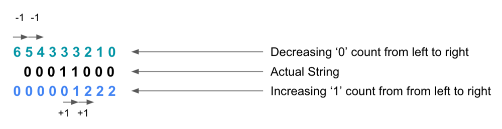
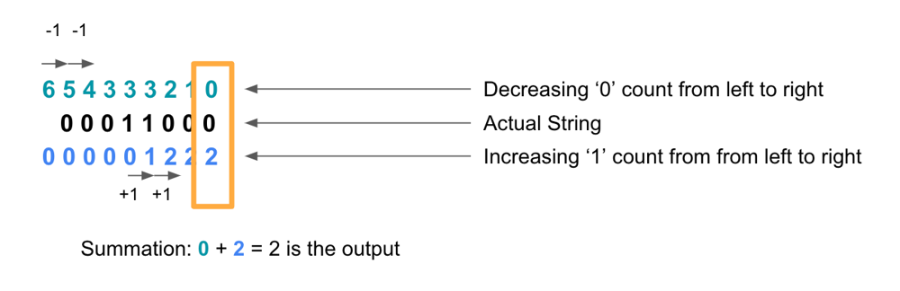
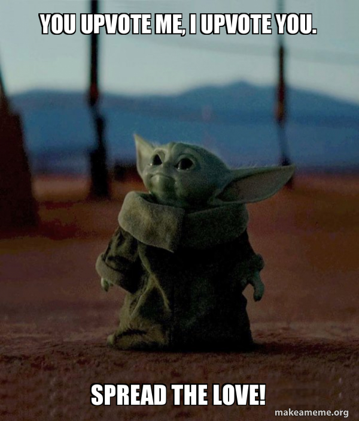

# Simple Explanation With Images || O(n) time, O(1) Space

**Author:** hridoy100
**Votes:** 84
**Link:** [https://leetcode.com/problems/flip-string-to-monotone-increasing/solutions/3061841/](https://leetcode.com/problems/flip-string-to-monotone-increasing/solutions/3061841/)

---

# Intuition
How about we think about the cost and gain? As we go from left to right, the zeroes we get are our costs and the ones we get are our gains.
<!-- Describe your first thoughts on how to solve this problem. -->

# Approach



We will first store the count of zeroes. Then from left to right we will decrease the count of `zeroes` if we find any '0'. We will also increase the count of `ones` if we find any '1'.



After each iteration we will calculate the minimum of `zeroes + ones`. The minimum count of zeroes and ones count is the answer.

# Algorithm

- Initialize variables `zeroes` and `ones` to 0.
- First, we need to keep the count of the zeroes. We will determine it by iterating the loop.
- Initialize variable `output` equals to `zeores`.
- Now, iterate the loop again. While Iterating:
    - Decrease the count of `zeroes` if '0' is found.
    - Increase the count of `ones` if '1' is found.
    - after each calculations, we determine the output. The output will be the minimum value. So, we do `output = Math.min(output, zeroes+ones)`.
- Return the `output`.

<!-- Describe your approach to solving the problem. -->

# Complexity
- Time complexity: $$O(n)$$
Actually, it is $$O(n + n)$$, because we iterate the loop twice. So, we can write, $$O(2n) = O(n)$$.
<!-- Add your time complexity here, e.g. $$O(n)$$ -->

- Space complexity: $$O(1)$$
We haven't used any n length array or, string or any other datastructure. So, space is fixed and constant.
<!-- Add your space complexity here, e.g. $$O(n)$$ -->

# Code [Java]
For other Languages just follow the syntax of that language.
```
class Solution {
    public int minFlipsMonoIncr(String s) {
        int zeroes = 0;
        int ones = 0;
        for(char ch : s.toCharArray()){
            if(ch == '0'){
                zeroes++;
            }
        }
        int output = zeroes;
        for(char ch : s.toCharArray()){
            if(ch == '0'){
                zeroes--;
            }
            else if(ch == '1'){
                ones++;
            }
            output = Math.min(output, zeroes+ones);
        }
        return output;
    }
}
```


