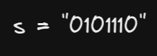
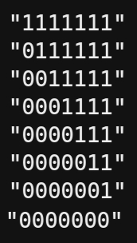
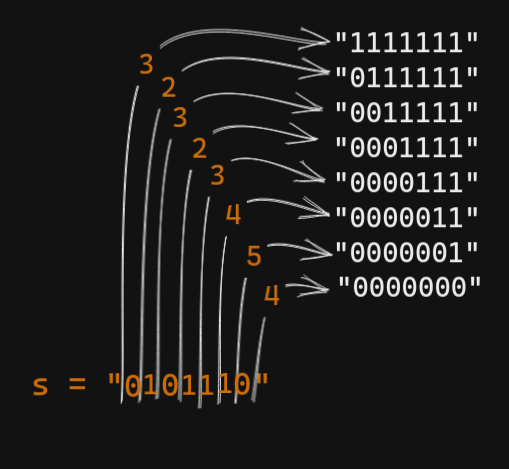
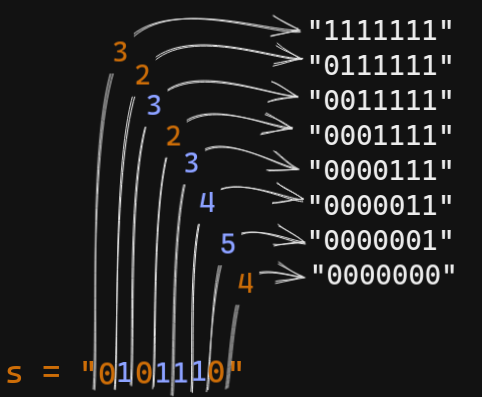

# Ruby solution - updated (T: 207 ms Beats 98.55%, M: 215.3 MB Beats 63.77%)

**Author:** ozovalihasan
**Votes:** 1
**Link:** [https://leetcode.com/problems/flip-string-to-monotone-increasing/solutions/3062627/](https://leetcode.com/problems/flip-string-to-monotone-increasing/solutions/3062627/)

---

# Approach

Let me explain approach with an example;



Firstly, let's check valid cases.



Now, all necessary flips can be counted for each case.



Firstly, the number of `0`s is found and assigned as `total_flip`. Then, if the checked digit is `0`, `total_flip` is decreased by 1. If it is `1`, it is increased by 1.




Also, each `total_flip` is compared with `min_flip` and the minimum one is selected.

Lastly, `min_flip` is returned.

# Code
```ruby []
# @param {String} s
# @return {Integer}
def min_flips_mono_incr(s)
  total_flip = s.count("0")
  min_flip = total_flip

  s.each_char do |char|
    total_flip += char == "1" ? 1 : -1
    min_flip = total_flip if min_flip > total_flip
  end
  
  min_flip
end
```