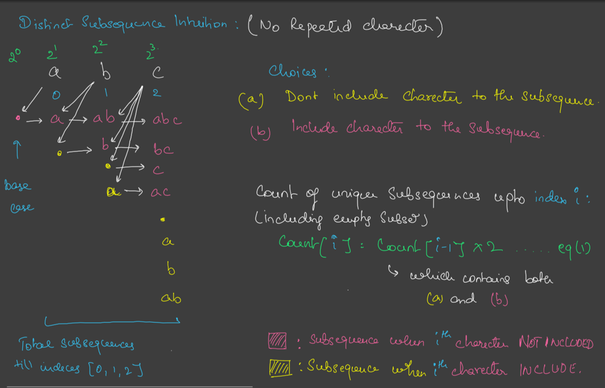
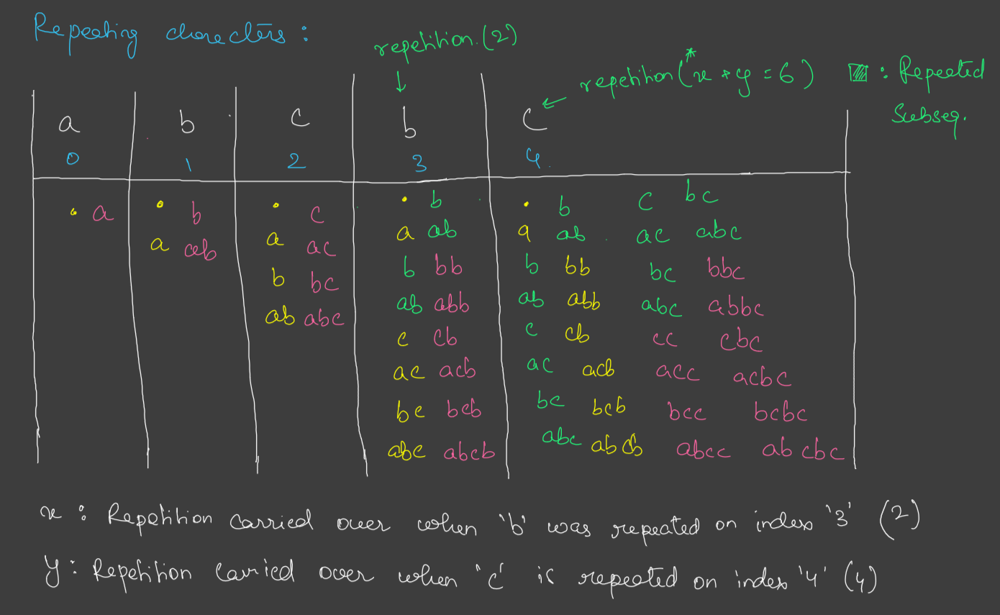
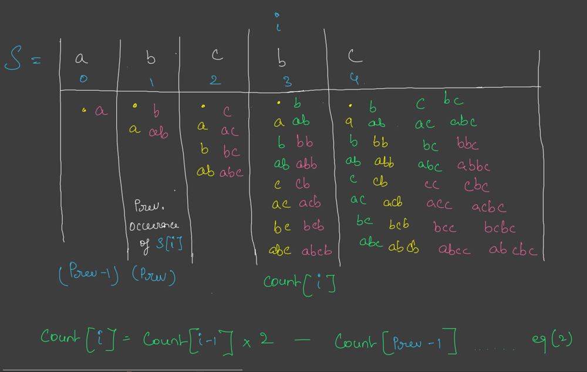

# Java Clean Solution With Detail Explanation || Interview Question

**Author:** Shree_Govind_Jee
**Votes:** 5
**Link:** [https://leetcode.com/problems/distinct-subsequences-ii/solutions/4899641/](https://leetcode.com/problems/distinct-subsequences-ii/solutions/4899641/)

---

**Intuition I :**

Below is a case where you need to find all distinct subsequences of input string that contains distinct charecters only, and from there we will build a solution which allows non-distinct charecters in the input string as well, taking an example of input **string "abc" :**




In the table we see all the possible subsequences forming at `index 0, 1, 2`

As seen at each step ith charecter of the string has 2 choices :

Include itself in the ongoing subsequences.
Skip itself from being part of the ongoing subsequences.
We can see that for an input string of `'n'` distinct charecters, we can form 2n distinct subsequences. in `O(1) time.` (including empty subsequence)

If `count[i]` is a data structure which stores the count of all distinct subsequences uptill index i then :
`count[ i ] = count[ i - 1] x 2`


**Intuition II :**
From intuition 1 lets now see what happens when we introduce repeated charecters in the input **string "abcbc" :**




Some observations :

Subsequences in green represent repreated subsequences. There are 2 occurances of 'b', 1st at index 1 and 2nd at index 3.

The latest occurance of 'b' contains repeated subsequences from the just previous occurance of 'b'. `Subsequences ['b', 'ab']` first occur at index 1 and then they repeat when 'b' repeats.

Similarly, `['c', 'ac', 'bc', 'abc']` repeat at the latest occurance of 'c' at index 4. These strings first occur at index 2 at the previous occurance of 'c'.

If 'prev' is the previous occurance of the repreated charecter at index 'i' then, Repetition **`count = count[ prev - 1]`**





# Code
```
class Solution {
    int MOD = 1_000_000_007;

    // Recusive Solution
    private void solveRec(String s, int idx, StringBuilder sb, List<String> list) {
        // Base Case
        if (idx >= s.length()) {
            if (sb.toString().length() != 0) {
                if (list.contains(sb.toString())) {
                    return;
                }
                list.add(sb.toString());
            }
            return;
        }

        // take it
        sb.append(s.charAt(idx));
        solveRec(s, idx + 1, sb, list);
        sb.deleteCharAt(sb.length() - 1);

        // nontake
        solveRec(s, idx + 1, sb, list);
    }


    // DP + Memoization
    private int solveMemo(String s, int idx, int[] dp) {
        // Base Case
        if (idx >= s.length()) {
            return 0;
        }

        // step-2 => if already calculated just return it
        if (dp[idx] != -1)
            return dp[idx];

        // step-3 => if not calculated just calculate it
        Set<Character> set = new HashSet<>();
        int res = 0;
        for (int j = idx; j < s.length(); j++) {
            if (set.contains(s.charAt(j))) {
                continue;
            }

            set.add(s.charAt(j));
            res = (1 + solveMemo(s, j + 1, dp) % MOD + res % MOD) % MOD;
        }
        return dp[idx] = res;
    }


    // Drive Code
    public int distinctSubseqII(String s) {
        // Recursive
        // List<String> list = new ArrayList<>();
        // solveRec(s, 0, new StringBuilder(), list);
        // return list.size() % MOD;


        // DP + Memoization
        // int[] dp = new int[s.length()];
        // Arrays.fill(dp, -1);
        // return solveMemo(s, 0, dp) % MOD;


        // DP + Tabulation
        int res = 0, added = 0;
        int[] count = new int[26];
        for (char ch : s.toCharArray()) {
            added = (res + 1 - count[ch - 'a']) % MOD;
            res = (res + added) % MOD;
            count[ch - 'a'] = (added + count[ch - 'a']) % MOD;
        }
        return (res + MOD) % MOD;
    }
}


// class Solution {
//     private static final int mod = (int) (1e9 + 7);

//     public int distinctSubseqII(String s) {
//         int[] dp = new int[s.length() + 1];
//         Arrays.fill(dp, -1);

//         int[] last = new int[26];
//         Arrays.fill(last, -1);

//         return (countDistinctSubsequences(s, s.length(), dp, last) - 1 + mod) % mod;
//     }

//     private static int countDistinctSubsequences(String s, int i, int[] dp, int[] last) {
//         if (i == 0) {
//             return 1;
//         }

//         if (dp[i] != -1) {
//             return dp[i];
//         }

//         dp[i] = (int) ((long) 2 * countDistinctSubsequences(s, i - 1, dp, last)) % mod;

//         int charIndex = s.charAt(i - 1) - 'a';
//         if (last[charIndex] != -1) {
//             dp[i] = (dp[i] - countDistinctSubsequences(s, last[charIndex], dp, last) + mod) % mod;
//         }

//         last[charIndex] = i - 1;

//         return dp[i] % mod;
//     }
// }
```