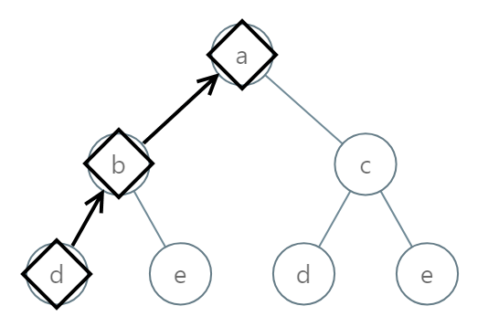
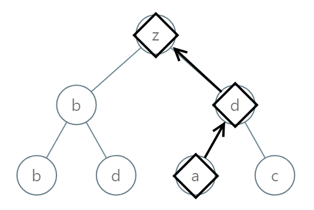
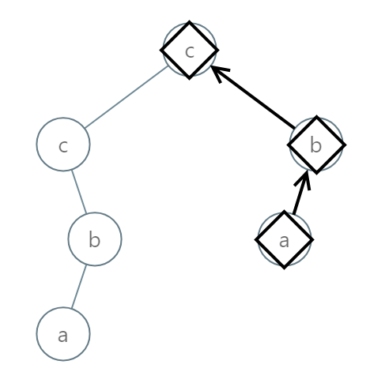

# [988. Smallest String Starting From Leaf](https://leetcode.com/problems/smallest-string-starting-from-leaf/)

| Category | Difficulty | Likes | Dislikes |
| :------: | :--------: | :---: | :------: |
| Algorithms | Medium | 2392 | 336 |

**Tags:** [`string`](https://leetcode.com/tag/string), [`backtracking`](https://leetcode.com/tag/backtracking), [`tree`](https://leetcode.com/tag/tree), [`depth-first-search`](https://leetcode.com/tag/depth-first-search), [`binary-tree`](https://leetcode.com/tag/binary-tree)

**Companies:** `google`, `amazon`

## Description

You are given the `root` of a binary tree where each node has a value in the range `[0, 25]` representing the letters `'a'` to `'z'`.

Return *the **lexicographically smallest** string that starts at a leaf of this tree and ends at the root*.

As a reminder, any shorter prefix of a string is **lexicographically smaller**.

	- For example, `"ab"` is lexicographically smaller than `"aba"`.

A leaf of a node is a node that has no children.

 

**Example 1:**


```

Input: root = [0,1,2,3,4,3,4]
Output: &quot;dba&quot;

```

**Example 2:**


```

Input: root = [25,1,3,1,3,0,2]
Output: &quot;adz&quot;

```

**Example 3:**


```

Input: root = [2,2,1,null,1,0,null,0]
Output: &quot;abc&quot;

```

 

**Constraints:**

	- The number of nodes in the tree is in the range `[1, 8500]`.

	- `0 <= Node.val <= 25`

---

**Links:** [Submissions](https://leetcode.com/problems/smallest-string-starting-from-leaf/) | [Solutions](https://leetcode.com/problems/smallest-string-starting-from-leaf/)
