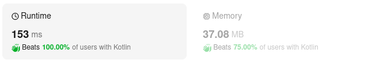

# Kotlin. Beats 100% (153 m). DFS with static IntArrays.

**Author:** mobdev778
**Votes:** 3
**Link:** [https://leetcode.com/problems/smallest-string-starting-from-leaf/solutions/5035313/](https://leetcode.com/problems/smallest-string-starting-from-leaf/solutions/5035313/)

---



# Code
```
class Solution {
    fun smallestFromLeaf(root: TreeNode?) : String {
        minSize = 0
        root?.let { rec(it, 0) }

        val builder = StringBuilder()
        while (minSize > 0) {
            minSize--
            builder.append('a' + minArray[minSize])
        }
        return builder.toString()
    }

    private fun rec(root: TreeNode, index: Int) {
        tempArray[index] = root.`val`
        val newIndex = index + 1
        if (root.left == root.right) {
            if (minSize == 0 || compareArrays(newIndex - minSize) < 0) {
                minSize = newIndex
                System.arraycopy(tempArray, 0, minArray, 0, newIndex)
            }
        } else {
            root.left?.let { rec(it, newIndex) }
            root.right?.let { rec(it, newIndex) }
        }
    }

    private fun compareArrays(offset: Int): Int {
        var i = minSize
        var ti = i + offset
        while (i > 0 && ti > 0) {
            i--
            ti--
            val diff = tempArray[ti].compareTo(minArray[i])
            if (diff != 0) return diff
        }
        // if tempArray is shorter
        if (offset < 0) return -1
        return 0
    }

    companion object {
        var minSize = 0
        val minArray = IntArray(8501)
        val tempArray = IntArray(8501)
    }
}
```