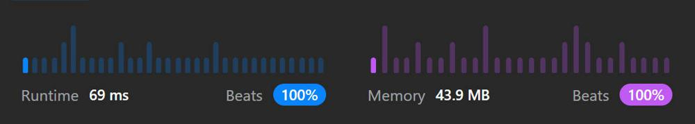

# JS T:100% S:100%

**Author:** hanbi58
**Votes:** 3
**Link:** [https://leetcode.com/problems/check-if-word-is-valid-after-substitutions/solutions/3072025/](https://leetcode.com/problems/check-if-word-is-valid-after-substitutions/solutions/3072025/)

---

# Complexity
- Time complexity:
O(n^2)

- Space complexity:
O(n)

# Code
```
var isValid = function (s) {
  while (s.length) {
    if (s.indexOf("abc") === -1) break;
    s = s.replaceAll("abc", "");
  }
  return !s.length;
};

```


