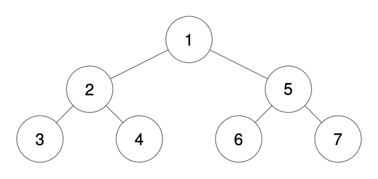
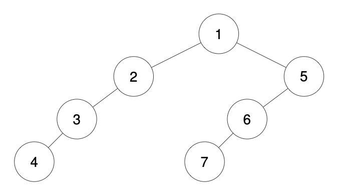
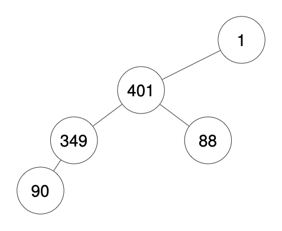

# [1028. Recover a Tree From Preorder Traversal](https://leetcode.com/problems/recover-a-tree-from-preorder-traversal/)

| Category | Difficulty | Likes | Dislikes |
| :------: | :--------: | :---: | :------: |
| Algorithms | Hard | 2279 | 69 |

**Tags:** [`string`](https://leetcode.com/tag/string), [`tree`](https://leetcode.com/tag/tree), [`depth-first-search`](https://leetcode.com/tag/depth-first-search), [`binary-tree`](https://leetcode.com/tag/binary-tree)

**Companies:** `google`, `microsoft`, `facebook`, `amazon`

## Description

We run a preorder depth-first search (DFS) on the `root` of a binary tree.

At each node in this traversal, we output `D` dashes (where `D` is the depth of this node), then we output the value of this node.  If the depth of a node is `D`, the depth of its immediate child is `D + 1`.  The depth of the `root` node is `0`.

If a node has only one child, that child is guaranteed to be **the left child**.

Given the output `traversal` of this traversal, recover the tree and return *its* `root`.

 

**Example 1:**


```

Input: traversal = &quot;1-2--3--4-5--6--7&quot;
Output: [1,2,5,3,4,6,7]

```

**Example 2:**


```

Input: traversal = &quot;1-2--3---4-5--6---7&quot;
Output: [1,2,5,3,null,6,null,4,null,7]

```

**Example 3:**


```

Input: traversal = &quot;1-401--349---90--88&quot;
Output: [1,401,null,349,88,90]

```

 

**Constraints:**

	- The number of nodes in the original tree is in the range `[1, 1000]`.

	- `1 <= Node.val <= 10^9`

---

**Links:** [Submissions](https://leetcode.com/problems/recover-a-tree-from-preorder-traversal/) | [Solutions](https://leetcode.com/problems/recover-a-tree-from-preorder-traversal/)
