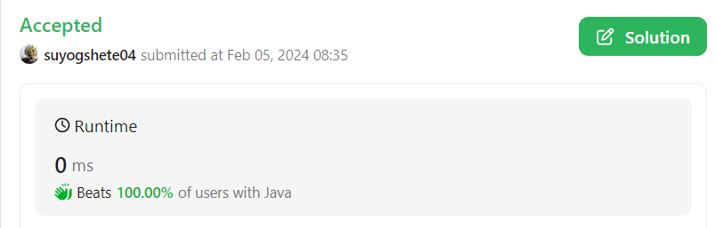

# 🚀Beats 100%🚀✅Easiest (Java/C++/Python) Solution With Detailed Explanation✅

**Author:** suyogshete04
**Votes:** 3
**Link:** [https://leetcode.com/problems/occurrences-after-bigram/solutions/4678899/](https://leetcode.com/problems/occurrences-after-bigram/solutions/4678899/)

---

# Intuition
The intuition is to split the input text into words, iterates through these words to find sequences where a given `first` word is immediately followed by a `second` word, and collects the word immediately after this pair. It leverages Java's `String.split()` for tokenization, and an `ArrayList` for dynamically collecting matching words, finally returning the results as an array of strings.




# Approach

### Splitting the Input String

- **`String.split()` Method:** The method is used to split the input text into an array of words. This is achieved by splitting the string based on spaces, effectively tokenizing the text into individual words. This step eliminates the need for manual iteration and parsing that might be necessary in languages without such a straightforward string manipulation method.

### Iterating Over the Words

- **Looping with Conditions:** The code iterates over the array of words using a `for` loop. It stops the iteration two words before the end of the array to avoid `IndexOutOfBoundsException`. This precaution is necessary because the algorithm needs to access `words[i + 2]` within the loop, and ensuring `i <= words.length - 3` guarantees that this access is safe.

### Checking for Specific Word Pairs

- **Conditional Checks:** Inside the loop, the code checks if the current word (`words[i]`) and the next word (`words[i + 1]`) match the specified `first` and `second` words. This is done using the `.equals()` method, which is the correct way to compare string equality in Java, as opposed to the `==` operator, which compares object references.

### Collecting and Returning Results

- **Dynamic List Collection:** The code uses an `ArrayList<String>` to dynamically collect words that meet the condition (i.e., words that immediately follow a `first`, `second` word pair). This choice allows for flexible accumulation of results, as the number of qualifying words is not known in advance.

- **Conversion to Array:** Finally, the collected results are converted to an array of strings (`String[]`) using `List.toArray(new String[0])`. This conversion is necessary because the method's return type is defined as an array. The `new String[0]` argument is a type hint to the `toArray` method, ensuring that it returns an array of `String`. In Java, it's common to return collections or arrays from methods, and the conversion between these types is a typical pattern.

# Complexity
The algorithm has a linear time complexity (\\(O(n)\\)), where \\(n\\) is the number of words in the input text, because it involves a single pass through the array of words. The space complexity is also linear (\\(O(m)\\)), where \\(m\\) is the number of matching word triplets, due to the storage requirements of the result list.

# Code
```Java []

public class Solution {
    public String[] findOcurrences(String text, String first, String second) {
        String[] words = text.split(" "); // Split the text into words.
        List<String> ans = new ArrayList<>(); // Use a dynamic list to collect answers.

        // Iterate through the words, stopping at the third-to-last to avoid out-of-bounds access.
        for (int i = 0; i <= words.length - 3; i++) {
            if (words[i].equals(first) && words[i + 1].equals(second)) {
                ans.add(words[i + 2]); // Add the word following the first and second words to the answer list.
            }
        }

        // Convert the List to an array of strings to match the return type.
        return ans.toArray(new String[0]);
    }
}

```
```C++ []
class Solution {
public:
    vector<string> findOcurrences(string text, string first, string second) {
        vector<string> res;

        string s;

        stringstream ss(text);

        while (getline(ss, s, ' ')) {
            res.push_back(s);
        }

        int n = res.size();
        vector<string> ans;
        for (int i = 0; i <= n - 3; i++) {
            if (res[i] == first && res[i + 1] == second) {
                ans.push_back(res[i + 2]);
            }
        }

        return ans;
    }
};

```
```Python3 []

class Solution:
    def findOcurrences(self, text: str, first: str, second: str) -> List[str]:
        words = text.split()  # Split the text into words.
        ans = []  # List to hold the answers.

        # Iterate through words, stopping before the last two to avoid index errors.
        for i in range(len(words) - 2):
            # If the current word and the next word match `first` and `second`, add the third word.
            if words[i] == first and words[i + 1] == second:
                ans.append(words[i + 2])

        return ans
```