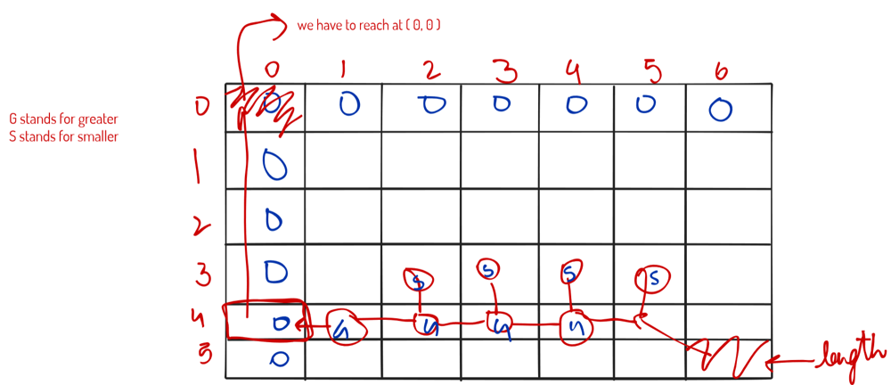

# [Javascript] Dynamic Programming Solution ! Explained

**Author:** dhairyabahl
**Votes:** 10
**Link:** [https://leetcode.com/problems/shortest-common-supersequence/solutions/1440589/](https://leetcode.com/problems/shortest-common-supersequence/solutions/1440589/)

---

**Explanation** : This question is a combination of two other questions of dynamic programming. First one is **Printing Longest Common Subsequence** and second one was to **calculate the length of shortest common supersequence**.




Printing Longest common subsequence : In this question, we had to calculate the length of Longest common subsequence for every possible combination of str1 and str2 and then we get the lengths. After this, we traverse the grid from the bottom right corner like we did in this question

but the catch in this question is to print the shortest common supersequence and for that we will print those which are same in both the strings and most importantly, **we will also print those which are not common because here we are not finding the subsequence but the supersequence**. Rest of the code is almost same from printing LCS.

PS: If you liked the approach and explanation of this question, do upvote this post ! It really motivates the author to post more solutions.

```
/**
 * @param {string} str1
 * @param {string} str2
 * @return {string}
 */
var shortestCommonSupersequence = function(str1, str2) {
    
    let dp = [];
    
    for(let rctr = 0 ; rctr <= str1.length ; rctr ++){
        let arr = [];
        
        for(let cctr = 0 ; cctr <= str2.length ; cctr ++) arr.push(0);
        
        dp.push(arr);
    }
    
    for(let row = 1 ; row <= str1.length ; row ++)
        for(let col = 1 ; col <= str2.length ; col ++) {
            
            if(str1[row-1] === str2[col-1])
                dp[row][col] = 1 + dp[row-1][col-1];
            else
                dp[row][col] = Math.max(dp[row-1][col],dp[row][col-1]);
            
        }
    
    let row = str1.length, col = str2.length ;
    
    let ans = "";
    
    while( row > 0 && col > 0 ) {
        
        if(str1[row-1] === str2[col-1]) {
            ans += str1[row-1];
            row -=1;
            col -=1;
            continue;
        }
        
        if(dp[row-1][col] > dp[row][col-1]) {
            ans += str1[row-1];
            row-=1;
        }
        else {
            ans+= str2[col-1]
            col -=1
        }
    }
    
    while(row > 0) {
        ans += str1[row-1]
        row -=1;
    }
    
    while(col > 0) {
        ans += str2[col-1];
        col -=1;
    }
    
    ans = ans.split("");
    
    ans = ans.reverse()
    
    ans = ans.join("");
    
    return ans;
    
};
```