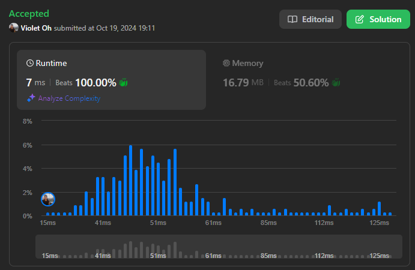

# Beats 100% Optimized Solution 🧠 Python | Java | C++ O(N), O(N)

**Author:** violet_6
**Votes:** 136
**Link:** [https://leetcode.com/problems/parsing-a-boolean-expression/solutions/5939345/](https://leetcode.com/problems/parsing-a-boolean-expression/solutions/5939345/)

---

# Intuition
Fundamentally, we want to use `stack`, but instead of adding every char to `stack`, we focus on the elements that matter (`operators`, `boolean values`, and `parantheses`) while ignoring commas (since they don't affect the outcome).

We still push `operators` and `boolean values` onto the stack as we process the expression, but when we encounter a `closing parenthesis`, we immediately evaluate the subexpression by popping values from the stack. 

The key improvement is that we can stop early if the result becomes clear. For example, with the `&` operator, if we find an `f` while popping values, we know the subexpression result is `f` and can stop without checking further. Similarly, for the `|` operator, finding a `t` allows us to stop early.


# Example: 
`&(t,|(f,t))`
We push `&` and `t`, then `|`, followed by `f` and `t`. 
When popping values for the `|` subexpression, we know the result is `t` as soon as we find one `t`. 
We push `t` back onto the stack and continue with the `&` operator, which evaluates to `t` since both values are true.


# Approach
- Initialize stack for operators & boolean values
- Traverse through `expression`:
    - If char is comma, or an open parenthesis, skip
    - If char is bool, or an operator, push to stack
    - If char is a closing parenthesis:
        - Initialize two boolean flags to track presence of true & false within the parentheses
        - Process values in parentheses:
            - While the top of stack is not an operator:
                - Pop from stack and check:
                    - If `t`: hasTrue 
                    - If `f`: hasFalse
        - Pop operator from stack
        - Evaluate subexpression based on the operator:
            - If `!`, push `f` if `hasTrue`. Otherwise, push `t`.
            - If `&`, push `f` if `hasFalse`. Otherwise, push `t`.
            - If `|`, push `t` if `hasTrue` is true. Otherwise, push `f`.
- The final result will be at the top of the stack
# Complexity
- Time complexity: $$O(N)$$
<!-- Add your time complexity here, e.g. $$O(n)$$ -->

- Space complexity: $$O(N)$$
<!-- Add your space complexity here, e.g. $$O(n)$$ -->

# Code
```python3 []
class Solution:
    def parseBoolExpr(self, expression: str) -> bool:
        st = deque()
        for c in expression:
            if c == "," or c == "(":
                continue
            if c in ["t", "f", "!", "&", "|"]:
                st.append(c)
            elif c == ")":
                has_true = False
                has_false = False
                while st[-1] not in ["!", "&", "|"]:
                    top_value = st.pop()
                    if top_value == "t":
                        has_true = True
                    elif top_value == "f":
                        has_false = True
                op = st.pop()
                if op == "!":
                    st.append("t" if not has_true else "f")
                elif op == "&":
                    st.append("f" if has_false else "t")
                else:
                    st.append("t" if has_true else "f")
        return st[-1] == "t"
```
```java []
public class Solution {

    public boolean parseBoolExpr(String expression) {
        Stack<Character> st = new Stack<>();

        for (char currChar : expression.toCharArray()) {
            if (currChar == ',' || currChar == '(') continue; 
            if (
                currChar == 't' ||
                currChar == 'f' ||
                currChar == '!' ||
                currChar == '&' ||
                currChar == '|'
            ) {
                st.push(currChar);
            }
            else if (currChar == ')') {
                boolean hasTrue = false, hasFalse = false;

                while (
                    st.peek() != '!' && st.peek() != '&' && st.peek() != '|'
                ) {
                    char topValue = st.pop();
                    if (topValue == 't') hasTrue = true;
                    if (topValue == 'f') hasFalse = true;
                }

                char op = st.pop();
                if (op == '!') {
                    st.push(hasTrue ? 'f' : 't');
                } else if (op == '&') {
                    st.push(hasFalse ? 'f' : 't');
                } else {
                    st.push(hasTrue ? 't' : 'f');
                }
            }
        }
        return st.peek() == 't';
    }
}
```
```C++ []
class Solution {
public:
    bool parseBoolExpr(string expression) {
        stack<char> st;

        for (char currChar : expression) {
            if (currChar == ',' || currChar == '(')
                continue;  
            if (currChar == 't' || currChar == 'f' || currChar == '!' ||
                currChar == '&' || currChar == '|') {
                st.push(currChar);
            }
            else if (currChar == ')') {
                bool hasTrue = false, hasFalse = false;

                while (st.top() != '!' && st.top() != '&' && st.top() != '|') {
                    char topValue = st.top();
                    st.pop();
                    if (topValue == 't') hasTrue = true;
                    if (topValue == 'f') hasFalse = true;
                }
                char op = st.top();
                st.pop();
                if (op == '!') {
                    st.push(hasTrue ? 'f' : 't');
                } else if (op == '&') {
                    st.push(hasFalse ? 'f' : 't');
                } else {
                    st.push(hasTrue ? 't' : 'f');
                }
            }
        }
        return st.top() == 't';
    }
};
```





