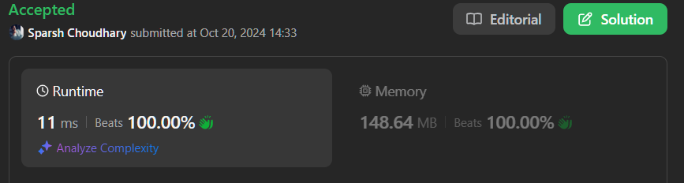

# 🔥BEATS 💯 % 🎯 |✨SUPER EASY BEGINNERS 👏

**Author:** CodeWithSparsh
**Votes:** 2
**Link:** [https://leetcode.com/problems/parsing-a-boolean-expression/solutions/5941522/](https://leetcode.com/problems/parsing-a-boolean-expression/solutions/5941522/)

---



### **Intuition**

The given problem involves evaluating a boolean expression, where the expression can contain logical operators `&` (AND), `|` (OR), and `!` (NOT), along with parentheses for grouping. The expression can be nested, so we need to evaluate from the inside out, similar to how arithmetic expressions are evaluated.

We can process the expression using a stack to handle nested sub-expressions, evaluating them step by step as we encounter closing parentheses.

### **Approach**

1. **Use a stack**: We will traverse the expression character by character. If we encounter a closing parenthesis `)`, it indicates the end of a sub-expression, so we pop elements from the stack until we find the opening parenthesis `(`.
2. **Evaluate the sub-expression**: After popping the sub-expression and its operator, we evaluate the boolean expression based on the operator (`&`, `|`, `!`) and push the result back onto the stack.
3. **Operators**:
   - `&` (AND): Returns true only if all elements in the sub-expression are true.
   - `|` (OR): Returns true if at least one element in the sub-expression is true.
   - `!` (NOT): Inverts the single element in the sub-expression.
4. **Final Result**: After processing the entire expression, the final result will be the only element left in the stack.

### **Complexity**

- **Time Complexity**: \\( O(n) \\), where \\( n \\) is the length of the input expression. Each character is processed at most twice (once when added to the stack and once when popped).
- **Space Complexity**: \\( O(n) \\), as we use a stack to store parts of the expression.

---

### **Code Implementations**

```dart []
class Solution {
  bool parseBoolExpr(String expression) {
    List<String> stack = [];

    for (int i = 0; i < expression.length; i++) {
      String char = expression[i];

      if (char == ')') {
        // When we encounter a closing bracket, we need to evaluate the current expression
        List<String> subExpr = [];

        // Pop until we find the opening bracket
        while (stack.isNotEmpty && stack.last != '(') {
          subExpr.add(stack.removeLast());
        }

        // Pop the opening bracket '('
        stack.removeLast();

        // Pop the operator that is before the opening bracket
        String operator = stack.removeLast();

        // Evaluate the sub-expression and push the result to the stack
        stack.add(evaluate(subExpr, operator) ? 't' : 'f');
      } else if (char != ',') {
        // Ignore commas and push everything else to the stack
        stack.add(char);
      }
    }

    // The final result is the only element left in the stack
    return stack.last == 't';
  }

  // This function evaluates the sub-expression based on the operator
  bool evaluate(List<String> subExpr, String operator) {
    subExpr = subExpr.reversed.toList();  // Reverse the list as we popped elements
    if (operator == '&') {
      // AND: All elements must be true
      return subExpr.every((e) => e == 't');
    } else if (operator == '|') {
      // OR: At least one element must be true
      return subExpr.any((e) => e == 't');
    } else if (operator == '!') {
      // NOT: Invert a single element
      return subExpr.first == 'f';
    }
    return false;  // Fallback case (should never reach here)
  }
}
```

```python []
class Solution:
    def parseBoolExpr(self, expression: str) -> bool:
        stack = []

        for char in expression:
            if char == ')':
                sub_expr = []
                while stack[-1] != '(':
                    sub_expr.append(stack.pop())
                stack.pop()  # remove '('
                operator = stack.pop()
                stack.append('t' if self.evaluate(sub_expr, operator) else 'f')
            elif char != ',':
                stack.append(char)

        return stack[-1] == 't'

    def evaluate(self, sub_expr, operator):
        if operator == '&':
            return all(x == 't' for x in sub_expr)
        elif operator == '|':
            return any(x == 't' for x in sub_expr)
        elif operator == '!':
            return sub_expr[0] == 'f'
```

```java []
import java.util.Stack;

class Solution {
    public boolean parseBoolExpr(String expression) {
        Stack<Character> stack = new Stack<>();

        for (char ch : expression.toCharArray()) {
            if (ch == ')') {
                List<Character> subExpr = new ArrayList<>();
                while (stack.peek() != '(') {
                    subExpr.add(stack.pop());
                }
                stack.pop();  // Remove '('
                char operator = stack.pop();
                stack.push(evaluate(subExpr, operator) ? 't' : 'f');
            } else if (ch != ',') {
                stack.push(ch);
            }
        }

        return stack.peek() == 't';
    }

    private boolean evaluate(List<Character> subExpr, char operator) {
        if (operator == '&') {
            return subExpr.stream().allMatch(c -> c == 't');
        } else if (operator == '|') {
            return subExpr.stream().anyMatch(c -> c == 't');
        } else {
            return subExpr.get(0) == 'f';
        }
    }
}
```

```cpp []
class Solution {
public:
    bool parseBoolExpr(string expression) {
        stack<char> stk;

        for (char ch : expression) {
            if (ch == ')') {
                vector<char> subExpr;
                while (stk.top() != '(') {
                    subExpr.push_back(stk.top());
                    stk.pop();
                }
                stk.pop();  // Remove '('
                char op = stk.top();
                stk.pop();
                stk.push(evaluate(subExpr, op) ? 't' : 'f');
            } else if (ch != ',') {
                stk.push(ch);
            }
        }

        return stk.top() == 't';
    }

private:
    bool evaluate(vector<char>& subExpr, char op) {
        if (op == '&') {
            return all_of(subExpr.begin(), subExpr.end(), [](char c) { return c == 't'; });
        } else if (op == '|') {
            return any_of(subExpr.begin(), subExpr.end(), [](char c) { return c == 't'; });
        } else {
            return subExpr[0] == 'f';
        }
    }
};
```

```javascript []
class Solution {
    parseBoolExpr(expression) {
        let stack = [];

        for (let char of expression) {
            if (char === ')') {
                let subExpr = [];
                while (stack[stack.length - 1] !== '(') {
                    subExpr.push(stack.pop());
                }
                stack.pop(); // Remove '('
                let operator = stack.pop();
                stack.push(this.evaluate(subExpr, operator) ? 't' : 'f');
            } else if (char !== ',') {
                stack.push(char);
            }
        }

        return stack[stack.length - 1] === 't';
    }

    evaluate(subExpr, operator) {
        if (operator === '&') {
            return subExpr.every(e => e === 't');
        } else if (operator === '|') {
            return subExpr.some(e => e === 't');
        } else {
            return subExpr[0] === 'f';
        }
    }
}
```

```go []
package main

import (
	"fmt"
)

func parseBoolExpr(expression string) bool {
	stack := []rune{}

	for _, ch := range expression {
		if ch == ')' {
			subExpr := []rune{}
			for stack[len(stack)-1] != '(' {
				subExpr = append(subExpr, stack[len(stack)-1])
				stack = stack[:len(stack)-1]
			}
			stack = stack[:len(stack)-1] // Remove '('
			op := stack[len(stack)-1]
			stack = stack[:len(stack)-1]
			if evaluate(subExpr, op) {
				stack = append(stack, 't')
			} else {
				stack = append(stack, 'f')
			}
		} else if ch != ',' {
			stack = append(stack, ch)
		}
	}

	return stack[len(stack)-1] == 't'
}

func evaluate(subExpr []rune, operator rune) bool {
	switch operator {
	case '&':
		for _, v := range subExpr {
			if v == 'f' {
				return false
			}
		}
		return true
	case '|':
		for _, v := range subExpr {
			if v == 't' {
				return true
			}
		}
		return false
	case '!':
		return subExpr[0] == 'f'
	}
	return false
}

func main() {
	fmt.Println(parseBoolExpr("&(t,f)")) // Output: false
}
```

```c []
#include <stdio.h>
#include <stdbool.h>

bool evaluate(char* subExpr, int subExprSize, char op);

bool parseBoolExpr(char* expression) {
    char stack[1000];
    int top = -1;

    for (int i = 0; expression[i] != '\\0

'; i++) {
        char ch = expression[i];

        if (ch == ')') {
            char subExpr[1000];
            int subExprSize = 0;

            while (stack[top] != '(') {
                subExpr[subExprSize++] = stack[top--];
            }
            top--;  // Remove '('
            char op = stack[top--];

            bool result = evaluate(subExpr, subExprSize, op);
            stack[++top] = result ? 't' : 'f';
        } else if (ch != ',') {
            stack[++top] = ch;
        }
    }

    return stack[top] == 't';
}

bool evaluate(char* subExpr, int subExprSize, char op) {
    if (op == '&') {
        for (int i = 0; i < subExprSize; i++) {
            if (subExpr[i] == 'f') return false;
        }
        return true;
    } else if (op == '|') {
        for (int i = 0; i < subExprSize; i++) {
            if (subExpr[i] == 't') return true;
        }
        return false;
    } else if (op == '!') {
        return subExpr[0] == 'f';
    }
    return false;
}

int main() {
    printf("%d\
", parseBoolExpr("&(t,f)"));  // Output: 0 (false)
}
```

---

 {:style='width:250px'}