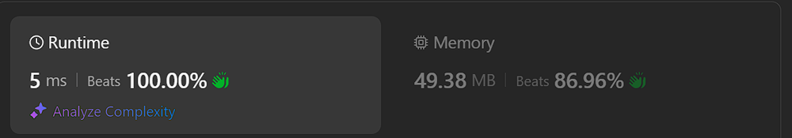

# ✅ Beats 100% | O(n log n) | ✅ Working 20.10.2024

**Author:** Piotr_Maminski
**Votes:** 3
**Link:** [https://leetcode.com/problems/parsing-a-boolean-expression/solutions/5939327/](https://leetcode.com/problems/parsing-a-boolean-expression/solutions/5939327/)

---

```python3 []
class Solution:
    def andd(self, exp):
        # Function to evaluate AND expression
        n = len(exp)
        j = 0
        subexp = ""
        active = 0

        while j < n:
            # Check if we're at a top-level comma (not inside nested parentheses)
            if active == 0 and exp[j] == ',':
                # Evaluate the sub-expression
                if not self.parseBoolExpr(subexp):
                    return False  # If any sub-expression is False, the entire AND is False
                subexp = ""  # Reset sub-expression
                j += 1
                continue

            # Keep track of nested parentheses
            if exp[j] == '(':
                active += 1
            if exp[j] == ')':
                active -= 1

            subexp += exp[j]  # Build the sub-expression
            j += 1

        # Evaluate the last sub-expression
        if not self.parseBoolExpr(subexp):
            return False

        return True  # If all sub-expressions are True, the AND is True

    def orr(self, exp):
        # Function to evaluate OR expression
        n = len(exp)
        j = 0
        subexp = ""
        active = 0

        while j < n:
            # Check if we're at a top-level comma (not inside nested parentheses)
            if active == 0 and exp[j] == ',':
                # Evaluate the sub-expression
                if self.parseBoolExpr(subexp):
                    return True  # If any sub-expression is True, the entire OR is True
                subexp = ""  # Reset sub-expression
                j += 1
                continue

            # Keep track of nested parentheses
            if exp[j] == '(':
                active += 1
            if exp[j] == ')':
                active -= 1

            subexp += exp[j]  # Build the sub-expression
            j += 1

        # Evaluate the last sub-expression
        if self.parseBoolExpr(subexp):
            return True

        return False  # If all sub-expressions are False, the OR is False

    def parseBoolExpr(self, exp):
        # Main function to parse and evaluate boolean expressions
        n = len(exp)

        # Base case: single character 't' or 'f'
        if n == 1:
            return exp[0] == 't'

        # NOT operation
        if exp[0] == '!':
            return not self.parseBoolExpr(exp[2:n-1])

        # AND operation
        if exp[0] == '&':
            return self.andd(exp[2:n-1])

        # OR operation
        if exp[0] == '|':
            return self.orr(exp[2:n-1])

        return False  # Default case (should not reach here if input is valid)
```
```cpp []
class Solution {
public:
    // Function to handle AND operation
    bool andd(string exp){
        int n = exp.length(), j=0;
        string subexp;
        int active = 0;
        while(j<n){
            // If we're not inside parentheses and encounter a comma
            if(active == 0 && exp[j]==','){
                // Evaluate the sub-expression, return false if it's false
                if(!parseBoolExpr(subexp)) return false;
                subexp = ""; // Reset sub-expression
                j++;
                continue;
            }
            // Keep track of nested parentheses
            if(exp[j]=='(') active++;
            if(exp[j]==')') active--;
            subexp += exp[j++]; // Build sub-expression
        }
        // Evaluate the last sub-expression
        if(!parseBoolExpr(subexp)) return false;
        // If all sub-expressions are true, return true
        return true;
    }

    // Function to handle OR operation
    bool orr(string exp){
        int n = exp.length(), j=0;
        string subexp;
        int active = 0;
        while(j<n){
            // If we're not inside parentheses and encounter a comma
            if(active==0 && exp[j]==','){
                // Evaluate the sub-expression, return true if it's true
                if(parseBoolExpr(subexp)) return true;
                subexp = ""; // Reset sub-expression
                j++;
                continue;
            }
            // Keep track of nested parentheses
            if(exp[j]=='(') active++;
            if(exp[j]==')') active--;
            subexp += exp[j++]; // Build sub-expression
        }
        // Evaluate the last sub-expression
        if(parseBoolExpr(subexp)) return true;
        // If all sub-expressions are false, return false
        return false;
    }

    // Main function to parse boolean expressions
    bool parseBoolExpr(string exp) {
        int n = exp.length();
        // Base case: single character 't' or 'f'
        if(n==1) return (exp[0]=='t');
        // Handle NOT operation
        if(exp[0] == '!') return !parseBoolExpr(exp.substr(2, n-3));
        // Handle AND operation
        if(exp[0] == '&') return andd(exp.substr(2, n-3));
        // Handle OR operation
        if(exp[0] == '|') return orr(exp.substr(2, n-3));
        // Default case (should not reach here if input is valid)
        return false;
    }
};
```
```java []
class Solution {
    public boolean andd(String exp) {
        // Function to evaluate AND expression
        int n = exp.length();
        int j = 0;
        StringBuilder subexp = new StringBuilder();
        int active = 0;

        while (j < n) {
            // Check if we're at a top-level comma (not inside nested parentheses)
            if (active == 0 && exp.charAt(j) == ',') {
                // Evaluate the sub-expression
                if (!parseBoolExpr(subexp.toString())) {
                    return false;  // If any sub-expression is False, the entire AND is False
                }
                subexp = new StringBuilder();  // Reset sub-expression
                j++;
                continue;
            }

            // Keep track of nested parentheses
            if (exp.charAt(j) == '(') {
                active++;
            }
            if (exp.charAt(j) == ')') {
                active--;
            }

            subexp.append(exp.charAt(j));  // Build the sub-expression
            j++;
        }

        // Evaluate the last sub-expression
        if (!parseBoolExpr(subexp.toString())) {
            return false;
        }

        return true;  // If all sub-expressions are True, the AND is True
    }

    public boolean orr(String exp) {
        // Function to evaluate OR expression
        int n = exp.length();
        int j = 0;
        StringBuilder subexp = new StringBuilder();
        int active = 0;

        while (j < n) {
            // Check if we're at a top-level comma (not inside nested parentheses)
            if (active == 0 && exp.charAt(j) == ',') {
                // Evaluate the sub-expression
                if (parseBoolExpr(subexp.toString())) {
                    return true;  // If any sub-expression is True, the entire OR is True
                }
                subexp = new StringBuilder();  // Reset sub-expression
                j++;
                continue;
            }

            // Keep track of nested parentheses
            if (exp.charAt(j) == '(') {
                active++;
            }
            if (exp.charAt(j) == ')') {
                active--;
            }

            subexp.append(exp.charAt(j));  // Build the sub-expression
            j++;
        }

        // Evaluate the last sub-expression
        if (parseBoolExpr(subexp.toString())) {
            return true;
        }

        return false;  // If all sub-expressions are False, the OR is False
    }

    public boolean parseBoolExpr(String exp) {
        // Main function to parse and evaluate boolean expressions
        int n = exp.length();

        // Base case: single character 't' or 'f'
        if (n == 1) {
            return exp.charAt(0) == 't';
        }

        // NOT operation
        if (exp.charAt(0) == '!') {
            return !parseBoolExpr(exp.substring(2, n - 1));
        }

        // AND operation
        if (exp.charAt(0) == '&') {
            return andd(exp.substring(2, n - 1));
        }

        // OR operation
        if (exp.charAt(0) == '|') {
            return orr(exp.substring(2, n - 1));
        }

        return false;  // Default case (should not reach here if input is valid)
    }
}
```
```csharp []
public class Solution
{
    // Function to handle AND operation
    private bool Andd(string exp)
    {
        int n = exp.Length, j = 0;
        string subexp = "";
        int active = 0;
        while (j < n)
        {
            // If we're not inside parentheses and encounter a comma
            if (active == 0 && exp[j] == ',')
            {
                // Evaluate the sub-expression, return false if it's false
                if (!ParseBoolExpr(subexp)) return false;
                subexp = ""; // Reset sub-expression
                j++;
                continue;
            }
            // Keep track of nested parentheses
            if (exp[j] == '(') active++;
            if (exp[j] == ')') active--;
            subexp += exp[j++]; // Build sub-expression
        }
        // Evaluate the last sub-expression
        if (!ParseBoolExpr(subexp)) return false;
        // If all sub-expressions are true, return true
        return true;
    }

    // Function to handle OR operation
    private bool Orr(string exp)
    {
        int n = exp.Length, j = 0;
        string subexp = "";
        int active = 0;
        while (j < n)
        {
            // If we're not inside parentheses and encounter a comma
            if (active == 0 && exp[j] == ',')
            {
                // Evaluate the sub-expression, return true if it's true
                if (ParseBoolExpr(subexp)) return true;
                subexp = ""; // Reset sub-expression
                j++;
                continue;
            }
            // Keep track of nested parentheses
            if (exp[j] == '(') active++;
            if (exp[j] == ')') active--;
            subexp += exp[j++]; // Build sub-expression
        }
        // Evaluate the last sub-expression
        if (ParseBoolExpr(subexp)) return true;
        // If all sub-expressions are false, return false
        return false;
    }

    // Main function to parse boolean expressions
    public bool ParseBoolExpr(string exp)
    {
        int n = exp.Length;
        // Base case: single character 't' or 'f'
        if (n == 1) return (exp[0] == 't');
        // Handle NOT operation
        if (exp[0] == '!') return !ParseBoolExpr(exp.Substring(2, n - 3));
        // Handle AND operation
        if (exp[0] == '&') return Andd(exp.Substring(2, n - 3));
        // Handle OR operation
        if (exp[0] == '|') return Orr(exp.Substring(2, n - 3));
        // Default case (should not reach here if input is valid)
        return false;
    }
}
```
```javascript [JS]
/**
 * Splits a string by commas that are not inside parentheses
 * @param {string} str - The string to split
 * @return {string[]} An array of substrings split by outer commas
 */
function splitByOuterCommas(str) {
    let openParentheses = 0;
    let parts = [];
    let lastSplitIndex = 0;
    
    for (let i = 0; i < str.length; i++) {
        if (str[i] === '(') {
            openParentheses++;
        } else if (str[i] === ')') {
            openParentheses--;
        } else if (str[i] === ',' && openParentheses === 0) {
            // Split the string from the last split point to the current index
            parts.push(str.slice(lastSplitIndex, i));
            lastSplitIndex = i + 1;  // Move the split point after the comma
        }
    }
    
    // Add the last part after the final comma (or the whole string if no valid commas)
    parts.push(str.slice(lastSplitIndex));
    
    return parts;
}

/**
 * Parses and evaluates a boolean expression
 * @param {string} expression - The boolean expression to evaluate
 * @return {boolean} The result of the boolean expression
 */
var parseBoolExpr = function(expression) {
    // Object to store memoized results
    let dp = {};

    /**
     * Recursive helper function to calculate the result of a boolean expression
     * @param {string} str - The (sub)expression to evaluate
     * @return {boolean} The result of the (sub)expression
     */
    const _calc = (str) => {
        // Base cases
        if(str == 'f') return false;
        if(str == 't') return true;

        // Check if result is already memoized
        if(dp[str] != undefined) return dp[str]

        // Handle NOT operation
        if(['!'].includes(str.charAt(0))) {
            let subExpression = str.substring(2, str.length - 1);
            dp[str] = !_calc(subExpression);
            return dp[str];
        }

        // Handle AND and OR operations
        if(['&', '|'].includes(str.charAt(0))) {
            let subExpressions = splitByOuterCommas(str.substring(2, str.length-1))
            
            // OR operation
            if(str.charAt(0) == '|') {
                dp[str] = subExpressions.reduce((acc, curr) => (acc || _calc(curr)), false);
                return dp[str];
            }
            
            // AND operation
            if(str.charAt(0) == '&') {
                dp[str] = subExpressions.reduce((acc, curr) => (acc && _calc(curr)), true);
                return dp[str];
            }
        }
    }

    // Start the calculation with the full expression
    return _calc(expression);
};
```
```typescript [TS]
function parseBoolExpr(expression: string): boolean {
    // Store the input expression
    const expr = expression;
    // Get the length of the expression
    const n = expr.length;
    // Initialize a pointer to traverse the expression
    let i = 0;

    // Define a recursive depth-first search function
    const dfs = () => {
        // Array to store boolean results of sub-expressions
        let res: boolean[] = [];

        // Traverse the expression
        while (i < n) {
            // Get the current character and move the pointer
            const c = expr[i++];

            // If we encounter a closing parenthesis, end this sub-expression
            if (c === ')') {
                break;
            }

            // Handle different operators and values
            if (c === '!') {
                // NOT operator: negate the result of the next sub-expression
                res.push(!dfs()[0]);
            } else if (c === '|') {
                // OR operator: true if any sub-expression is true
                res.push(dfs().some(v => v));
            } else if (c === '&') {
                // AND operator: true if all sub-expressions are true
                res.push(dfs().every(v => v));
            } else if (c === 't') {
                // True value
                res.push(true);
            } else if (c === 'f') {
                // False value
                res.push(false);
            }
            // Note: Opening parenthesis '(' is implicitly handled by recursive calls
        }

        // Return the array of boolean results
        return res;
    };

    // Start the parsing process and return the final result
    // We take the first (and only) element of the result array
    return dfs()[0];
};
```
```golang []
import "fmt"

func parseBoolExpr(expression string) bool {
    // Map to store boolean values for 'f' (false) and 't' (true)
    values := map[string]bool{"f":false, "t":true}

    // Map to convert boolean values back to string representation
    stringVal := map[bool]string{false: "f", true: "t"}

    // Stack to keep track of operators and operands
    stack := []string{}

    // Iterate through each character in the expression
    for _, c := range expression {
        if c == ',' {
            // Skip commas
            continue
        } else if c == ')' {
            // When closing parenthesis is encountered, evaluate the expression
            operands := []string{}

            // Pop operands from the stack until opening parenthesis is found
            for true {
                op := stack[len(stack)-1]
                stack = stack[:len(stack)-1]

                if op == "(" {
                    // Found opening parenthesis, get the operator
                    expOp := stack[len(stack)-1]
                    stack = stack[:len(stack)-1]

                    var res bool
                    // Evaluate the expression based on the operator
                    if expOp == "|" {
                        // OR operation
                        res = false
                        for _,o := range operands {
                            res = res || values[o]
                            if res == true {
                                break
                            }
                        }
                    } else if expOp == "&" {
                        // AND operation
                        res = true
                        for _,o := range operands {
                            res = res && values[o]
                            if res == false {
                                break
                            }
                        }
                    } else if expOp == "!" {
                        // NOT operation
                        if len(operands) == 1 {
                            res = !values[operands[0]]
                        }
                    }

                    // Push the result back to the stack
                    stack = append(stack, stringVal[res])
                    break

                } else {
                    // Add operand to the list
                    operands = append(operands, op)
                }
            }
        } else {
            // Push other characters (operators, 't', 'f') to the stack
            stack = append(stack, string(c))
        }
    }

    // Return the final result (should be the only item left in the stack)
    return values[stack[0]]
}
```
```rust []
impl Solution {
    // Public function to parse a boolean expression given as a String
    pub fn parse_bool_expr(expression: String) -> bool {
        // Call the private helper function to parse the expression
        Self::parse_bool_expression(&expression)
    }

    // Private helper function to recursively parse boolean expressions
    fn parse_bool_expression(expression: &str) -> bool {
        // Base cases: "f" for false and "t" for true
        if expression == "f" {
            return false;
        }
        if expression == "t" {
            return true;
        }

        // Match on the first character of the expression
        match expression.as_bytes()[0] as char {
            // AND operation
            '&' => {
                // Extract the inner part of the expression (remove '&' and outer parentheses)
                let inner = &expression[2..(expression.len() - 1)];
                let mut paren_count = 0;
                // Split the inner expression into sub-expressions
                let mut expressions = inner
                    .split(
                        |c| {
                            match c {
                                // Keep track of nested parentheses
                                '(' => {paren_count += 1; false},
                                ')' => {paren_count -= 1; false},
                                // Split on commas only when not inside nested parentheses
                                ',' if paren_count == 0 => true,
                                _ => false,
                            }
                        }
                    );
                // Return true if all sub-expressions are true
                expressions.all(Self::parse_bool_expression)
            },

            // OR operation
            '|' => {
                // Extract the inner part of the expression (remove '|' and outer parentheses)
                let inner = &expression[2..(expression.len() - 1)];
                let mut paren_count = 0;
                // Split the inner expression into sub-expressions
                let mut expressions = inner
                    .split(
                        |c| {
                            match c {
                                // Keep track of nested parentheses
                                '(' => {paren_count += 1; false},
                                ')' => {paren_count -= 1; false},
                                // Split on commas only when not inside nested parentheses
                                ',' if paren_count == 0 => true,
                                _ => false,
                            }
                        }
                    );
                // Return true if any sub-expression is true
                expressions.any(Self::parse_bool_expression)
            },

            // NOT operation
            '!' => {
                // Negate the result of parsing the inner expression
                !Self::parse_bool_expression(&expression[2..(expression.len() - 1)])
            },

            // Invalid expression
            _ => panic!("Invalid expression {}", expression),
        }
    }
}
```
```php []
class Solution {
    // Function to handle AND operation
    private function andd($exp) {
        $n = strlen($exp);
        $j = 0;
        $subexp = '';
        $active = 0;
        while ($j < $n) {
            // If we're not inside parentheses and encounter a comma
            if ($active == 0 && $exp[$j] == ',') {
                // Evaluate the sub-expression, return false if it's false
                if (!$this->parseBoolExpr($subexp)) return false;
                $subexp = ''; // Reset sub-expression
                $j++;
                continue;
            }
            // Keep track of nested parentheses
            if ($exp[$j] == '(') $active++;
            if ($exp[$j] == ')') $active--;
            $subexp .= $exp[$j++]; // Build sub-expression
        }
        // Evaluate the last sub-expression
        if (!$this->parseBoolExpr($subexp)) return false;
        // If all sub-expressions are true, return true
        return true;
    }

    // Function to handle OR operation
    private function orr($exp) {
        $n = strlen($exp);
        $j = 0;
        $subexp = '';
        $active = 0;
        while ($j < $n) {
            // If we're not inside parentheses and encounter a comma
            if ($active == 0 && $exp[$j] == ',') {
                // Evaluate the sub-expression, return true if it's true
                if ($this->parseBoolExpr($subexp)) return true;
                $subexp = ''; // Reset sub-expression
                $j++;
                continue;
            }
            // Keep track of nested parentheses
            if ($exp[$j] == '(') $active++;
            if ($exp[$j] == ')') $active--;
            $subexp .= $exp[$j++]; // Build sub-expression
        }
        // Evaluate the last sub-expression
        if ($this->parseBoolExpr($subexp)) return true;
        // If all sub-expressions are false, return false
        return false;
    }

    // Main function to parse boolean expressions
    public function parseBoolExpr($exp) {
        $n = strlen($exp);
        // Base case: single character 't' or 'f'
        if ($n == 1) return ($exp[0] == 't');
        // Handle NOT operation
        if ($exp[0] == '!') return !$this->parseBoolExpr(substr($exp, 2, $n - 3));
        // Handle AND operation
        if ($exp[0] == '&') return $this->andd(substr($exp, 2, $n - 3));
        // Handle OR operation
        if ($exp[0] == '|') return $this->orr(substr($exp, 2, $n - 3));
        // Default case (should not reach here if input is valid)
        return false;
    }
}
```
```swift []
class Solution {
    // Function to handle AND operation
    func andd(_ exp: String) -> Bool {
        let n = exp.count
        var j = 0
        var subexp = ""
        var active = 0
        
        while j < n {
            let currentChar = exp[exp.index(exp.startIndex, offsetBy: j)]
            // If we're not inside parentheses and encounter a comma
            if active == 0 && currentChar == "," {
                // Evaluate the sub-expression, return false if it's false
                if !parseBoolExpr(subexp) { return false }
                subexp = "" // Reset sub-expression
                j += 1
                continue
            }
            // Keep track of nested parentheses
            if currentChar == "(" { active += 1 }
            if currentChar == ")" { active -= 1 }
            subexp.append(currentChar) // Build sub-expression
            j += 1
        }
        // Evaluate the last sub-expression
        if !parseBoolExpr(subexp) { return false }
        // If all sub-expressions are true, return true
        return true
    }

    // Function to handle OR operation
    func orr(_ exp: String) -> Bool {
        let n = exp.count
        var j = 0
        var subexp = ""
        var active = 0
        
        while j < n {
            let currentChar = exp[exp.index(exp.startIndex, offsetBy: j)]
            // If we're not inside parentheses and encounter a comma
            if active == 0 && currentChar == "," {
                // Evaluate the sub-expression, return true if it's true
                if parseBoolExpr(subexp) { return true }
                subexp = "" // Reset sub-expression
                j += 1
                continue
            }
            // Keep track of nested parentheses
            if currentChar == "(" { active += 1 }
            if currentChar == ")" { active -= 1 }
            subexp.append(currentChar) // Build sub-expression
            j += 1
        }
        // Evaluate the last sub-expression
        if parseBoolExpr(subexp) { return true }
        // If all sub-expressions are false, return false
        return false
    }

    // Main function to parse boolean expressions
    func parseBoolExpr(_ exp: String) -> Bool {
        let n = exp.count
        // Base case: single character 't' or 'f'
        if n == 1 { return (exp == "t") }
        // Handle NOT operation
        if exp.first == "!" { return !parseBoolExpr(String(exp.dropFirst(2).dropLast())) }
        // Handle AND operation
        if exp.first == "&" { return andd(String(exp.dropFirst(2).dropLast())) }
        // Handle OR operation
        if exp.first == "|" { return orr(String(exp.dropFirst(2).dropLast())) }
        // Default case (should not reach here if input is valid)
        return false
    }
}
```


### Complexity 
- Time complexity: O(n log n)

- Space complexity: O(n)




