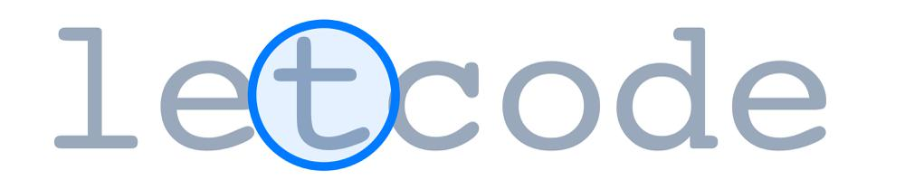
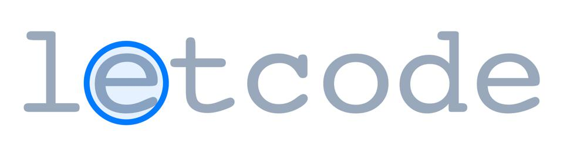
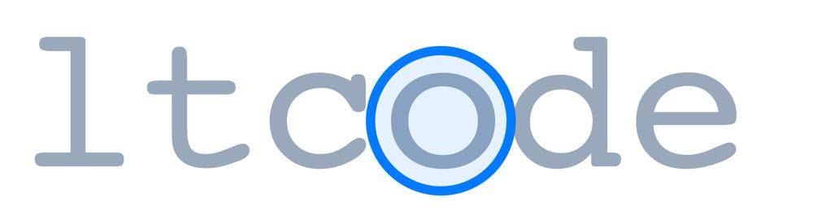
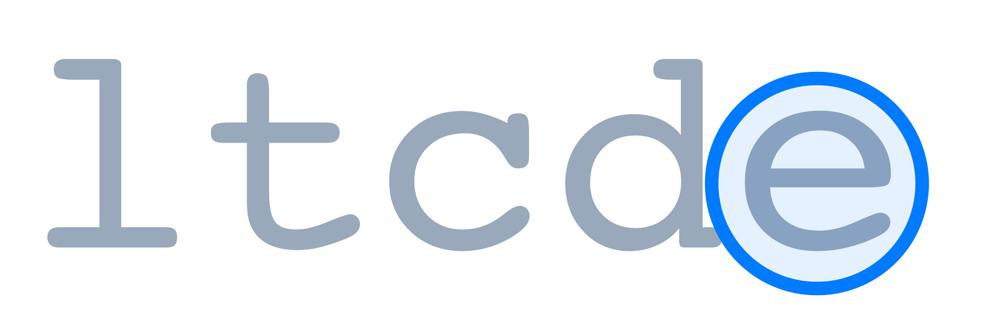
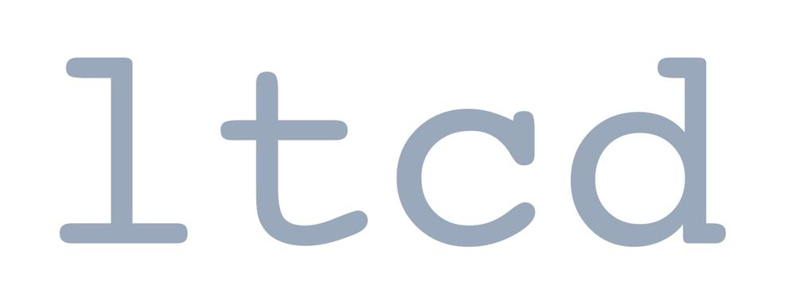

# Two Golang solution both faster than 100% with explanation and images

**Author:** nathannaveen
**Votes:** 2
**Link:** [https://leetcode.com/problems/remove-vowels-from-a-string/solutions/1115662/](https://leetcode.com/problems/remove-vowels-from-a-string/solutions/1115662/)

---

The first approach is pretty simple. If the letter is not a vowel, add it to a resulting string.

The second approach is better because we keep on using the same string. We remake the string every time there is a vowel by going around the vowel.

This can be shown with some images:

We can have:

```
input: "leetcode"
expected output: "ltcd"
```

> We can fast forward to our first vowel, `'e'`.


> Now we re-assign our string `s` to `"leetcode"` without the `'e'` and we get:


> We have circled the letter `'t'` because `i == 2` but we forgot about the second `'e'` so we subtract `1` from `i` and we get:



> As we can see, `'e'` is a vowel, so we have to remake the string to:



> *Note: As you can see, we skipped a lot of the letter because it would take a lot longer if we didn't ignore them*
> 
> You can see that the `'o'` is a vowel, so we can remake the string to:



> We skipped some more letters again because the other letters were not needed.
> 
> The `'e'` is a vowel, so we can remake the string to:



As we can see, `ltdc` is equal to our expected output.

**The First Code:**

```
func removeVowels(s string) string {
	res := ""
	for _, i2 := range s {
		if i2 != 'a' && i2 != 'e' && i2 != 'i' && i2 != 'o' && i2 != 'u' {
			res += string(i2)
		}
	}
	return res
}
```

``` go
func removeVowels(s string) string {
	for i := 0; i < len(s); i++ {
		if s[i] == 'a' || s[i] == 'e' || s[i] == 'i' || s[i] == 'o' || s[i] == 'u' {
			s = s[:i] + s[i+1:]
			i -= 1
		}
	}
	return s
}
```