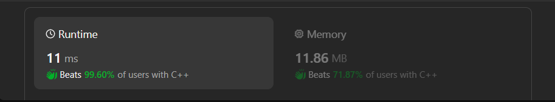

# ✅Beats 100% - Dynamic Programming - C++/Java/Python/JS - Explained with [ Video ]

**Author:** lancertech6
**Votes:** 138
**Link:** [https://leetcode.com/problems/longest-common-subsequence/solutions/4622129/](https://leetcode.com/problems/longest-common-subsequence/solutions/4622129/)

---



# YouTube Video Explanation:

<!-- **If you want a video for this question please write in the comments** -->

<!-- https://www.youtube.com/watch?v=ujU-jeO1v-k -->

https://youtu.be/16G6jjbMhjo

**\uD83D\uDD25 Please like, share, and subscribe to support our channel's mission of making complex concepts easy to understand.**

Subscribe Link: https://www.youtube.com/@leetlogics/?sub_confirmation=1

*Subscribe Goal: 1700 Subscribers*
*Current Subscribers: 1610*

---

# Intuition:
The problem asks for finding the length of the longest common subsequence between two strings. A common subsequence is a sequence of characters that appear in the same order in both strings. The dynamic programming approach can be used to efficiently find the length of the longest common subsequence.

# Approach:
1. **Dynamic Programming (DP):**
   - We create a 2D array `dp` to store the lengths of the longest common subsequences for all subproblems.
   - The array `dp` has dimensions `(length1 + 1) x (length2 + 1)` to accommodate empty strings as substrings.
   - The cell `dp[i][j]` represents the length of the longest common subsequence of substrings `text1[0...i-1]` and `text2[0...j-1]`.
   - We fill in the `dp` array from the bottom up using the following recurrence relation:
     - If characters at indices `i-1` and `j-1` match, `dp[i][j] = dp[i-1][j-1] + 1`.
     - If characters do not match, `dp[i][j] = max(dp[i-1][j], dp[i][j-1])`.

2. **Result:**
   - The bottom-right cell `dp[length1][length2]` contains the length of the longest common subsequence of the entire strings `text1` and `text2`.

# Complexity Analysis:
- **Time Complexity:** O(length1 * length2)
  - The nested loops iterate through each character in both strings, filling the 2D array.
- **Space Complexity:** O(length1 * length2)
  - The space used by the 2D array to store intermediate results.

# Code Explanation:
- The code initializes a 2D array `dp` and iterates through both strings, updating the `dp` array according to the recurrence relation.
- The result is obtained from the bottom-right cell of the `dp` array, which represents the length of the longest common subsequence.

# Code
```Java []
class Solution {
    public int longestCommonSubsequence(String text1, String text2) {
        // Lengths of the input strings
        int length1 = text1.length();
        int length2 = text2.length();
      
        // Create a 2D array to store the lengths of longest common subsequences
        // for all subproblems, initialized with zero
        int[][] dp = new int[length1 + 1][length2 + 1];

        // Build the dp array from the bottom up
        for (int i = 1; i <= length1; ++i) {
            for (int j = 1; j <= length2; ++j) {
                // If characters match, take diagonal value and add 1
                if (text1.charAt(i - 1) == text2.charAt(j - 1)) {
                    dp[i][j] = dp[i - 1][j - 1] + 1;
                }
                // If characters do not match, take the maximum value from 
                // the left (dp[i][j-1]) or above (dp[i-1][j])
                else {
                    dp[i][j] = Math.max(dp[i - 1][j], dp[i][j - 1]);
                }
            }
        }
        // The bottom-right cell contains the length of the longest
        // common subsequence of text1 and text2
        return dp[length1][length2];
    }
}
```
```C++ []
class Solution {
public:
    // Function to find the length of the longest common subsequence in two strings.
    int longestCommonSubsequence(string text1, string text2) {
        int text1Length = text1.size(), text2Length = text2.size();
        // Create a 2D array to store lengths of common subsequence at each index.
        int dp[text1Length + 1][text2Length + 1];
      
        // Initialize the 2D array with zero.
        memset(dp, 0, sizeof dp);
      
        // Loop through both strings and fill the dp array.
        for (int i = 1; i <= text1Length; ++i) {
            for (int j = 1; j <= text2Length; ++j) {
                // If current characters match, add 1 to the length of the sequence
                // until the previous character from both strings.
                if (text1[i - 1] == text2[j - 1]) {
                    dp[i][j] = dp[i - 1][j - 1] + 1;
                } else {
                    // If current characters do not match, take the maximum length
                    // achieved by either skipping the current character of text1 or text2.
                    dp[i][j] = max(dp[i - 1][j], dp[i][j - 1]);
                }
            }
        }
      
        // Return the value in the bottom-right cell which contains the
        // length of the longest common subsequence for the entire strings.
        return dp[text1Length][text2Length];
    }
};
```
```Python []
class Solution:
    def longestCommonSubsequence(self, text1: str, text2: str) -> int:
        # Get the lengths of both input strings
        len_text1, len_text2 = len(text1), len(text2)
      
        # Initialize a 2D array (list of lists) with zeros for dynamic programming
        # The array has (len_text1 + 1) rows and (len_text2 + 1) columns
        dp_matrix = [[0] * (len_text2 + 1) for _ in range(len_text1 + 1)]
      
        # Loop through each character index of text1 and text2
        for i in range(1, len_text1 + 1):
            for j in range(1, len_text2 + 1):
                # If the characters match, take the diagonal value and add 1
                if text1[i - 1] == text2[j - 1]:
                    dp_matrix[i][j] = dp_matrix[i - 1][j - 1] + 1
                else:
                    # If the characters do not match, take the maximum of the value from the left and above
                    dp_matrix[i][j] = max(dp_matrix[i - 1][j], dp_matrix[i][j - 1])
      
        # The bottom-right value in the matrix contains the length of the longest common subsequence
        return dp_matrix[len_text1][len_text2]
```
```JavaScript []
/**
 * @param {string} text1
 * @param {string} text2
 * @return {number}
 */
var longestCommonSubsequence = function(text1, text2) {
    // Lengths of the input strings
    const length1 = text1.length;
    const length2 = text2.length;

    // Create a 2D array to store the lengths of longest common subsequences
    // for all subproblems, initialized with zero
    const dp = new Array(length1 + 1).fill(0).map(() => new Array(length2 + 1).fill(0));

    // Build the dp array from the bottom up
    for (let i = 1; i <= length1; ++i) {
        for (let j = 1; j <= length2; ++j) {
            // If characters match, take diagonal value and add 1
            if (text1.charAt(i - 1) === text2.charAt(j - 1)) {
                dp[i][j] = dp[i - 1][j - 1] + 1;
            }
            // If characters do not match, take the maximum value from 
            // the left (dp[i][j-1]) or above (dp[i-1][j])
            else {
                dp[i][j] = Math.max(dp[i - 1][j], dp[i][j - 1]);
            }
        }
    }
    // The bottom-right cell contains the length of the longest
    // common subsequence of text1 and text2
    return dp[length1][length2];
};
```

