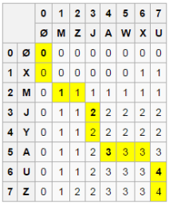
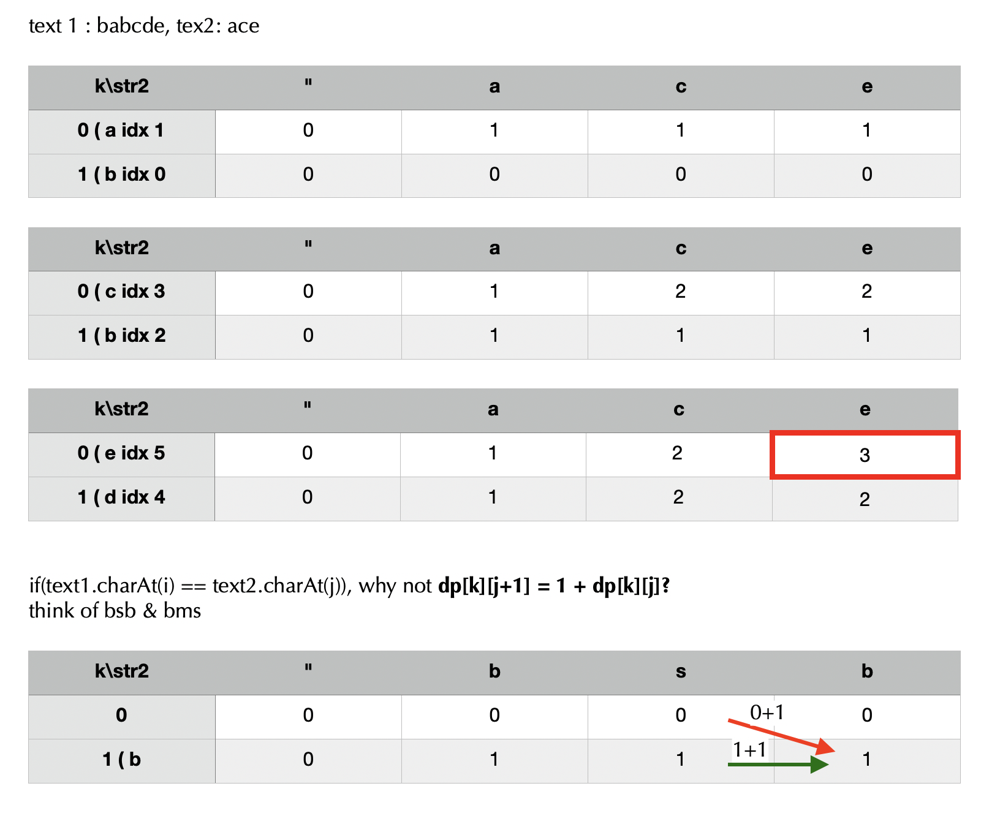

# [Java/Python 3] Two DP codes of O(mn) & O(min(m, n)) spaces w/ picture and analysis

**Author:** rock
**Votes:** 324
**Link:** [https://leetcode.com/problems/longest-common-subsequence/solutions/351689/](https://leetcode.com/problems/longest-common-subsequence/solutions/351689/)

---

**Update:**
**Q & A:**

Q1: What is the difference between `[[0] * m] * n` and `[[0] * m for _ in range(n)]`? Why does the former update all the rows of that column when I try to update one particular cell ?
A1: `[[0] * m] * n` creates `n` references to the exactly same list objet: `[0] * m`; In contrast: `[[0] * m for _ in range(n)]` creates `n` different list objects that have same value of `[0] * m`.

**End of Q & A**


----


Please refer to my solution [Java/Python 3 2 Clean DP codes of O(m * n) & O(min(m, n)) space w/ breif explanation and analysis](https://leetcode.com/problems/max-dot-product-of-two-subsequences/discuss/649858/JavaPython-3-2-Clean-DP-codes-of-O(mn)-and-O(min(m-n))-space-w-breif-explanation-and-analysis.) of a similar problem: [1458. Max Dot Product of Two Subsequences](https://leetcode.com/problems/max-dot-product-of-two-subsequences/description/)

More similar LCS problems:
[1092. Shortest Common Supersequence](https://leetcode.com/problems/shortest-common-supersequence/) and [Solution](https://leetcode.com/problems/shortest-common-supersequence/discuss/312757/JavaPython-3-O(mn)-clean-DP-code-w-picture-comments-and-analysis.)
[1062. Longest Repeating Substring](https://leetcode.com/problems/longest-repeating-substring/) (Premium).
[516. Longest Palindromic  Subsequence](https://leetcode.com/problems/longest-palindromic-subsequence/)
[1312. Minimum Insertion Steps to Make a String Palindrome](https://leetcode.com/problems/minimum-insertion-steps-to-make-a-string-palindrome/discuss/470709/JavaPython-3-DP-longest-common-subsequence-w-brief-explanation-and-analysis)

----

Find LCS;
Let `X` be `\u201CXMJYAUZ\u201D` and `Y` be `\u201CMZJAWXU\u201D`. The longest common subsequence between `X` and `Y` is `\u201CMJAU\u201D`. The following table shows the lengths of the longest common subsequences between prefixes of `X` and `Y`. The `ith` row and `jth` column shows the length of the LCS between `X_{1..i}` and `Y_{1..j}`.

you can refer to [here](https://en.m.wikipedia.org/wiki/Longest_common_subsequence_problem) for more details.


**Method 1:**

```java
    public int longestCommonSubsequence(String s1, String s2) {
        int[][] dp = new int[s1.length() + 1][s2.length() + 1];
        for (int i = 0; i < s1.length(); ++i)
            for (int j = 0; j < s2.length(); ++j)
                if (s1.charAt(i) == s2.charAt(j)) dp[i + 1][j + 1] = 1 + dp[i][j];
                else dp[i + 1][j + 1] =  Math.max(dp[i][j + 1], dp[i + 1][j]);
        return dp[s1.length()][s2.length()];
    }
```
```python
    def longestCommonSubsequence(self, text1: str, text2: str) -> int:
        dp = [[0] * (len(text2) + 1) for _ in range(len(text1) + 1)]
        for i, c in enumerate(text1):
            for j, d in enumerate(text2):
                dp[i + 1][j + 1] = 1 + dp[i][j] if c == d else max(dp[i][j + 1], dp[i + 1][j])
        return dp[-1][-1]
```
**Analysis:**

Time & space: O(m * n)

---

**Method 2:**

***Space Optimization***

credit to **@FunBam** for the following picture.



Obviously, the code in method 1 only needs information of previous row to update current row. So we just use a **two-row** 2D array to save and update the matching results for chars in `s1` and `s2`.

Note: use `k ^ 1` and `k ^= 1` to switch between `dp[0] (row 0)` and `dp[1] (row 1)`.

```java
    public int longestCommonSubsequence(String s1, String s2) {
        int m = s1.length(), n = s2.length();
        if (m < n)  return longestCommonSubsequence(s2, s1);
        int[][] dp = new int[2][n + 1];
        for (int i = 0, k = 1; i < m; ++i, k ^= 1)
            for (int j = 0; j < n; ++j)
                if (s1.charAt(i) == s2.charAt(j)) dp[k][j + 1] = 1 + dp[k ^ 1][j];
                else dp[k][j + 1] = Math.max(dp[k ^ 1][j + 1], dp[k][j]);
        return dp[m % 2][n];
    }
```
Note: use `1 - i % 2` and `i % 2` to switch between `dp[0] (row 0)` and `dp[1] (row 1)`.
```python
    def longestCommonSubsequence(self, text1: str, text2: str) -> int:
        m, n = len(text1), len(text2)
        if m < n:
            tex1, tex2 = text2, text1
        dp = [[0] * (n + 1) for _ in range(2)]
        for i, c in enumerate(text1):
            for j, d in enumerate(text2):
                dp[1 - i % 2][j + 1] = 1 + dp[i % 2][j] if c == d else max(dp[i % 2][j + 1], dp[1 - i % 2][j])
        return dp[m % 2][-1]
```
***Further Space Optimization to save half space*** - credit to **@survive and @lenchen1112**.

Obviously, the above code in method 2 only needs information of previous and current columns of previous row to update current row. So we just use a **1-row** 1D array and `2` variables to save and update the matching results for chars in `text1` and `text2`.

```java
    public int longestCommonSubsequence(String text1, String text2) {
        int m = text1.length(), n = text2.length();
        if (m < n) {
            return longestCommonSubsequence(text2, text1);
        }
        int[] dp = new int[n + 1];
        for (int i = 0; i < text1.length(); ++i) {
            for (int j = 0, prevRow = 0, prevRowPrevCol = 0; j < text2.length(); ++j) {
                prevRowPrevCol = prevRow;
                prevRow = dp[j + 1];
                dp[j + 1] = text1.charAt(i) == text2.charAt(j) ? prevRowPrevCol + 1 : Math.max(dp[j], prevRow);
            }
        }
        return dp[n];
    }
```
```python
    def longestCommonSubsequence(self, text1: str, text2: str) -> int:
        m, n = map(len, (text1, text2))
        if m < n:
            tex1, tex2 = text2, text1
        dp = [0] * (n + 1)
        for c in text1:
            prevRow, prevRowPrevCol = 0, 0
            for j, d in enumerate(text2):
                prevRow, prevRowPrevCol = dp[j + 1], prevRow
                dp[j + 1] = prevRowPrevCol + 1 if c == d else max(dp[j], prevRow)
        return dp[-1]
```

**Analysis:**

 Time: O(m * n). space: O(min(m, n)).
