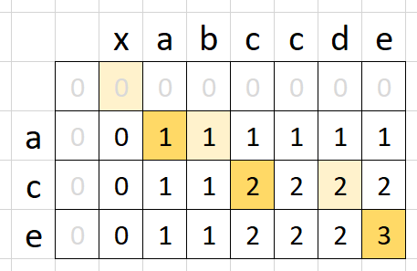

# Kotlin | Dynamic Programming | O(m⋅n)

**Author:** naXa777
**Votes:** 2
**Link:** [https://leetcode.com/problems/longest-common-subsequence/solutions/4624570/](https://leetcode.com/problems/longest-common-subsequence/solutions/4624570/)

---

# Approach

Dynamic Programming.

Bottom-up DP utilizes a matrix `memo` where we track LCS sizes for  `text1[0..i]` & `text2[0..j]` (for each combination of i and j).

This picture shows the populated matrix for "xabccde", "ace" test case.

Picture author: votrubac

# Complexity

- Time complexity: $$O(m\u22C5n)$$
- Space complexity: $$O(m\u22C5n)$$

# Code
```kt
class Solution {
    fun longestCommonSubsequence(text1: String, text2: String): Int {
        val memo = Array<IntArray>(text1.length) { IntArray(text2.length) }

        for (i in 0 until text1.length) {
            val limitI = i + 1
            val safeI = if (i == 0) 0 else i - 1
            for (j in 0 until text2.length) {
                val safeJ = if (j == 0) 0 else j - 1
                if (text1[i] == text2[j]) {
                    memo[i][j] = minOf(limitI, j + 1, 1 + memo[safeI][safeJ])
                } else {
                    memo[i][j] = maxOf(memo[safeI][j], memo[i][safeJ])
                }
            }
        }

        return memo.last().last()
    }
}
```