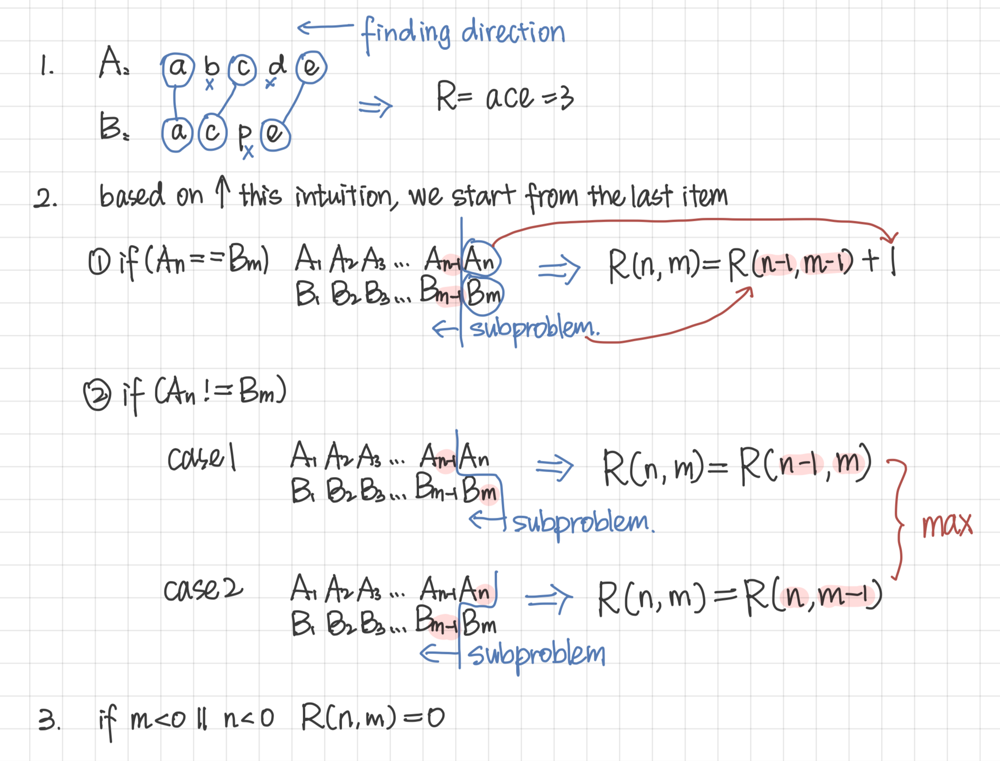

# 🍊 Very Concise, Easy Visualized Explanation | DP Memoization

**Author:** kristine70
**Votes:** 4
**Link:** [https://leetcode.com/problems/longest-common-subsequence/solutions/5949603/](https://leetcode.com/problems/longest-common-subsequence/solutions/5949603/)

---

## Intuition
**n**: A length. **m**: B length. 
**R**(result): the length of the longest common subsequence


## Simple Approach
we can get a very simple approach
```js
const R = (n, m) => {
  if (n < 0 || m < 0) return 0
  if (A[n] == B[m]) return R(n - 1, m - 1) + 1;
  else return Math.max(R(n, m - 1), R(n - 1, m));
};
```
## Memoization
the core of DP optimization is to create a `Memo` array. 
As we can see in the simple approach\u2B06\uFE0F, the recursive keys are `n` and`m`. so we can create a (n x m) array.

```js
const Memo = Array.from({length: A.length}, () => new Array(B.length).fill(-1));
```
The last step is to add this Memo into our simple approach!!!
```js
const R = (n, m) => {
  if (n < 0 || m < 0) return 0;
  if (Memo[n][m] != -1) return Memo[n][m]; //add

  if (A[n] == B[m]) Memo[n][m] = R(n - 1, m - 1) + 1;
  else Memo[n][m] = Math.max(R(n, m - 1), R(n - 1, m));

  return Memo[n][m]; // add Memo to memoize the results
};
```
That's all. Here is a version with better variable names for readability.

```js
function longestCommonSubsequence(text1: string, text2: string): number {
  const memo = Array.from({length: text1.length}, () => new Array(text2.length).fill(-1));

  function lcs(i: number, j: number): number {
    if (i < 0 || j < 0) return 0;
    if (memo[i][j] !== -1) return memo[i][j];

    if (text1[i] === text2[j]) {
      memo[i][j] = lcs(i - 1, j - 1) + 1;
    } else {
      memo[i][j] = Math.max(lcs(i - 1, j), lcs(i, j - 1));
    }

    return memo[i][j];
  }

  return lcs(text1.length - 1, text2.length - 1);
}
```

